# Deliverable 7: Database Schema and Entity Relationship Diagrams
# Part 1 of 4: Conventions and Foundation Modules

**Version:** 1.0 (draft for approval) | **Date:** 23 Nov 2026
**Builds on:** D2 key entities, D3 (Core additions), D4 (DEC-43 to DEC-52), D5 (RBAC model), D6 and D6A (academic model)

**Why four parts:** the schema covers about 230 tables across 34 modules. Each part is complete for the modules it covers.

| Part | Contents |
|---|---|
| **1** | Conventions, standard columns, domain map, Core, Platform, Organization, Identity, Settings, Audit, Approval, Notification, ImportExport, Document |
| 2 | Academic, Admission, Student, Guardian, HR, Attendance, Leave |
| 3 | Fee, Accounting, Examination, Result, ExternalExam, Timetable, Communication, Administration, Reporting |
| 4 | Learning, Homework, Assessment, Payroll, Library, Transport, Inventory, Discipline; duplicate and cross-tenant prevention explained; history handling; cardinality summary; partitioning; migration order; seed data |

---

## 7.1 New Decisions in This Deliverable

| ID | Decision |
|---|---|
| DEC-89 | Every table uses one of the **standard column sets** in 7.2, created through Core Blueprint macros (`$table->tenantColumns()`, `$table->branchColumns()`, `$table->auditColumns()`, `$table->softDeletesWithUser()`), so the AI agent never hand-writes tenant columns |
| DEC-90 | Date-times are `DATETIME` (not `TIMESTAMP`) to avoid the 2038 limit; stored in UTC. Macros define `created_at` and `updated_at` as `DATETIME` explicitly |
| DEC-91 | Status and type columns are `VARCHAR(32)` mapped to PHP backed enums. MySQL `ENUM` is not used. `CHECK` constraints are used only for invariants (non-negative money, exactly-one-of rules), not for enum value lists |
| DEC-92 | Nullable columns never sit inside a unique index directly. A stored generated column (`*_key = IFNULL(col, 0)` or an `active_marker`) is used instead, because MySQL allows many NULLs in a unique index |
| DEC-93 | Index and constraint names are explicit and at most 64 characters: `pk_`, `uq_`, `ix_`, `fk_`, `ck_` prefixes plus a short table alias (aliases listed per table). Laravel's auto-generated names are never relied on for composite keys |
| DEC-94 | Character set `utf8mb4`, collation `utf8mb4_0900_ai_ci` (full Urdu support, accent-insensitive search) |
| DEC-95 | CNIC and B-Form numbers are stored encrypted (Laravel `encrypted` cast) with a separate `*_lookup_hash` (HMAC-SHA256 with an application pepper) for uniqueness and search, and `*_last4` for masked display |
| DEC-96 | Password reset tokens use an organization-aware custom table (Laravel's default table keys on email, which repeats across organizations) |
| DEC-97 | JSON columns are allowed only for: snapshots, payloads, configuration blobs, provider responses and small option lists. Anything filtered, joined or reported on gets a real column |
| DEC-98 | Polymorphic relations are limited to attachments, audit, timeline, approval subjects, notifications and issued documents, with `Relation::enforceMorphMap()` so stored type values are short aliases (`student`, `employee`, `fee_voucher`), never class names |

---

## 7.2 Standard Column Sets

| Set | Columns | Used for |
|---|---|---|
| **[P] Platform** | `id` BIGINT UNSIGNED PK AUTO_INCREMENT; `created_at`, `updated_at` DATETIME NULL | Global tables (plans, permissions) |
| **[T] Tenant** | `id` BIGINT UNSIGNED PK; `uuid` CHAR(26) NOT NULL (ULID); `organization_id` BIGINT UNSIGNED NOT NULL; `created_by`, `updated_by` BIGINT UNSIGNED NULL; `created_at`, `updated_at` DATETIME NULL. Keys: `uq_{a}_uuid (uuid)`, `uq_{a}_org_id (organization_id, id)`, `fk_{a}_org (organization_id) -> organizations(id)`, `fk_{a}_crby (organization_id, created_by) -> users(organization_id, id)`, same for `updated_by` | Organization-owned rows addressed in URLs |
| **[T-] Tenant child** | Same as [T] without `uuid` | Child rows never addressed in URLs |
| **[B] Branch** | [T] plus `branch_id` BIGINT UNSIGNED NOT NULL; `fk_{a}_branch (organization_id, branch_id) -> branches(organization_id, id)`; index `ix_{a}_org_branch (organization_id, branch_id)` | Branch-owned rows |
| **[B-] Branch child** | [T-] plus `branch_id` (copied from parent, immutable) | Children of branch rows |
| **[S] Soft delete** | `deleted_at` DATETIME NULL; `deleted_by` BIGINT UNSIGNED NULL | Master data only |
| **[L] Log** | `id` BIGINT UNSIGNED; `organization_id` BIGINT UNSIGNED NULL; optional `branch_id`; `created_at` DATETIME(3) NOT NULL; PK `(id, created_at)`; **no foreign keys** (DEC-48) | High-volume append-only tables |

Notation in the tables below: `FK->table` means a composite tenant foreign key `(organization_id, col) -> table(organization_id, id)` unless written `FK=>table` (simple foreign key to `id`, used for global tables and platform users). `?` after a type means NULL allowed.

---

## 7.3 Type Conventions

| Data | Type |
|---|---|
| Identifiers | BIGINT UNSIGNED |
| Public id | CHAR(26) ULID |
| Codes | VARCHAR(30) |
| Slugs | VARCHAR(60) |
| Names | VARCHAR(150); Urdu name columns `*_ur` VARCHAR(150) |
| Mobile | VARCHAR(16) in E.164 (`+923001234567`) |
| Email | VARCHAR(191) |
| CNIC / B-Form | TEXT encrypted + `*_lookup_hash` CHAR(64) + `*_last4` CHAR(4) (DEC-95) |
| Money | DECIMAL(15,2) via `MoneyCast` |
| Percentages | DECIMAL(5,2) |
| Marks | DECIMAL(6,2) |
| Status / type | VARCHAR(32) (DEC-91) |
| Booleans | TINYINT(1) |
| Dates | DATE (school-day facts), DATETIME (events, UTC) |
| Times | TIME (bell schedules, shift times) |
| Long text | TEXT; rich text sanitized before storage |
| JSON | JSON (DEC-97) |
| Secrets | TEXT with `encrypted` cast |

---

## 7.4 Domain Map

```
                                 +------------------+
                                 |  PLATFORM        |  plans, permissions, subscriptions,
                                 |                  |  organization_domains, usage
                                 +--------+---------+
                                          |
                                 +--------v---------+
                                 |  ORGANIZATION    |  organizations, institutions, branches,
                                 |                  |  departments, shifts, rooms
                                 +--------+---------+
             +----------------+-----------+------------+------------------+
             |                |                        |                  |
     +-------v------+  +------v-------+        +-------v------+   +-------v-------+
     | IDENTITY     |  | SETTINGS     |        | ACADEMIC     |   | HR            |
     | users, roles |  | settings,    |        | sessions,    |   | employees,    |
     | assignments  |  | translations |        | levels,      |   | assignments   |
     +-------+------+  +--------------+        | classes,     |   +-------+-------+
             |                                 | sections,    |           |
             |                                 | teaching     |<----------+
             |                                 +-------+------+
             |                                         |
     +-------v------+      +--------------+    +-------v------+      +---------------+
     | GUARDIAN     |<---->| STUDENT      |<---| ADMISSION    |      | ATTENDANCE    |
     | guardians,   |      | students,    |    | applications |      | punches,      |
     | families     |      | enrollments  |    +--------------+      | daily records |
     +--------------+      +---+----+-----+                          +---------------+
                               |    |
              +----------------+    +-----------------+-------------------+
              |                                       |                   |
      +-------v------+   +--------------+     +-------v------+    +-------v-------+
      | FEE          |-->| ACCOUNTING   |     | EXAMINATION  |--->| RESULT        |
      | vouchers,    |   | journals,    |     | papers,      |    | results,      |
      | payments     |   | ledgers      |     | marks        |    | report cards  |
      +--------------+   +--------------+     +--------------+    +---------------+

  Cross-cutting: CORE (files, numbering, locks, idempotency, webhooks, bulk ops), AUDIT,
  APPROVAL, NOTIFICATION, IMPORTEXPORT, DOCUMENT, REPORTING
```

---

## 7.5 Core

### `numbering_sequences` [T-] alias `nsq`
Purpose: counters for vouchers, receipts, admissions, requests (FR-CORE-003).

| Column | Type | Rules |
|---|---|---|
| sequence_key | VARCHAR(60) | e.g. `fee_voucher`, `fee_receipt`, `gr_no` |
| scope_type | VARCHAR(20) | `organization`, `institution`, `branch` |
| scope_id | BIGINT UNSIGNED | NOT NULL; organization id when scope is organization (DEC-92) |
| period_key | VARCHAR(20) | NOT NULL DEFAULT ''; e.g. `2026`, `FY2026-27`, `2026-11` |
| format | VARCHAR(120) | e.g. `{BRANCH}-{FY}-{SEQ:6}` |
| next_value | BIGINT UNSIGNED | DEFAULT 1 |
| padding | TINYINT UNSIGNED | DEFAULT 5 |
| is_gapless | TINYINT(1) | DEFAULT 0 |
| reset_policy | VARCHAR(20) | `never`, `yearly`, `fiscal_yearly`, `monthly` |

Keys: `uq_nsq_scope (organization_id, sequence_key, scope_type, scope_id, period_key)`. Access only with `SELECT ... FOR UPDATE` inside the caller's transaction.

### `stored_files` [T] alias `sfl`

| Column | Type | Rules |
|---|---|---|
| disk | VARCHAR(30) | `private`, `public_assets` |
| path | VARCHAR(500) | `org/{uuid}/{module}/{yyyy}/{mm}/{ulid}.{ext}` |
| original_name | VARCHAR(255) | |
| mime_type | VARCHAR(100) | Detected from content |
| size_bytes | BIGINT UNSIGNED | |
| checksum_sha256 | CHAR(64) | |
| image_width, image_height | INT UNSIGNED? | |
| scan_status | VARCHAR(32) | `pending`, `clean`, `infected`, `skipped` |
| purpose | VARCHAR(50) | `photo`, `document`, `attachment`, `export`, `import`, `generated_pdf` |

Keys: `ix_sfl_org_created (organization_id, created_at)`, `ix_sfl_org_checksum (organization_id, checksum_sha256)`.

### `file_attachments` [T-] alias `fat`

| Column | Type | Rules |
|---|---|---|
| stored_file_id | BIGINT UNSIGNED | FK->stored_files |
| attachable_type | VARCHAR(40) | Morph alias (DEC-98) |
| attachable_id | BIGINT UNSIGNED | |
| collection | VARCHAR(50) | `photo`, `documents`, `attachments` |
| sort_order | SMALLINT UNSIGNED | DEFAULT 0 |
| caption | VARCHAR(255)? | |

Keys: `ix_fat_target (organization_id, attachable_type, attachable_id, collection)`.

### `period_locks` [T] alias `plk`

| Column | Type | Rules |
|---|---|---|
| branch_id | BIGINT UNSIGNED? | NULL for organization-wide modules (accounting) |
| branch_key | BIGINT UNSIGNED | GENERATED ALWAYS AS (IFNULL(branch_id, 0)) STORED |
| module | VARCHAR(30) | `attendance`, `staff_attendance`, `fee`, `accounting`, `examination`, `payroll`, `session` |
| period_start, period_end | DATE | Month boundaries |
| status | VARCHAR(32) | `locked`, `unlocked` |
| locked_at / locked_by | DATETIME / BIGINT UNSIGNED | |
| unlocked_at / unlocked_by | DATETIME? / BIGINT UNSIGNED? | |
| unlock_request_id | BIGINT UNSIGNED? | FK->approval_requests |
| relock_due_at | DATETIME? | Time-boxed unlock |

Keys: `uq_plk_period (organization_id, branch_key, module, period_start)`; `fk_plk_branch (organization_id, branch_id) -> branches`.

### `idempotency_keys` [T-] alias `idk`

| Column | Type | Rules |
|---|---|---|
| user_id | BIGINT UNSIGNED | FK->users |
| idempotency_key | VARCHAR(100) | From header or form token |
| route_name | VARCHAR(150) | |
| request_hash | CHAR(64) | Same key with different body is rejected (422) |
| response_status | SMALLINT UNSIGNED? | |
| response_ref_type / response_ref_id | VARCHAR(40)? / BIGINT UNSIGNED? | e.g. `fee_payment`, id |
| expires_at | DATETIME | created + 24 h |

Keys: `uq_idk_key (organization_id, user_id, idempotency_key)`, `ix_idk_expires (expires_at)`.

### `webhook_receipts` [L] alias `whr`

| Column | Type | Rules |
|---|---|---|
| organization_id | BIGINT UNSIGNED? | NULL until resolved |
| organization_key | BIGINT UNSIGNED | GENERATED (IFNULL(organization_id, 0)) STORED |
| provider | VARCHAR(40) | `zkteco_adms`, `signed_punch`, `jazzcash`, `easypaisa`, `onebill`, `sms_dlr` |
| endpoint | VARCHAR(150) | |
| external_id | VARCHAR(150)? | Provider transaction or message id |
| device_serial | VARCHAR(60)? | ADMS |
| headers | JSON | Secrets stripped |
| payload | LONGTEXT | Raw body |
| signature_valid | TINYINT(1)? | |
| status | VARCHAR(32) | `received`, `processed`, `failed`, `ignored_duplicate`, `rejected` |
| attempts | TINYINT UNSIGNED | |
| processed_at | DATETIME? | |
| error | TEXT? | |
| created_at | DATETIME(3) | Received time; part of PK |

Keys: PK `(id, created_at)`; `ix_whr_dedupe (provider, organization_key, external_id)`; `ix_whr_status (status, created_at)`. Duplicate detection runs in the processing job against `ix_whr_dedupe` plus the target table's own unique key.

### `bulk_operations` [T] alias `bop`

| Column | Type | Rules |
|---|---|---|
| operation_type | VARCHAR(60) | `voucher_generation`, `promotion`, `result_processing`, `pdf_batch`, ... |
| user_id | BIGINT UNSIGNED | FK->users |
| branch_id | BIGINT UNSIGNED? | FK->branches |
| parameters | JSON | |
| job_batch_id | CHAR(36)? | Laravel `job_batches.id` |
| status | VARCHAR(32) | `pending`, `running`, `completed`, `completed_with_errors`, `failed`, `cancelled` |
| total_items, processed_items, failed_items | INT UNSIGNED | |
| result_file_id | BIGINT UNSIGNED? | FK->stored_files |
| summary | JSON? | |
| started_at, finished_at | DATETIME? | |

Keys: `ix_bop_org_user (organization_id, user_id, created_at)`.

### Framework tables (Laravel)

| Table | Changes from Laravel default |
|---|---|
| `jobs`, `job_batches`, `failed_jobs` | Unchanged (database queue used only locally; Redis in staging and production) |
| `cache`, `cache_locks` | Unchanged (local only) |
| `sessions` | Adds `organization_id` BIGINT UNSIGNED? with index `(organization_id, user_id)`; owned by Identity |
| `personal_access_tokens` | Adds `organization_id` and index; owned by Identity |
| `notifications` | Adds `organization_id` and index `(organization_id, notifiable_type, notifiable_id, read_at)`; owned by Notification |
| `password_reset_tokens` | Replaced by custom table (DEC-96, Identity) |

---

## 7.6 Platform

### `plans` [P] alias `pln`

| Column | Type | Rules |
|---|---|---|
| code | VARCHAR(30) | UNIQUE |
| name | VARCHAR(100) | |
| description | TEXT? | |
| display_price, currency | DECIMAL(15,2)?, CHAR(3) | Display only |
| max_active_students | INT UNSIGNED? | NULL = unlimited |
| max_branches | SMALLINT UNSIGNED? | |
| storage_gb | INT UNSIGNED? | |
| sms_credits_monthly | INT UNSIGNED? | |
| is_public, is_active | TINYINT(1) | |

### `plan_modules` [P] alias `plm`
`plan_id` FK=>plans; `module_key` VARCHAR(40). Keys: `uq_plm (plan_id, module_key)`.

### `organization_subscriptions` alias `osb`

| Column | Type | Rules |
|---|---|---|
| id, created_at, updated_at | standard [P] | |
| organization_id | BIGINT UNSIGNED | FK=>organizations |
| plan_id | BIGINT UNSIGNED | FK=>plans |
| status | VARCHAR(32) | `trial`, `active`, `past_due`, `cancelled` |
| starts_on, ends_on | DATE, DATE? | |
| billing_cycle | VARCHAR(20)? | |
| notes | TEXT? | |

Keys: `ix_osb_org_status (organization_id, status)`.

### `organization_modules` alias `omd`
[P] + `organization_id` FK=>organizations, `module_key` VARCHAR(40), `is_enabled` TINYINT(1), `starts_on` DATE?, `ends_on` DATE?, `limit_overrides` JSON?, `reason` VARCHAR(255), `granted_by` FK=>users (platform user). Keys: `uq_omd (organization_id, module_key)`.

### `organization_domains` alias `odm`

| Column | Type | Rules |
|---|---|---|
| organization_id | BIGINT UNSIGNED | FK=>organizations |
| domain | VARCHAR(191) | UNIQUE, lowercase |
| type | VARCHAR(32) | `platform_subdomain`, `custom` |
| is_primary | TINYINT(1) | |
| verification_token | CHAR(40)? | |
| verified_at | DATETIME? | |
| tls_status | VARCHAR(32)? | |
| redirect_until | DATETIME? | Old slug redirect window |

Keys: `uq_odm_domain (domain)`, `ix_odm_org (organization_id)`.

### `usage_counters` alias `usc`
[P] + `organization_id` FK=>organizations, `counter_date` DATE, `metric` VARCHAR(40) (`active_students`, `storage_bytes`, `sms_segments`, `whatsapp_messages`), `value` BIGINT. Keys: `uq_usc (organization_id, counter_date, metric)`.

### `support_access_grants` alias `sag`

| Column | Type | Rules |
|---|---|---|
| organization_id | BIGINT UNSIGNED | FK=>organizations |
| requested_by | BIGINT UNSIGNED | FK=>users (platform user) |
| granted_by | BIGINT UNSIGNED? | Tenant user, FK (organization_id, granted_by) -> users |
| status | VARCHAR(32) | `requested`, `granted`, `rejected`, `expired`, `revoked` |
| reason | VARCHAR(500) | |
| requested_at, granted_at, expires_at, revoked_at | DATETIME? | |

Keys: `ix_sag_org_status (organization_id, status)`.

### `platform_announcements` [P] alias `pan`
`title` VARCHAR(200), `body` TEXT, `audience` VARCHAR(32) (`all`, `plan`), `plan_id` FK=>plans?, `starts_at`, `ends_at`, `published_at` DATETIME?, `created_by` FK=>users.

---

## 7.7 Organization

### `organizations` alias `org`

| Column | Type | Rules |
|---|---|---|
| id | BIGINT UNSIGNED | PK |
| uuid | CHAR(26) | UNIQUE |
| slug | VARCHAR(60) | UNIQUE |
| legal_name, display_name, display_name_ur | VARCHAR(150) | `display_name_ur` NULL |
| status | VARCHAR(32) | `trial`, `active`, `suspended`, `archived` |
| timezone | VARCHAR(40) | DEFAULT `Asia/Karachi` |
| currency | CHAR(3) | DEFAULT `PKR` |
| default_locale | VARCHAR(5) | DEFAULT `en` |
| fiscal_year_start_month | TINYINT UNSIGNED | DEFAULT 7 |
| ntn | VARCHAR(20)? | |
| address, city, phone, email | VARCHAR | NULL allowed |
| logo_file_id | BIGINT UNSIGNED? | FK=>stored_files (added in a later migration) |
| trial_ends_at, suspended_at, archived_at | DATETIME? | |
| created_at, updated_at | DATETIME | |

### `institutions` [T][S] alias `ins`

| Column | Type | Rules |
|---|---|---|
| name, name_ur, short_name | VARCHAR(150) | |
| type | VARCHAR(32) | `school`, `college`, `school_and_college` |
| curriculum | VARCHAR(32) | `national`, `cambridge`, `dual` (DEC-78) |
| registration_no | VARCHAR(60)? | |
| logo_file_id | BIGINT UNSIGNED? | FK->stored_files |
| address, phone, email | VARCHAR? | |
| is_active | TINYINT(1) | |

Keys: `uq_ins_name (organization_id, name)`.

### `branches` [T][S] alias `brn`

| Column | Type | Rules |
|---|---|---|
| institution_id | BIGINT UNSIGNED | FK->institutions |
| code | VARCHAR(20) | |
| name, name_ur | VARCHAR(150) | |
| address, city, district | VARCHAR | |
| phone, email | VARCHAR? | |
| latitude, longitude | DECIMAL(10,7)? | Geofence centre |
| geofence_radius_m | SMALLINT UNSIGNED? | |
| available_wings | JSON | `["boys","girls"]` or `["combined"]` |
| opened_on | DATE? | |
| principal_employee_id | BIGINT UNSIGNED? | FK->employees (later migration) |
| status | VARCHAR(32) | `active`, `inactive` |
| deactivated_at | DATETIME? | |

Keys: `uq_brn_code (organization_id, code)`, `ix_brn_ins (organization_id, institution_id)`.

### `branch_bank_accounts` [B][S] alias `bba`
`bank_name` VARCHAR(100), `bank_branch` VARCHAR(150)?, `account_title` VARCHAR(150), `account_number` VARCHAR(40), `iban` VARCHAR(34)?, `is_default_for_vouchers` TINYINT(1), `account_id` BIGINT UNSIGNED? FK->accounts (ledger mapping, later migration), `sort_order` SMALLINT, `is_active`. Keys: `uq_bba_acct (organization_id, branch_id, account_number)`.

### `departments` [T][S] alias `dpt`
`branch_id` BIGINT UNSIGNED? FK->branches, `branch_key` GENERATED, `name`, `name_ur`, `code` VARCHAR(30)?, `head_employee_id` BIGINT UNSIGNED? FK->employees. Keys: `uq_dpt_name (organization_id, branch_key, name)`.

### `shifts` [B][S] alias `shf`
`name`, `name_ur`, `starts_at` TIME, `ends_at` TIME, `working_days` JSON (`["mon","tue","wed","thu","fri"]`), `is_default` TINYINT(1). Keys: `uq_shf_name (organization_id, branch_id, name)`.

### `rooms` [B][S] alias `rom`
`name` VARCHAR(100), `code` VARCHAR(30), `type` VARCHAR(32) (`classroom`, `lab`, `library`, `hall`, `office`), `capacity` SMALLINT UNSIGNED, `floor` VARCHAR(20)?, `is_active`. Keys: `uq_rom_code (organization_id, branch_id, code)`.

---

## 7.8 Identity

### `users` alias `usr`

| Column | Type | Rules |
|---|---|---|
| id, uuid | BIGINT UNSIGNED, CHAR(26) | PK; UNIQUE uuid |
| organization_id | BIGINT UNSIGNED? | NULL only for platform users |
| organization_key | BIGINT UNSIGNED | GENERATED (IFNULL(organization_id, 0)) STORED |
| name, name_ur | VARCHAR(150) | |
| email | VARCHAR(191)? | |
| mobile_e164 | VARCHAR(16)? | |
| username | VARCHAR(60)? | Students may log in with registration no |
| password | VARCHAR(255) | Hash |
| locale | VARCHAR(5) | DEFAULT `en` |
| status | VARCHAR(32) | `active`, `inactive`, `locked` |
| must_change_password | TINYINT(1) | |
| two_factor_secret, two_factor_recovery_codes | TEXT? | Encrypted (Fortify) |
| two_factor_confirmed_at | DATETIME? | |
| email_verified_at, mobile_verified_at | DATETIME? | |
| failed_login_count | SMALLINT UNSIGNED | DEFAULT 0 |
| locked_until | DATETIME? | |
| password_changed_at | DATETIME? | |
| last_login_at | DATETIME? | |
| last_login_ip | VARCHAR(45)? | |
| preferred_branch_id | BIGINT UNSIGNED? | FK->branches |
| preferred_portal | VARCHAR(20)? | |
| remember_token | VARCHAR(100)? | |
| deactivated_at | DATETIME? | |
| created_at, updated_at | DATETIME | |

Keys: `uq_usr_org_id (organization_id, id)`, `uq_usr_email (organization_key, email)`, `uq_usr_mobile (organization_key, mobile_e164)`, `uq_usr_username (organization_key, username)`, `fk_usr_org (organization_id) -> organizations`.

### `roles` alias `rol`

| Column | Type | Rules |
|---|---|---|
| id, uuid | | PK; UNIQUE |
| organization_id | BIGINT UNSIGNED? | NULL for platform roles |
| organization_key | BIGINT UNSIGNED | GENERATED |
| slug | VARCHAR(60) | |
| name, name_ur | VARCHAR(100) | |
| portal | VARCHAR(20) | `platform`, `app`, `guardian`, `student` |
| template_slug | VARCHAR(60)? | |
| template_version | SMALLINT UNSIGNED? | |
| is_customized, is_locked | TINYINT(1) | |
| default_visibility | VARCHAR(20) | `own`, `assigned`, `branch`, `institution`, `organization` |
| requires_two_factor | TINYINT(1) | |
| description | VARCHAR(500)? | |
| created_at, updated_at | DATETIME | |

Keys: `uq_rol_slug (organization_key, slug)`, `uq_rol_org_id (organization_id, id)`.

### `permissions` [P] alias `prm`
`key` VARCHAR(120) UNIQUE, `module` VARCHAR(40), `resource` VARCHAR(60), `action` VARCHAR(40), `label_en` VARCHAR(200), `label_ur` VARCHAR(200)?, `is_sensitive` TINYINT(1), `allowed_scope_types` JSON, `portal` VARCHAR(20), `release` VARCHAR(5), `default_template_roles` JSON, `is_deprecated` TINYINT(1). Keys: `ix_prm_module (module, resource)`.

### `role_permissions` alias `rpm`
`id` PK, `organization_id` BIGINT UNSIGNED?, `role_id` FK=>roles, `permission_id` FK=>permissions, `visibility` VARCHAR(20)?, timestamps. Keys: `uq_rpm (role_id, permission_id)`, `ix_rpm_org (organization_id)`.

### `user_role_assignments` [T-] alias `ura`

| Column | Type | Rules |
|---|---|---|
| user_id | BIGINT UNSIGNED | FK->users |
| role_id | BIGINT UNSIGNED | FK->roles (composite) |
| scope_type | VARCHAR(20) | `organization`, `institution`, `branch` |
| scope_id | BIGINT UNSIGNED? | NULL for organization |
| visibility | VARCHAR(20)? | Overrides role default |
| starts_on | DATE | |
| ends_on | DATE? | |
| assigned_by | BIGINT UNSIGNED | FK->users |
| reason | VARCHAR(255)? | |

Keys: `ix_ura_user (organization_id, user_id, ends_on)`, `ix_ura_role (organization_id, role_id)`, `ix_ura_scope (organization_id, scope_type, scope_id)`. Overlapping assignments of the same role and scope are rejected by the `AssignRole` action; history is kept (rows are ended, never deleted).

### `user_permission_overrides` [T-] alias `upo`
`user_id` FK->users, `permission_id` FK=>permissions, `effect` VARCHAR(10) (`grant`, `deny`), `scope_type`, `scope_id` BIGINT UNSIGNED?, `visibility` VARCHAR(20)?, `reason` VARCHAR(255) NOT NULL, `expires_at` DATETIME?, `granted_by` FK->users, `revoked_at` DATETIME?, `revoked_by` BIGINT UNSIGNED?. Keys: `ix_upo_user (organization_id, user_id, expires_at)`.

### `password_reset_tokens` alias `prt` (custom, DEC-96)
`id` PK, `organization_id` BIGINT UNSIGNED?, `user_id` FK=>users, `token_hash` CHAR(64), `channel` VARCHAR(10) (`email`, `sms`), `created_at`, `expires_at`, `used_at` DATETIME?. Keys: `ix_prt_user (user_id, created_at)`, `uq_prt_hash (token_hash)`.

### `one_time_passwords` alias `otp`
`id` PK, `organization_id` BIGINT UNSIGNED?, `user_id` BIGINT UNSIGNED?, `channel` VARCHAR(10), `destination` VARCHAR(191), `purpose` VARCHAR(32) (`activation`, `password_reset`, `verify_mobile`, `admission_verify`), `code_hash` CHAR(64), `attempts` TINYINT UNSIGNED, `expires_at`, `consumed_at`?, `ip_address` VARCHAR(45), `created_at`. No foreign keys (pruned hourly). Keys: `ix_otp_dest (destination, purpose, created_at)`.

### `trusted_devices` [T-] alias `tdv`
`user_id` FK->users, `device_name` VARCHAR(100), `fingerprint_hash` CHAR(64), `platform` VARCHAR(50)?, `registered_at`, `last_used_at` DATETIME?, `revoked_at` DATETIME?, `revoked_by` BIGINT UNSIGNED?. Keys: `uq_tdv (organization_id, user_id, fingerprint_hash)`.

### `sessions`, `personal_access_tokens`
Laravel defaults plus `organization_id` (see 7.5).

---

## 7.9 Settings

### `settings` [T-] alias `set`
`scope_type` VARCHAR(20) (`organization`, `institution`, `branch`), `scope_id` BIGINT UNSIGNED NOT NULL, `setting_key` VARCHAR(120), `value` JSON, `updated_by`. Keys: `uq_set (organization_id, scope_type, scope_id, setting_key)`. Platform defaults live in code (SettingRegistry).

### `platform_settings` [P] alias `pst`
`setting_key` VARCHAR(120) UNIQUE, `value` JSON. Platform-wide overrides of code defaults.

### `translation_overrides` [T-] alias `tro`
`locale` VARCHAR(5), `translation_key` VARCHAR(191) (e.g. `organization::ui.branch`), `value` TEXT. Keys: `uq_tro (organization_id, locale, translation_key)`.

---

## 7.10 Audit

### `audit_logs` [L] alias `aud`

| Column | Type | Rules |
|---|---|---|
| organization_id | BIGINT UNSIGNED? | NULL for platform actions |
| branch_id | BIGINT UNSIGNED? | |
| user_id | BIGINT UNSIGNED? | |
| impersonator_user_id | BIGINT UNSIGNED? | Platform user during support access |
| action | VARCHAR(100) | `{module}.{resource}.{past_verb}` |
| module | VARCHAR(40) | |
| auditable_type | VARCHAR(40)? | Morph alias |
| auditable_id | BIGINT UNSIGNED? | |
| auditable_uuid | CHAR(26)? | |
| old_values, new_values | JSON? | Masked (FR-AUD-003) |
| reason | VARCHAR(500)? | |
| ip_address | VARCHAR(45)? | |
| user_agent | VARCHAR(500)? | |
| correlation_id | CHAR(26)? | |
| created_at | DATETIME(3) | Part of PK |

Keys: PK `(id, created_at)`; `ix_aud_record (organization_id, auditable_type, auditable_id, created_at)`; `ix_aud_user (organization_id, user_id, created_at)`; `ix_aud_action (organization_id, action, created_at)`; `ix_aud_corr (correlation_id)`. Database grants: INSERT and SELECT only for the application user (BR-AUD-01).

### `login_events` [L] alias `lge`
`organization_id`?, `user_id`?, `identifier_masked` VARCHAR(100), `event` VARCHAR(32) (`login_succeeded`, `login_failed`, `logout`, `lockout`, `password_reset`, `two_factor_failed`, `tenant_mismatch`, `impersonation_started`, `impersonation_ended`), `portal` VARCHAR(20)?, `ip_address`, `user_agent`, `created_at` DATETIME(3). Keys: PK `(id, created_at)`; `ix_lge_user (organization_id, user_id, created_at)`; `ix_lge_event (organization_id, event, created_at)`.

---

## 7.11 Approval

### `approval_workflows` [T][S] alias `awf`
`request_type` VARCHAR(60), `branch_id` BIGINT UNSIGNED? FK->branches, `branch_key` GENERATED, `name` VARCHAR(150), `version` SMALLINT UNSIGNED, `is_active` TINYINT(1), `active_marker` TINYINT GENERATED (IF(is_active = 1, 1, NULL)) STORED. Keys: `uq_awf_active (organization_id, request_type, branch_key, active_marker)`. Editing creates a new version; in-flight requests keep their version.

### `approval_workflow_steps` [T-] alias `aws`
`approval_workflow_id` FK->approval_workflows, `step_order` TINYINT UNSIGNED, `name` VARCHAR(150), `resolver_type` VARCHAR(60) (`role_in_branch`, `user`, `guardian_of_student`, `class_teacher_of_student`, `hod_of_subject`, `reporting_manager`), `resolver_config` JSON, `mode` VARCHAR(10) (`any`, `all`), `condition` JSON?, `skip_rule` JSON?, `sla_hours` SMALLINT UNSIGNED?, `escalation` JSON?. Keys: `uq_aws_order (approval_workflow_id, step_order)`.

### `approval_requests` [T] alias `arq`

| Column | Type | Rules |
|---|---|---|
| branch_id | BIGINT UNSIGNED? | FK->branches; NULL for organization-level requests |
| request_no | VARCHAR(30) | From numbering service |
| request_type | VARCHAR(60) | |
| approval_workflow_id | BIGINT UNSIGNED | FK->approval_workflows |
| workflow_version | SMALLINT UNSIGNED | |
| requester_user_id | BIGINT UNSIGNED | FK->users |
| subject_type / subject_id | VARCHAR(40) / BIGINT UNSIGNED | Morph alias |
| subject_version | VARCHAR(40)? | `updated_at` fingerprint for stale detection (BR-APR-02) |
| title | VARCHAR(200) | |
| description | TEXT? | |
| payload | JSON | Proposed change |
| status | VARCHAR(32) | `draft`, `submitted`, `in_review`, `returned`, `approved`, `rejected`, `cancelled`, `expired` |
| current_step_order | TINYINT UNSIGNED? | |
| submitted_at, decided_at, applied_at, cancelled_at | DATETIME? | |
| apply_error | TEXT? | |

Keys: `uq_arq_no (organization_id, request_no)`, `ix_arq_status (organization_id, branch_id, status)`, `ix_arq_requester (organization_id, requester_user_id, status)`, `ix_arq_subject (organization_id, subject_type, subject_id)`.

### `approval_request_steps` [T-] alias `ars`
`approval_request_id` FK->approval_requests, `step_order`, `name`, `mode`, `status` VARCHAR(32) (`pending`, `approved`, `rejected`, `returned`, `skipped`, `escalated`), `due_at` DATETIME?, `decided_at` DATETIME?. Keys: `uq_ars (approval_request_id, step_order)`.

### `approval_step_assignees` [T-] alias `asa` (added for indexed inboxes)
`approval_request_step_id` FK->approval_request_steps, `user_id` FK->users, `status` VARCHAR(32) (`pending`, `acted`, `superseded`), `via_delegation_id` BIGINT UNSIGNED? FK->approval_delegations. Keys: `uq_asa (approval_request_step_id, user_id)`, `ix_asa_inbox (organization_id, user_id, status)`.

### `approval_actions` [T-] alias `aac`
`approval_request_id` FK->approval_requests, `approval_request_step_id` BIGINT UNSIGNED? FK->approval_request_steps, `user_id` FK->users, `on_behalf_of_user_id` BIGINT UNSIGNED?, `action` VARCHAR(32) (`submitted`, `approved`, `rejected`, `returned`, `resubmitted`, `cancelled`, `escalated`, `commented`), `comment` TEXT?, `created_at`. Keys: `ix_aac_req (organization_id, approval_request_id, created_at)`. Rows are never updated.

### `approval_delegations` [T-] alias `adl`
`delegator_user_id`, `delegate_user_id` FK->users, `request_types` JSON? (NULL = all), `starts_on`, `ends_on` DATE, `reason` VARCHAR(255), `revoked_at` DATETIME?. Keys: `ix_adl_delegator (organization_id, delegator_user_id, ends_on)`.

---

## 7.12 Notification

### `notification_templates` [T][S] alias `ntp`
`event_key` VARCHAR(80), `channel` VARCHAR(20) (`sms`, `email`, `whatsapp`, `in_app`, `push`), `locale` VARCHAR(5), `institution_id` BIGINT UNSIGNED? FK->institutions, `institution_key` GENERATED, `subject` VARCHAR(200)?, `body` TEXT, `provider_template_ref` VARCHAR(100)?, `is_active`. Keys: `uq_ntp (organization_id, event_key, channel, locale, institution_key)`.

### `notification_providers` [T] alias `npv`
`channel`, `driver` VARCHAR(40), `name` VARCHAR(100), `credentials` TEXT (encrypted JSON), `sender_id` VARCHAR(20)?, `is_primary`, `is_fallback`, `is_active` TINYINT(1), `rate_limit_per_minute` SMALLINT UNSIGNED?, `last_tested_at` DATETIME?, `last_test_status` VARCHAR(32)?. Keys: `ix_npv_channel (organization_id, channel, is_active)`.

### `notification_rules` [T] alias `nrl`
`event_key` VARCHAR(80), `channels` JSON, `recipient_resolvers` JSON, `is_enabled`, `is_critical`, `quiet_hours_exempt` TINYINT(1), `conditions` JSON?. Keys: `uq_nrl (organization_id, event_key)`.

### `notification_dispatches` [L] alias `ndp`

| Column | Type | Rules |
|---|---|---|
| organization_id, branch_id | BIGINT UNSIGNED, BIGINT UNSIGNED? | |
| event_key | VARCHAR(80) | |
| channel | VARCHAR(20) | |
| recipient_type / recipient_id | VARCHAR(40) / BIGINT UNSIGNED | `user`, `guardian`, `employee` |
| recipient_address | VARCHAR(191) | Mobile or email |
| notification_template_id | BIGINT UNSIGNED? | |
| locale | VARCHAR(5) | |
| rendered_subject | VARCHAR(200)? | |
| rendered_body | TEXT | Snapshot (BR-NTF-02) |
| segments | TINYINT UNSIGNED? | SMS |
| dedupe_key | CHAR(64) | Hash of event, recipient, source |
| status | VARCHAR(32) | `queued`, `held_quiet_hours`, `sent`, `delivered`, `failed`, `cancelled`, `skipped_quota`, `skipped_preference`, `skipped_duplicate` |
| scheduled_for, sent_at, delivered_at | DATETIME? | |
| notification_provider_id | BIGINT UNSIGNED? | |
| provider_message_id | VARCHAR(100)? | |
| cost_units | DECIMAL(10,4)? | |
| source_type / source_id | VARCHAR(40)? / BIGINT UNSIGNED? | |
| created_at | DATETIME(3) | Part of PK |

Keys: PK `(id, created_at)`; `ix_ndp_org_time (organization_id, created_at)`; `ix_ndp_recipient (organization_id, recipient_type, recipient_id, created_at)`; `ix_ndp_pending (status, scheduled_for)`; `ix_ndp_dedupe (organization_id, dedupe_key, created_at)`; `ix_ndp_provider_msg (provider_message_id)`.

### `notification_delivery_attempts` [L] alias `nda`
`notification_dispatch_id` BIGINT UNSIGNED, `organization_id`, `attempt_no` TINYINT UNSIGNED, `notification_provider_id` BIGINT UNSIGNED?, `request_summary` JSON (secrets removed), `response_code` VARCHAR(20)?, `response_body` TEXT?, `status` VARCHAR(32), `error` VARCHAR(500)?, `created_at` DATETIME(3). Keys: PK `(id, created_at)`; `ix_nda_dispatch (notification_dispatch_id)`.

### `notification_preferences` [T-] alias `npf`
`user_id` FK->users, `event_key` VARCHAR(80), `channel` VARCHAR(20), `is_enabled` TINYINT(1). Keys: `uq_npf (organization_id, user_id, event_key, channel)`.

### `notifications` (Laravel database channel)
`id` CHAR(36) PK, `organization_id` BIGINT UNSIGNED, `type` VARCHAR(191), `notifiable_type` VARCHAR(40), `notifiable_id` BIGINT UNSIGNED, `data` JSON, `read_at` DATETIME?, `created_at`, `updated_at`. Keys: `ix_ntf_inbox (organization_id, notifiable_type, notifiable_id, read_at)`.

---

## 7.13 ImportExport

### `import_jobs` [T] alias `imj`

| Column | Type | Rules |
|---|---|---|
| import_type | VARCHAR(60) | Registry key |
| user_id | BIGINT UNSIGNED | FK->users |
| branch_id | BIGINT UNSIGNED? | FK->branches |
| stored_file_id | BIGINT UNSIGNED | FK->stored_files |
| import_mapping_id | BIGINT UNSIGNED? | FK->import_mappings |
| column_mapping | JSON | |
| options | JSON | Duplicate mode etc. |
| status | VARCHAR(32) | `uploaded`, `mapping`, `validating`, `validated`, `importing`, `completed`, `completed_with_errors`, `failed`, `cancelled`, `undone` |
| total_rows, valid_rows, warning_rows, error_rows, imported_rows | INT UNSIGNED | |
| error_file_id | BIGINT UNSIGNED? | FK->stored_files |
| bulk_operation_id | BIGINT UNSIGNED? | FK->bulk_operations |
| started_at, finished_at | DATETIME? | |

Keys: `ix_imj_org (organization_id, import_type, created_at)`.

### `import_job_rows` [T-] alias `imr`
`import_job_id` FK->import_jobs, `row_number` INT UNSIGNED, `status` VARCHAR(32) (`valid`, `warning`, `error`, `imported`, `skipped`), `data` JSON, `messages` JSON?, `created_record_type` VARCHAR(40)?, `created_record_id` BIGINT UNSIGNED?. Keys: `uq_imr (import_job_id, row_number)`, `ix_imr_status (import_job_id, status)`. Purged 90 days after completion.

### `import_mappings` [T] alias `imm` (added for saved mappings, FR-IMX-003)
`import_type`, `name` VARCHAR(100), `mapping` JSON. Keys: `uq_imm (organization_id, import_type, name)`.

### `export_jobs` [T] alias `exj`
`export_type` VARCHAR(60), `user_id` FK->users, `branch_id`? FK->branches, `filters` JSON, `format` VARCHAR(10) (`xlsx`, `csv`, `pdf`), `status` VARCHAR(32), `row_count` INT UNSIGNED?, `stored_file_id` BIGINT UNSIGNED? FK->stored_files, `expires_at` DATETIME?, `finished_at` DATETIME?. Keys: `ix_exj_user (organization_id, user_id, created_at)`.

---

## 7.14 Document

### `document_templates` [T][S] alias `dtp`
`institution_id` BIGINT UNSIGNED? FK->institutions, `institution_key` GENERATED, `document_type` VARCHAR(60), `name` VARCHAR(150), `locale_mode` VARCHAR(10) (`en`, `ur`, `bilingual`), `paper_size` VARCHAR(20), `orientation` VARCHAR(10), `view_key` VARCHAR(150) (system Blade template), `options` JSON, `is_default` TINYINT(1), `default_marker` TINYINT GENERATED (IF(is_default = 1, 1, NULL)), `version` SMALLINT UNSIGNED. Keys: `uq_dtp_default (organization_id, institution_key, document_type, default_marker)`.

### `issued_documents` [B] alias `isd`

| Column | Type | Rules |
|---|---|---|
| document_type | VARCHAR(60) | |
| document_template_id | BIGINT UNSIGNED | FK->document_templates |
| template_version | SMALLINT UNSIGNED | |
| serial_no | VARCHAR(40) | Numbering service |
| verification_code | CHAR(12) | Random, UNIQUE globally |
| subject_type / subject_id | VARCHAR(40) / BIGINT UNSIGNED | `student`, `employee` |
| content_snapshot | JSON | Immutable (BR-DOC-01) |
| stored_file_id | BIGINT UNSIGNED | FK->stored_files |
| issued_by | BIGINT UNSIGNED | FK->users |
| issued_at | DATETIME | |
| reprint_count | SMALLINT UNSIGNED | DEFAULT 0 |
| status | VARCHAR(32) | `issued`, `superseded`, `revoked` |
| superseded_by_id | BIGINT UNSIGNED? | FK->issued_documents |
| revoked_at / revoked_reason | DATETIME? / VARCHAR(255)? | |

Keys: `uq_isd_serial (organization_id, document_type, serial_no)`, `uq_isd_code (verification_code)`, `ix_isd_subject (organization_id, subject_type, subject_id)`.

---

## 7.15 ER Diagram: Foundation Modules

```mermaid
erDiagram
    organizations ||--o{ organization_domains : "has"
    organizations ||--o{ organization_subscriptions : "has"
    plans ||--o{ organization_subscriptions : "used by"
    plans ||--o{ plan_modules : "includes"
    organizations ||--o{ organization_modules : "entitled to"
    organizations ||--o{ institutions : "owns"
    institutions ||--o{ branches : "has"
    branches ||--o{ branch_bank_accounts : "has"
    branches ||--o{ shifts : "has"
    branches ||--o{ rooms : "has"
    organizations ||--o{ departments : "has"
    organizations ||--o{ users : "has"
    organizations ||--o{ roles : "defines"
    roles ||--o{ role_permissions : "grants"
    permissions ||--o{ role_permissions : "granted in"
    users ||--o{ user_role_assignments : "holds"
    roles ||--o{ user_role_assignments : "assigned as"
    users ||--o{ user_permission_overrides : "has"
    permissions ||--o{ user_permission_overrides : "overridden"
    users ||--o{ trusted_devices : "registers"
    organizations ||--o{ settings : "configures"
    organizations ||--o{ approval_workflows : "defines"
    approval_workflows ||--|{ approval_workflow_steps : "has"
    approval_workflows ||--o{ approval_requests : "governs"
    approval_requests ||--|{ approval_request_steps : "has"
    approval_request_steps ||--o{ approval_step_assignees : "assigned to"
    approval_requests ||--o{ approval_actions : "logs"
    users ||--o{ approval_requests : "submits"
    organizations ||--o{ notification_rules : "defines"
    organizations ||--o{ notification_templates : "defines"
    organizations ||--o{ notification_providers : "configures"
    stored_files ||--o{ file_attachments : "attached as"
    document_templates ||--o{ issued_documents : "renders"
    stored_files ||--o{ issued_documents : "file of"
    import_jobs ||--o{ import_job_rows : "contains"
    bulk_operations ||--o| import_jobs : "tracks"
```



**Cardinality notes:** an organization has 1..n institutions, each institution 1..n branches; a user belongs to 0..1 organization (0 only for platform users); a user has 0..n role assignments, each to exactly one role and one scope; a role has 0..n permissions; an approval request has 1..n steps, each step 1..n assignees and 0..n actions.

---

## Assumptions (Part 1)

| ID | Assumption |
|---|---|
| A-53 | The application pepper for CNIC and B-Form lookup hashes is stored with the application key and moves with any tenant extracted to a dedicated instance (D4 4.20). |
| A-54 | Laravel's `datetime` columns are used for `created_at` and `updated_at` through Core macros; framework tables keep their defaults. |

## Gaps Found and Added (Part 1)

| ID | Gap | Decision |
|---|---|---|
| GAP-128 | Laravel auto-named composite indexes exceed MySQL's 64-character limit | Explicit short names (DEC-93) |
| GAP-129 | Nullable columns in unique keys silently allow duplicates | Generated key columns (DEC-92) |
| GAP-130 | CNIC and B-Form stored in plain text | Encryption plus lookup hash (DEC-95) |
| GAP-131 | Laravel password reset table keys on email, which repeats across organizations | Custom table (DEC-96) |
| GAP-132 | `TIMESTAMP` columns fail after 2038 | `DATETIME` (DEC-90) |
| GAP-133 | Approval inbox could not be indexed from JSON approver lists | `approval_step_assignees` |
| GAP-134 | Saved import mappings had no table | `import_mappings` |
| GAP-135 | Class names stored in polymorphic columns break on refactor | Enforced morph map (DEC-98) |
