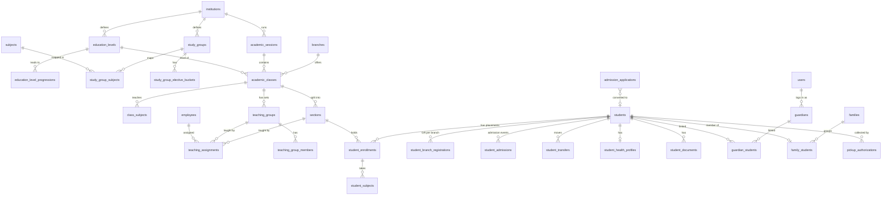
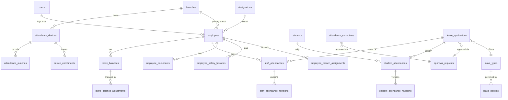

# Deliverable 7: Database Schema and Entity Relationship Diagrams
# Part 2 of 4: Academic, Admission, Student, Guardian, HR, Attendance, Leave

**Version:** 1.0 (draft for approval) | **Date:** 23 Nov 2026
**Conventions:** as defined in Part 1 (standard column sets [T], [T-], [B], [B-], [S], [L]; `FK->` composite tenant key; `FK=>` simple key; `?` = NULL allowed; explicit short key names)

---

## 7.16 New Decisions in This Part

| ID | Decision |
|---|---|
| DEC-99 | Clarifies DEC-92: when NULL means "not provided" and many NULLs are acceptable (B-Form, CNIC, email), a plain unique index on the nullable column is correct. Generated `*_key` columns are used only when NULL must behave as a real value (organization-wide scope, platform users) |
| DEC-100 | DEC-68 is tightened: a student may have **only one active enrollment in the whole organization** (`uq_sen_active (organization_id, student_id, active_marker)`). This also enforces BR-STU-01 (never in two branches) in the database |
| DEC-101 | Family membership is owned by Guardian (`family_students`), not stored on `students`, keeping Student free of a dependency on Guardian (D3 3.3) |
| DEC-102 | GR numbers and admission numbers live in their own tables (`student_branch_registrations`, `student_admissions`) because a student gets a new GR number per branch and a new admission number per admission event |
| DEC-103 | HR stores effective-dated monthly salary in R1 (`employee_salary_histories`); Payroll (R2) adds structures and components on top and treats HR history as the basic-pay source |
| DEC-104 | `attendance_punches` is partition-ready on `punched_at` (primary key `(id, punched_at)`), not on `created_at`, because reports and duplicate checks filter by punch time |
| DEC-105 | Attendance corrections never overwrite silently: each change to a daily attendance row writes a revision row; the main row holds the current value and `current_revision_no` |
| DEC-106 | `CHECK` constraints that reference foreign-key columns are allowed only because all foreign keys use `RESTRICT` (MySQL forbids CHECK on columns used by cascading foreign-key actions) |
| DEC-107 | Free-text health fields (conditions, medications, emergency instructions) are stored encrypted |

---

## 7.17 Academic

### `academic_sessions` [T] alias `acs`

| Column | Type | Rules |
|---|---|---|
| institution_id | BIGINT UNSIGNED | FK->institutions |
| track | VARCHAR(20) | `national`, `cambridge`, `common` (DEC-77, DEC-79) |
| name | VARCHAR(30) | e.g. `2026-2027` |
| starts_on, ends_on | DATE | CHECK ends_on > starts_on |
| admission_opens_on, admission_closes_on | DATE? | |
| promotion_date | DATE? | |
| status | VARCHAR(32) | `planning`, `active`, `closing`, `closed` |
| active_marker | TINYINT | GENERATED (IF(status = 'active', 1, NULL)) STORED |
| planning_marker | TINYINT | GENERATED (IF(status = 'planning', 1, NULL)) STORED |
| activated_at, closing_started_at, closed_at | DATETIME? | |
| closed_by | BIGINT UNSIGNED? | FK->users |

Keys: `uq_acs_name (organization_id, institution_id, track, name)`, `uq_acs_active (organization_id, institution_id, track, active_marker)`, `uq_acs_planning (organization_id, institution_id, track, planning_marker)`. The `ActivateSession` action also refuses a track-specific active session while a `common` session is active in the same institution, and the reverse.

### `education_levels` [T][S] alias `edl`

| Column | Type | Rules |
|---|---|---|
| institution_id | BIGINT UNSIGNED | FK->institutions |
| code | VARCHAR(10) | `PG`, `C1`, `C9`, `O1`, `AS` |
| name, name_ur | VARCHAR(100) | |
| display_order | SMALLINT UNSIGNED | |
| stage | VARCHAR(20) | `pre_primary`, `primary`, `middle`, `secondary`, `higher_secondary` |
| track | VARCHAR(20) | `national`, `cambridge`, `common` |
| grade_equivalent | TINYINT UNSIGNED? | 1 to 13 |
| is_external_exam_level | TINYINT(1) | Board or Cambridge exams |
| has_board_assessment | TINYINT(1) | Class 8 option (DEC-76) |
| student_login_default | TINYINT(1) | |
| is_active | TINYINT(1) | |

Keys: `uq_edl_code (organization_id, institution_id, code)`, `ix_edl_order (organization_id, institution_id, display_order)`.

### `education_level_progressions` [T-] alias `elp` (DEC-80)
`from_level_id` FK->education_levels, `to_level_id` FK->education_levels (may belong to another institution of the same organization), `track` VARCHAR(20), `is_default` TINYINT(1), `default_marker` GENERATED (IF(is_default = 1, 1, NULL)). Keys: `uq_elp_pair (organization_id, from_level_id, to_level_id)`, `uq_elp_default (organization_id, from_level_id, track, default_marker)`.

### `study_groups` [T][S] alias `stg`
`institution_id` FK->institutions, `code` VARCHAR(20) (`GEN`, `MSCI`, `OLVL`, `AL_PM`), `name`, `name_ur`, `track` VARCHAR(20), `is_system` TINYINT(1) (true for `GEN`), `is_active`. Keys: `uq_stg_code (organization_id, institution_id, code)`.

### `study_group_levels` [T-] alias `sgl`
`study_group_id` FK->study_groups, `education_level_id` FK->education_levels. Keys: `uq_sgl (organization_id, study_group_id, education_level_id)`.

### `study_group_elective_buckets` [T-] alias `sgb` (new; bucket rules from D6 and option blocks from D6A)
`study_group_id`, `education_level_id`, `bucket_code` VARCHAR(40), `label` VARCHAR(100), `min_choices` TINYINT UNSIGNED, `max_choices` TINYINT UNSIGNED, `timetable_block_label` VARCHAR(20)?. Keys: `uq_sgb (organization_id, study_group_id, education_level_id, bucket_code)`; CHECK `max_choices >= min_choices`.

### `study_group_subjects` [T-] alias `sgs`

| Column | Type | Rules |
|---|---|---|
| study_group_id | BIGINT UNSIGNED | FK->study_groups |
| education_level_id | BIGINT UNSIGNED | FK->education_levels |
| subject_id | BIGINT UNSIGNED | FK->subjects |
| requirement | VARCHAR(20) | `compulsory`, `elective` |
| alternative_set | VARCHAR(40)? | DEC-67 |
| elective_bucket | VARCHAR(40)? | Matches `study_group_elective_buckets.bucket_code` |
| default_periods_per_week | TINYINT UNSIGNED | |
| default_components | JSON? | Overrides subject defaults |
| default_qualification | VARCHAR(20)? | `as_only`, `a_level` (DEC-86) |
| sort_order | SMALLINT UNSIGNED | |

Keys: `uq_sgs (organization_id, study_group_id, education_level_id, subject_id)`.

### `subjects` [T][S] alias `sub`
`institution_id` FK->institutions, `code` VARCHAR(20), `name`, `name_ur`, `type` VARCHAR(20) (`theory`, `practical`, `theory_practical`), `default_components` JSON (`[{"code":"TH","name":"Theory","max":75},{"code":"PR","name":"Practical","max":25}]`), `is_board_subject` TINYINT(1), `department_id` BIGINT UNSIGNED? FK->departments, `color` CHAR(7)?, `is_active`. Keys: `uq_sub_code (organization_id, institution_id, code)`.

### `academic_classes` [B][S] alias `acl`
`academic_session_id` FK->academic_sessions, `education_level_id` FK->education_levels, `study_group_id` FK->study_groups, `name`, `name_ur`, `display_order` SMALLINT, `is_active`. Keys: `uq_acl (organization_id, branch_id, academic_session_id, education_level_id, study_group_id)`, `ix_acl_session (organization_id, branch_id, academic_session_id)`.

### `class_subjects` [B-] alias `csb`
`academic_class_id` FK->academic_classes, `subject_id` FK->subjects, `requirement`, `alternative_set`?, `elective_bucket`?, `periods_per_week` TINYINT UNSIGNED, `components` JSON, `qualification` VARCHAR(20)?, `is_active`. Keys: `uq_csb (organization_id, academic_class_id, subject_id)`.

### `sections` [B][S] alias `sec`

| Column | Type | Rules |
|---|---|---|
| academic_class_id | BIGINT UNSIGNED | FK->academic_classes |
| academic_session_id | BIGINT UNSIGNED | FK->academic_sessions (copied from class for fast filtering) |
| name | VARCHAR(30) | |
| capacity | SMALLINT UNSIGNED | CHECK capacity >= 1 |
| shift_id | BIGINT UNSIGNED? | FK->shifts |
| wing | VARCHAR(10)? | `boys`, `girls`, `combined` |
| class_teacher_employee_id | BIGINT UNSIGNED? | FK->employees |
| room_id | BIGINT UNSIGNED? | FK->rooms |
| display_order | SMALLINT UNSIGNED | |

Keys: `uq_sec_name (organization_id, academic_class_id, name)`, `ix_sec_session (organization_id, branch_id, academic_session_id)`, `ix_sec_ct (organization_id, class_teacher_employee_id)`. DEC-75 (one section per class teacher per session) is enforced in the action because it is a configurable setting.

### `section_class_teacher_histories` [B-] alias `sct`
`section_id` FK->sections, `employee_id` FK->employees, `starts_on` DATE, `ends_on` DATE?, `assigned_by` FK->users. Keys: `ix_sct (organization_id, section_id, starts_on)`.

### `teaching_groups` [B][S] alias `tgp` (DEC-81)
`academic_class_id` FK->academic_classes, `academic_session_id` FK->academic_sessions, `subject_id` FK->subjects, `name` VARCHAR(60), `capacity` SMALLINT UNSIGNED?, `room_id` BIGINT UNSIGNED? FK->rooms, `is_active`. Keys: `uq_tgp (organization_id, academic_class_id, subject_id, name)`.

### `teaching_group_members` [B-] alias `tgm`
`teaching_group_id` FK->teaching_groups, `student_enrollment_id` FK->student_enrollments, `student_id` FK->students, `subject_id` FK->subjects (copied), `academic_session_id` FK->academic_sessions (copied), `joined_on` DATE, `left_on` DATE?, `active_marker` GENERATED (IF(left_on IS NULL, 1, NULL)). Keys: `uq_tgm_one_group (organization_id, student_id, academic_session_id, subject_id, active_marker)`, `ix_tgm_group (organization_id, teaching_group_id, active_marker)`.

### `teaching_assignments` [B] alias `tas`

| Column | Type | Rules |
|---|---|---|
| academic_session_id | BIGINT UNSIGNED | FK->academic_sessions |
| section_id | BIGINT UNSIGNED? | FK->sections |
| teaching_group_id | BIGINT UNSIGNED? | FK->teaching_groups |
| section_key / group_key | BIGINT UNSIGNED | GENERATED (IFNULL(...,0)) |
| subject_id | BIGINT UNSIGNED | FK->subjects |
| employee_id | BIGINT UNSIGNED | FK->employees |
| role | VARCHAR(20) | `primary`, `co_teacher` |
| periods_per_week | TINYINT UNSIGNED | |
| starts_on | DATE | |
| ends_on | DATE? | |
| primary_marker | TINYINT | GENERATED (IF(role = 'primary' AND ends_on IS NULL, 1, NULL)) |

Keys: `ck_tas_target CHECK ((section_id IS NULL) <> (teaching_group_id IS NULL))` (DEC-106); `uq_tas_primary (organization_id, section_key, group_key, subject_id, primary_marker)`; `ix_tas_teacher (organization_id, employee_id, academic_session_id, ends_on)`; `ix_tas_section (organization_id, section_id, subject_id)`. Ending an assignment sets `ends_on`; rows are never deleted.

---

## 7.18 Admission

### `admission_form_templates` [T][S] alias `aft`
`institution_id` FK->institutions, `name`, `fields` JSON (field key, label en/ur, required, type, options), `document_checklist` JSON, `is_default`, `default_marker` GENERATED, `version` SMALLINT UNSIGNED. Keys: `uq_aft_default (organization_id, institution_id, default_marker)`.

### `admission_applications` [B] alias `aap`

| Column | Type | Rules |
|---|---|---|
| application_no | VARCHAR(30) | Numbering service |
| academic_session_id | BIGINT UNSIGNED | FK->academic_sessions (target) |
| education_level_id | BIGINT UNSIGNED | FK->education_levels |
| study_group_id | BIGINT UNSIGNED? | FK->study_groups |
| admission_form_template_id, form_version | BIGINT UNSIGNED, SMALLINT | FK->admission_form_templates |
| source | VARCHAR(20) | `online`, `office`, `import` |
| status | VARCHAR(32) | `submitted`, `under_review`, `test_scheduled`, `interview_scheduled`, `approved`, `waitlisted`, `rejected`, `admitted`, `withdrawn` |
| student_name, student_name_ur | VARCHAR(150) | |
| father_name | VARCHAR(150) | |
| date_of_birth | DATE | |
| gender | VARCHAR(10) | |
| b_form_encrypted, b_form_lookup_hash, b_form_last4 | TEXT?, CHAR(64)?, CHAR(4)? | DEC-95 |
| guardian_name | VARCHAR(150) | |
| guardian_mobile_e164 | VARCHAR(16) | Verified by OTP for online source |
| guardian_cnic_encrypted, guardian_cnic_lookup_hash, guardian_cnic_last4 | | |
| email | VARCHAR(191)? | |
| previous_school, previous_class | VARCHAR(150)? | |
| form_data | JSON | Custom fields |
| mobile_verified_at | DATETIME? | |
| detected_sibling_student_id | BIGINT UNSIGNED? | FK->students |
| possible_duplicate_student_id | BIGINT UNSIGNED? | FK->students |
| reviewed_by, reviewed_at | | |
| decided_by, decided_at, decision_reason | | |
| admission_voucher_id | BIGINT UNSIGNED? | FK->fee_vouchers (added in Fee migration) |
| converted_student_id | BIGINT UNSIGNED? | FK->students |
| converted_at, withdrawn_at, anonymized_at | DATETIME? | |

Keys: `uq_aap_no (organization_id, application_no)`, `ix_aap_status (organization_id, branch_id, academic_session_id, status)`, `ix_aap_bform (organization_id, b_form_lookup_hash)`, `ix_aap_mobile (organization_id, guardian_mobile_e164)`.

### `admission_application_documents` [B-] alias `aad`
`admission_application_id` FK->admission_applications, `document_code` VARCHAR(40), `stored_file_id` BIGINT UNSIGNED? FK->stored_files, `status` VARCHAR(32) (`pending`, `received`, `verified`, `rejected`), `verified_by`?, `verified_at`?, `remarks` VARCHAR(255)?. Keys: `uq_aad (organization_id, admission_application_id, document_code)`.

### `admission_inquiries` [B] alias `ainq` (R2)
`inquiry_no`, `academic_session_id`?, `child_name`, `guardian_name`, `mobile_e164`, `education_level_id`? FK->education_levels, `source` VARCHAR(20) (`walk_in`, `phone`, `social_media`, `referral`, `website`, `other`), `status` (`new`, `contacted`, `visit_scheduled`, `applied`, `lost`), `next_follow_up_on` DATE?, `assigned_to_user_id`? FK->users, `notes` TEXT?, `converted_application_id`? FK->admission_applications. Keys: `uq_ainq_no (organization_id, inquiry_no)`, `ix_ainq_follow (organization_id, branch_id, status, next_follow_up_on)`.

### `admission_assessments` [B-] alias `aas` (R2)
`admission_application_id`, `type` (`test`, `interview`), `scheduled_at` DATETIME, `location` VARCHAR(150)?, `assessor_user_id`?, `result` (`pending`, `pass`, `fail`, `absent`), `score` DECIMAL(6,2)?, `remarks` TEXT?. Keys: `ix_aas (organization_id, admission_application_id)`.

---

## 7.19 Student

### `students` [T] alias `stu`

| Column | Type | Rules |
|---|---|---|
| registration_no | VARCHAR(30) | Permanent (6.13) |
| current_branch_id | BIGINT UNSIGNED? | FK->branches (DEC-49). Set only by enrollment actions; after withdrawal or graduation it keeps the last branch so that branch's staff can still see the record. NULL only between admission approval and first enrollment |
| name, name_ur | VARCHAR(150) | |
| father_name, father_name_ur | VARCHAR(150) | |
| mother_name | VARCHAR(150)? | |
| date_of_birth | DATE | |
| gender | VARCHAR(10) | `male`, `female` |
| b_form_encrypted, b_form_lookup_hash, b_form_last4 | | DEC-95; `b_form_lookup_hash` NULL allowed |
| blood_group | VARCHAR(5)? | |
| religion | VARCHAR(30)? | Sensitive (A-45) |
| nationality | CHAR(2) | DEFAULT `PK` |
| is_foreign_national | TINYINT(1) | Affects O Level compulsory exemptions |
| address, city | VARCHAR | |
| student_mobile_e164, email | VARCHAR? | |
| student_category_id | BIGINT UNSIGNED | FK->student_categories |
| sponsor_id | BIGINT UNSIGNED? | FK->sponsors |
| first_admitted_on | DATE | |
| previous_school, previous_class | VARCHAR(150)? | |
| photo_file_id | BIGINT UNSIGNED? | FK->stored_files |
| user_id | BIGINT UNSIGNED? | FK->users (student login) |
| status | VARCHAR(32) | `active`, `suspended`, `struck_off`, `withdrawn`, `graduated` |
| status_changed_at | DATETIME | |

Keys: `uq_stu_reg (organization_id, registration_no)`, `uq_stu_bform (organization_id, b_form_lookup_hash)` (DEC-99), `uq_stu_user (user_id)`, `ix_stu_branch_status (organization_id, current_branch_id, status)`, `ix_stu_name (organization_id, name)`, `ix_stu_father (organization_id, father_name)`. Students are never deleted (no soft delete); data-entry errors before any dependent record use enrollment cancellation.

### `student_enrollments` [B] alias `sen`

| Column | Type | Rules |
|---|---|---|
| student_id | BIGINT UNSIGNED | FK->students |
| academic_session_id | BIGINT UNSIGNED | FK->academic_sessions |
| academic_class_id | BIGINT UNSIGNED | FK->academic_classes |
| section_id | BIGINT UNSIGNED | FK->sections |
| education_level_id | BIGINT UNSIGNED | FK->education_levels (copied) |
| study_group_id | BIGINT UNSIGNED | FK->study_groups (copied) |
| roll_no | VARCHAR(20)? | |
| starts_on | DATE | |
| ends_on | DATE? | |
| status | VARCHAR(32) | `active`, `completed`, `closed`, `cancelled` |
| outcome | VARCHAR(32)? | D6 6.8 list |
| is_conditional | TINYINT(1) | DEC-71 |
| condition_deadline | DATE? | |
| previous_enrollment_id | BIGINT UNSIGNED? | FK->student_enrollments |
| active_marker | TINYINT | GENERATED (IF(status = 'active', 1, NULL)) STORED |

Keys: `uq_sen_active (organization_id, student_id, active_marker)` (DEC-100), `uq_sen_roll (organization_id, section_id, roll_no, active_marker)`, `ix_sen_session (organization_id, branch_id, academic_session_id, status)`, `ix_sen_section (organization_id, section_id, status)`, `ix_sen_student (organization_id, student_id, starts_on)`; CHECK `ends_on IS NULL OR ends_on >= starts_on`.

### `student_subjects` [B-] alias `ssb`
`student_enrollment_id` FK->student_enrollments, `student_id` FK->students, `subject_id` FK->subjects, `class_subject_id` FK->class_subjects, `alternative_set`?, `elective_bucket`?, `target_qualification` VARCHAR(20)? (DEC-86), `starts_on` DATE, `ends_on` DATE?, `active_marker` GENERATED (IF(ends_on IS NULL, 1, NULL)). Keys: `uq_ssb (organization_id, student_enrollment_id, subject_id, active_marker)`, `ix_ssb_subject (organization_id, subject_id, active_marker)`.

### `student_branch_registrations` [B] alias `sbr` (DEC-102)
`student_id` FK->students, `gr_no` VARCHAR(30), `registered_on` DATE, `left_on` DATE?. Keys: `uq_sbr_gr (organization_id, branch_id, gr_no)`, `uq_sbr_student (organization_id, branch_id, student_id)`.

### `student_admissions` [B] alias `sad` (DEC-102)
`student_id` FK->students, `admission_no` VARCHAR(30), `admission_type` VARCHAR(20) (`new`, `readmission`, `progression`, `transfer_in`), `admitted_on` DATE, `admission_application_id` BIGINT UNSIGNED? FK->admission_applications, `student_enrollment_id` FK->student_enrollments. Keys: `uq_sad_no (organization_id, branch_id, admission_no)`, `ix_sad_student (organization_id, student_id)`.

### `student_transfers` [B] alias `str`
`student_id`, `transfer_type` VARCHAR(20) (`section`, `class`, `branch`), `from_branch_id`, `to_branch_id` FK->branches, `from_enrollment_id`, `to_enrollment_id` FK->student_enrollments, `effective_on` DATE, `fee_policy` VARCHAR(30)?, `approval_request_id`? FK->approval_requests, `reason` VARCHAR(500). Keys: `ix_str_student (organization_id, student_id, effective_on)`.

### `student_withdrawals` [B] alias `swd`
`student_id`, `student_enrollment_id`, `reason` VARCHAR(40) (6.11 list), `reason_details` VARCHAR(500)?, `effective_on` DATE, `clearance_snapshot` JSON, `approval_request_id`?, `slc_issued_document_id`? FK->issued_documents, `deposit_refund_id`? FK->fee_refunds (added in Fee migration). Keys: `ix_swd_student (organization_id, student_id)`.

### `student_suspensions` [B] alias `ssp`
`student_id`, `starts_on` DATE, `ends_on` DATE, `reason` VARCHAR(500), `decided_by` FK->users, `reinstated_at` DATETIME?. Keys: `ix_ssp (organization_id, student_id, starts_on)`; CHECK `ends_on >= starts_on`.

### `student_categories` [T][S] alias `scg`
`code` VARCHAR(30), `name`, `name_ur`, `description`?, `is_default` TINYINT(1). Keys: `uq_scg_code (organization_id, code)`.

### `sponsors` [T][S] alias `spn`
`name`, `type` VARCHAR(20) (`pef`, `ngo`, `trust`, `individual`, `corporate`, `other`), `contact_person`?, `mobile_e164`?, `email`?, `notes`?. Keys: `ix_spn_name (organization_id, name)`.

### `student_health_profiles` [T-] alias `shp`
`student_id` FK->students UNIQUE per organization, `blood_group`?, `conditions`, `allergies`, `medications`, `emergency_instructions` TEXT? (all encrypted, DEC-107), `doctor_name`?, `doctor_mobile_e164`?, `updated_by`. Keys: `uq_shp (organization_id, student_id)`.

### `student_documents` [T-] alias `sdc`
`student_id`, `document_type` VARCHAR(40) (`b_form`, `birth_certificate`, `previous_slc`, `photo`, `medical`, `other`), `stored_file_id` FK->stored_files, `status` (`pending`, `verified`, `rejected`), `uploaded_via` VARCHAR(10) (`staff`, `guardian`), `verified_by`?, `verified_at`?, `remarks`?. Keys: `ix_sdc (organization_id, student_id, document_type)`.

### `student_timeline_events` [L] alias `ste`
`organization_id` NOT NULL, `branch_id`?, `student_id`, `event_key` VARCHAR(60), `occurred_at` DATETIME(3), `actor_user_id`?, `title_en` VARCHAR(255), `title_ur` VARCHAR(255)?, `payload` JSON?, `visibility` VARCHAR(10) (`staff`, `guardian`), `source_type`?, `source_id`?, `created_at` DATETIME(3). Keys: PK `(id, created_at)`, `ix_ste_student (organization_id, student_id, occurred_at)`.

---

## 7.20 Guardian

### `guardians` [T] alias `gdn`

| Column | Type | Rules |
|---|---|---|
| user_id | BIGINT UNSIGNED? | FK->users; several guardian rows may share one user (DEC-22) |
| name, name_ur | VARCHAR(150) | |
| cnic_encrypted, cnic_lookup_hash, cnic_last4 | | DEC-95 |
| mobile_primary_e164 | VARCHAR(16) | |
| mobile_secondary_e164 | VARCHAR(16)? | |
| email | VARCHAR(191)? | |
| occupation, employer | VARCHAR(150)? | |
| address, city | VARCHAR? | |
| is_verified | TINYINT(1) | |
| verified_at, verified_by | | |
| verification_code_hash | CHAR(64)? | Code printed on slips (FR-GRD-006) |
| custody_restricted | TINYINT(1) | DEFAULT 0 (FR-GRD-003) |
| custody_restriction_reason | TEXT? | Encrypted |
| custody_restricted_at, custody_restricted_by | | |
| custody_document_file_id | BIGINT UNSIGNED? | FK->stored_files |
| is_active | TINYINT(1) | |

Keys: `uq_gdn_cnic (organization_id, cnic_lookup_hash)` (DEC-99), `ix_gdn_mobile (organization_id, mobile_primary_e164)`, `ix_gdn_user (organization_id, user_id)`.

### `guardian_students` [T-] alias `gst`

| Column | Type | Rules |
|---|---|---|
| guardian_id | BIGINT UNSIGNED | FK->guardians |
| student_id | BIGINT UNSIGNED | FK->students |
| relation | VARCHAR(20) | `father`, `mother`, `guardian`, `grandparent`, `uncle`, `aunt`, `sibling`, `other` |
| is_primary_contact, is_fee_payer, is_emergency_contact | TINYINT(1) | |
| has_portal_access, can_approve_requests, can_pickup | TINYINT(1) | |
| linked_on | DATE | |
| unlinked_on | DATE? | |
| unlink_reason | VARCHAR(255)? | |
| active_marker | TINYINT | GENERATED (IF(unlinked_on IS NULL, 1, NULL)) |
| primary_marker | TINYINT | GENERATED (IF(is_primary_contact = 1 AND unlinked_on IS NULL, 1, NULL)) |

Keys: `uq_gst_link (organization_id, guardian_id, student_id, active_marker)`, `uq_gst_primary (organization_id, student_id, primary_marker)`, `ix_gst_student (organization_id, student_id, active_marker)`. BR-GRD-02 (at least one primary) is enforced in the unlink action.

### `families` [T] alias `fam`
`family_code` VARCHAR(30), `name` VARCHAR(150), `primary_guardian_id` BIGINT UNSIGNED? FK->guardians, `voucher_mode` VARCHAR(20) (`individual`, `family`), `notes` TEXT?. Keys: `uq_fam_code (organization_id, family_code)`.

### `family_students` [T-] alias `fms` (DEC-101)
`family_id` FK->families, `student_id` FK->students, `joined_on` DATE. Keys: `uq_fms_student (organization_id, student_id)` (one family per student), `ix_fms_family (organization_id, family_id)`.

### `pickup_authorizations` [T-] alias `pua`
`student_id` FK->students, `name`, `relation` VARCHAR(30), `cnic_encrypted`, `cnic_lookup_hash`, `cnic_last4`, `mobile_e164`?, `photo_file_id`? FK->stored_files, `valid_until` DATE?, `is_active`, `created_via` VARCHAR(10) (`staff`, `guardian`). Keys: `ix_pua (organization_id, student_id, is_active)`.

---

## 7.21 HR

### `designations` [T][S] alias `dsg`
`code` VARCHAR(30), `name`, `name_ur`, `is_teaching_default` TINYINT(1), `suggested_role_slug` VARCHAR(60)?, `grade` VARCHAR(20)?. Keys: `uq_dsg_code (organization_id, code)`.

### `employees` [T] alias `emp`

| Column | Type | Rules |
|---|---|---|
| employee_code | VARCHAR(30) | Numbering service |
| user_id | BIGINT UNSIGNED? | FK->users |
| primary_branch_id | BIGINT UNSIGNED | FK->branches |
| department_id | BIGINT UNSIGNED? | FK->departments |
| designation_id | BIGINT UNSIGNED | FK->designations |
| name, name_ur, father_name | VARCHAR(150) | |
| gender | VARCHAR(10) | |
| date_of_birth | DATE? | |
| cnic_encrypted, cnic_lookup_hash, cnic_last4 | | DEC-95 |
| cnic_expires_on | DATE? | Reminder (FR-HR-007) |
| mobile_e164 | VARCHAR(16) | |
| personal_email | VARCHAR(191)? | |
| emergency_contact_name, emergency_contact_mobile_e164 | VARCHAR? | |
| address, city | VARCHAR? | |
| marital_status | VARCHAR(20)? | |
| joining_date | DATE | |
| employment_type | VARCHAR(20) | `permanent`, `contract`, `visiting`, `part_time`, `daily_wage` |
| status | VARCHAR(32) | `active`, `on_leave`, `suspended`, `resigned`, `terminated`, `retired` |
| status_changed_at | DATETIME | |
| is_teaching | TINYINT(1) | |
| specializations | JSON? | Subject ids |
| reporting_manager_employee_id | BIGINT UNSIGNED? | FK->employees |
| shift_id | BIGINT UNSIGNED? | FK->shifts |
| max_periods_per_week | TINYINT UNSIGNED? | Default 36 (D6 6.7) |
| photo_file_id | BIGINT UNSIGNED? | FK->stored_files |
| bank_name | VARCHAR(100)? | Sensitive |
| bank_account_encrypted | TEXT? | Sensitive |
| separated_on | DATE? | |

Keys: `uq_emp_code (organization_id, employee_code)`, `uq_emp_cnic (organization_id, cnic_lookup_hash)`, `uq_emp_user (user_id)`, `ix_emp_branch (organization_id, primary_branch_id, status)`.

### `employee_branch_assignments` [B] alias `eba`
`employee_id` FK->employees, `designation_id`? FK->designations, `starts_on` DATE, `ends_on` DATE?, `is_primary` TINYINT(1), `cost_share_percent` DECIMAL(5,2)? (R2), `active_marker` GENERATED (IF(ends_on IS NULL, 1, NULL)), `primary_marker` GENERATED (IF(is_primary = 1 AND ends_on IS NULL, 1, NULL)). Keys: `uq_eba_active (organization_id, employee_id, branch_id, active_marker)`, `uq_eba_primary (organization_id, employee_id, primary_marker)`.

### `employee_salary_histories` [T-] alias `esh` (DEC-103, sensitive)
`employee_id`, `monthly_salary` DECIMAL(15,2), `effective_from` DATE, `reason` VARCHAR(255), `approved_by`? FK->users. Keys: `uq_esh (organization_id, employee_id, effective_from)`.

### `employee_qualifications` [T-] alias `eql`
`employee_id`, `level` VARCHAR(20) (`matric`, `intermediate`, `bachelor`, `master`, `mphil`, `phd`, `diploma`, `certificate`, `other`), `title` VARCHAR(150), `institution` VARCHAR(150), `board_or_university` VARCHAR(150)?, `passing_year` SMALLINT UNSIGNED?, `result` VARCHAR(30)?, `stored_file_id`?. Keys: `ix_eql (organization_id, employee_id)`.

### `employee_experiences` [T-] alias `eex`
`employee_id`, `organization_name`, `designation`, `from_date` DATE, `to_date` DATE?, `reason_for_leaving` VARCHAR(255)?. Keys: `ix_eex (organization_id, employee_id)`.

### `employee_documents` [T-] alias `edc`
`employee_id`, `document_type` VARCHAR(40) (`cv`, `degree`, `cnic_copy`, `contract`, `experience_letter`, `other`), `stored_file_id`, `issued_on` DATE?, `expires_on` DATE?, `notes`?. Keys: `ix_edc_expiry (organization_id, expires_on)`, `ix_edc_emp (organization_id, employee_id)`.

### R2 HR tables

| Table | Alias | Columns | Keys |
|---|---|---|---|
| `employee_contracts` [T] | `ect` | `employee_id`, `contract_type`, `starts_on`, `ends_on`?, `terms` TEXT, `stored_file_id`?, `renewal_reminder_on`? | `ix_ect (organization_id, employee_id, ends_on)` |
| `performance_reviews` [B] | `prv` | `employee_id`, `review_period` VARCHAR(20), `reviewer_user_id`, `criteria` JSON, `overall_rating` DECIMAL(3,1)?, `comments` TEXT?, `status` (`draft`, `submitted`, `acknowledged`, `approved`), `acknowledged_at`? | `ix_prv (organization_id, employee_id, review_period)` |
| `training_records` [T-] | `trn` | `employee_id`, `title`, `provider`?, `from_date`, `to_date`?, `hours`?, `certificate_file_id`? | `ix_trn (organization_id, employee_id)` |
| `employee_disciplinary_actions` [B] | `eda` | `employee_id`, `incident_date`, `category`, `description` TEXT, `action_taken`, `decided_by` | `ix_eda (organization_id, employee_id)` |
| `employee_separations` [B] | `esp` | `employee_id`, `separation_type` (`resignation`, `termination`, `retirement`, `contract_end`), `notice_date`, `last_working_date`, `reason` TEXT?, `clearance_snapshot` JSON?, `approval_request_id`?, `final_settlement_status` | `uq_esp (organization_id, employee_id, last_working_date)` |

---

## 7.22 Attendance

### `attendance_policies` [T] alias `apl`
`branch_id`? FK->branches (NULL = organization default), `branch_key` GENERATED, `shift_id`? FK->shifts, `shift_key` GENERATED, `person_type` VARCHAR(10) (`student`, `staff`), `name`, `start_time` TIME, `grace_minutes` SMALLINT, `late_after_minutes`, `half_day_after_minutes`, `early_departure_before_minutes` SMALLINT?, `auto_absent_after` TIME?, `marking_window_ends_at` TIME, `lates_per_leave` TINYINT?, `official_sources` JSON, `count_suspended_in_percentage` TINYINT(1), `effective_from` DATE, `effective_to` DATE?. Keys: `uq_apl (organization_id, branch_key, shift_key, person_type, effective_from)`.

### `attendance_devices` [B] alias `atd`
`serial_number` VARCHAR(60) UNIQUE globally (DEC-29), `vendor` VARCHAR(40), `model` VARCHAR(60)?, `adapter` VARCHAR(30) (`zkteco_adms`, `signed_webhook`, `csv`, `agent`), `location_label` VARCHAR(100), `purpose` VARCHAR(10) (`staff`, `student`, `both`), `comm_key_encrypted` TEXT?, `webhook_secret_encrypted` TEXT?, `timezone` VARCHAR(40), `ip_allowlist` JSON?, `status` (`active`, `inactive`, `retired`), `last_heartbeat_at`?, `last_punch_at`?, `firmware_version`?. Keys: `uq_atd_serial (serial_number)`, `ix_atd_branch (organization_id, branch_id, status)`.

### `device_enrollments` [B-] alias `dve`
`attendance_device_id` FK->attendance_devices, `device_user_id` VARCHAR(30), `person_type` VARCHAR(10) (`student`, `employee`), `person_id` BIGINT UNSIGNED, `enrolled_on` DATE, `ended_on` DATE?, `active_marker` GENERATED. Keys: `uq_dve_pin (organization_id, attendance_device_id, device_user_id, active_marker)`, `ix_dve_person (organization_id, person_type, person_id)`.

### `attendance_punches` [L] alias `apn` (DEC-48, DEC-104)

| Column | Type | Rules |
|---|---|---|
| organization_id | BIGINT UNSIGNED | NOT NULL (resolved before insert) |
| branch_id | BIGINT UNSIGNED | |
| attendance_device_id | BIGINT UNSIGNED? | |
| device_key | BIGINT UNSIGNED | GENERATED (IFNULL(attendance_device_id, 0)) |
| device_user_id | VARCHAR(30)? | |
| person_type | VARCHAR(10)? | Resolved |
| person_id | BIGINT UNSIGNED? | Resolved |
| identity_key | VARCHAR(60) | GENERATED (IFNULL(device_user_id, CONCAT(person_type, ':', person_id))) |
| punched_at | DATETIME | UTC; partition column |
| punched_local_date | DATE | Organization timezone |
| direction | VARCHAR(10) | `in`, `out`, `unknown` |
| verify_type | VARCHAR(20) | `fingerprint`, `face`, `card`, `pin`, `qr`, `online`, `import` |
| source | VARCHAR(20) | `adms`, `webhook`, `csv`, `qr`, `online` |
| qr_attendance_session_id | BIGINT UNSIGNED? | |
| latitude, longitude | DECIMAL(10,7)? | Online check-in |
| geofence_result | VARCHAR(20)? | `inside`, `outside`, `not_checked` |
| trusted_device_id | BIGINT UNSIGNED? | |
| webhook_receipt_id | BIGINT UNSIGNED? | |
| is_duplicate | TINYINT(1) | Within collapse window |
| raw | JSON? | |
| created_at | DATETIME(3) | |

Keys: PK `(id, punched_at)`; `uq_apn (organization_id, device_key, identity_key, punched_at)`; `ix_apn_person (organization_id, person_type, person_id, punched_local_date)`; `ix_apn_branch_date (organization_id, branch_id, punched_local_date)`.

### `student_attendances` [B] alias `sat`

| Column | Type | Rules |
|---|---|---|
| student_id | BIGINT UNSIGNED | FK->students |
| student_enrollment_id | BIGINT UNSIGNED | FK->student_enrollments |
| section_id | BIGINT UNSIGNED | FK->sections |
| attendance_date | DATE | |
| status | VARCHAR(4) | `P`, `A`, `L`, `HD`, `LV`, `H`, `W`, `NM`, `SU` (DEC-24, DEC-73) |
| source | VARCHAR(20) | `teacher`, `device`, `qr`, `admin`, `correction`, `system` |
| check_in_at, check_out_at | DATETIME? | |
| late_minutes | SMALLINT UNSIGNED? | |
| remarks | VARCHAR(255)? | |
| marked_by | BIGINT UNSIGNED? | FK->users |
| marked_at | DATETIME? | |
| finalized_at | DATETIME? | |
| current_revision_no | SMALLINT UNSIGNED | DEFAULT 1 |
| leave_application_id | BIGINT UNSIGNED? | FK->leave_applications |

Keys: `uq_sat (organization_id, student_id, attendance_date)`, `ix_sat_section (organization_id, section_id, attendance_date)`, `ix_sat_branch (organization_id, branch_id, attendance_date, status)`.

### `student_attendance_revisions` [B-] alias `sar` (DEC-105)
`student_attendance_id` FK->student_attendances, `revision_no` SMALLINT UNSIGNED, `status`, `source`, `check_in_at`?, `check_out_at`?, `changed_by`? FK->users, `reason` VARCHAR(500)?, `attendance_correction_id`? FK->attendance_corrections, `created_at`. Keys: `uq_sar (student_attendance_id, revision_no)`.

### `student_period_attendances` [B] alias `spa`
`student_id`, `student_enrollment_id`, `attendance_date` DATE, `period_no` TINYINT UNSIGNED, `timetable_entry_id`? FK->timetable_entries (Part 3), `subject_id` FK->subjects, `teaching_assignment_id` FK->teaching_assignments, `status` VARCHAR(4) (`P`, `A`, `L`, `LV`), `marked_by`, `marked_at`. Keys: `uq_spa (organization_id, student_id, attendance_date, period_no)`, `ix_spa_assignment (organization_id, teaching_assignment_id, attendance_date)`.

### `staff_attendances` [B] alias `sta`
`employee_id` FK->employees, `attendance_date` DATE, `status` VARCHAR(4), `first_in_at` DATETIME?, `last_out_at` DATETIME?, `late_minutes`, `early_departure_minutes` SMALLINT UNSIGNED?, `worked_minutes` SMALLINT UNSIGNED?, `punch_count` SMALLINT UNSIGNED, `source` VARCHAR(20), `remarks`?, `finalized_at`?, `current_revision_no`, `leave_application_id`?. `branch_id` = branch of first check-in (D4 4.11). Keys: `uq_sta (organization_id, employee_id, attendance_date)`, `ix_sta_branch (organization_id, branch_id, attendance_date, status)`.

### `staff_attendance_revisions` [B-] alias `sav`
Same shape as `student_attendance_revisions` with `staff_attendance_id`. Keys: `uq_sav (staff_attendance_id, revision_no)`.

### `attendance_corrections` [B] alias `acr`
`correction_type` VARCHAR(30) (`student_daily`, `student_period`, `staff_missing_punch`, `staff_status`), `person_type`, `person_id`, `attendance_date` DATE, `target_type` VARCHAR(40)?, `target_id` BIGINT UNSIGNED?, `current_status` VARCHAR(4)?, `requested_status` VARCHAR(4)?, `requested_check_in` DATETIME?, `requested_check_out` DATETIME?, `reason` VARCHAR(500), `approval_request_id` FK->approval_requests, `status` (`pending`, `approved`, `rejected`, `cancelled`), `applied_at` DATETIME?. Keys: `ix_acr_person (organization_id, person_type, person_id, attendance_date)`, `ix_acr_status (organization_id, branch_id, status)`.

### `qr_attendance_sessions` [B] alias `qrs`
`purpose` VARCHAR(20) (`staff_kiosk`, `class`), `section_id`?, `teaching_assignment_id`?, `created_by`, `secret_encrypted` TEXT, `rotation_seconds` TINYINT UNSIGNED DEFAULT 30, `starts_at`, `ends_at` DATETIME, `status` (`active`, `ended`). Keys: `ix_qrs (organization_id, branch_id, status)`.

### `device_sync_logs` [L] alias `dsl`
`attendance_device_id`, `branch_id`, `event` VARCHAR(20) (`handshake`, `punch_upload`, `heartbeat`, `command`, `error`, `offline_alert`), `records_received`, `records_accepted`, `records_duplicate` INT UNSIGNED, `clock_drift_seconds` INT?, `message` VARCHAR(500)?, `created_at`. Keys: PK `(id, created_at)`, `ix_dsl_device (organization_id, attendance_device_id, created_at)`.

---

## 7.23 Leave

### `leave_types` [T][S] alias `lvt`
`code` VARCHAR(20), `name`, `name_ur`, `applies_to` VARCHAR(10) (`staff`, `student`, `both`), `is_paid`, `requires_document_after_days` TINYINT UNSIGNED?, `allows_half_day`, `allows_short_leave` TINYINT(1), `is_active`. Keys: `uq_lvt_code (organization_id, code)`.

### `leave_policies` [T] alias `lvp`
`leave_type_id` FK->leave_types, `employment_type` VARCHAR(20)?, `designation_id`? FK->designations, `annual_quota` DECIMAL(5,1), `accrual` VARCHAR(10) (`yearly`, `monthly`), `carry_forward_max` DECIMAL(5,1), `sandwich_rule` TINYINT(1), `allow_negative` TINYINT(1), `effective_from` DATE, `effective_to` DATE?. Keys: `ix_lvp (organization_id, leave_type_id, effective_from)`.

### `leave_balances` [T-] alias `lvb`
`employee_id`, `leave_type_id`, `period_key` VARCHAR(10) (`2026` or `FY2026-27`), `opening`, `accrued`, `used`, `adjusted` DECIMAL(5,1), `closing` DECIMAL(5,1) (maintained by service). Keys: `uq_lvb (organization_id, employee_id, leave_type_id, period_key)`; CHECK `closing >= 0 OR allow-negative policy` enforced in service.

### `leave_balance_adjustments` [T-] alias `lba`
`leave_balance_id` FK->leave_balances, `amount` DECIMAL(5,1), `reason` VARCHAR(255), `source_type` VARCHAR(40)? (`leave_application`, `accrual`, `manual`), `source_id`?, `adjusted_by`, `created_at`. Keys: `ix_lba (organization_id, leave_balance_id, created_at)`. Every balance change writes a row (history).

### `leave_applications` [B] alias `lva`

| Column | Type | Rules |
|---|---|---|
| application_no | VARCHAR(30) | |
| applicant_type | VARCHAR(10) | `employee`, `student` |
| employee_id | BIGINT UNSIGNED? | FK->employees |
| student_id | BIGINT UNSIGNED? | FK->students |
| leave_type_id | BIGINT UNSIGNED | FK->leave_types |
| starts_on, ends_on | DATE | CHECK ends_on >= starts_on |
| start_part, end_part | VARCHAR(12) | `full`, `first_half`, `second_half` |
| days_count | DECIMAL(5,1) | Computed with sandwich rule |
| short_leave_minutes | SMALLINT UNSIGNED? | |
| reason | VARCHAR(500) | |
| status | VARCHAR(32) | `pending`, `approved`, `rejected`, `cancelled`, `cancellation_requested` |
| approval_request_id | BIGINT UNSIGNED? | FK->approval_requests |
| applied_by_user_id | BIGINT UNSIGNED | FK->users |
| applied_via | VARCHAR(12) | `self`, `guardian`, `on_behalf` |
| decided_at, cancelled_at | DATETIME? | |

Keys: `ck_lva_applicant CHECK ((employee_id IS NULL) <> (student_id IS NULL))`, `uq_lva_no (organization_id, application_no)`, `ix_lva_emp (organization_id, employee_id, starts_on)`, `ix_lva_stu (organization_id, student_id, starts_on)`, `ix_lva_status (organization_id, branch_id, status)`. Overlap with another approved or pending application of the same person is rejected by `ApplyLeave` (FR-LVE-005).

---

## 7.24 ER Diagrams

### Academic, Admission, Student, Guardian

### HR, Attendance, Leave

**Cardinality notes:** a student has 1..n enrollments over time and at most one active (DEC-100); a section has 0..n enrollments; a teaching assignment targets exactly one section or one teaching group; a guardian has 1..n student links and a student 1..n guardian links with exactly one active primary; a student belongs to 0..1 family; an employee has exactly one active primary branch assignment and 0..n others; each student or employee has at most one daily attendance row per date and 1..n revisions for it.

---

## Assumptions (Part 2)

| ID | Assumption |
|---|---|
| A-55 | Gender values are `male` and `female` for students and staff, matching board and IBCC documents; organizations can add values through configuration if required. |
| A-56 | Device user IDs (PINs) are unique per device, not across devices; the same person may have different PINs on different devices. |
| A-57 | Leave balances are tracked per employee only; student leave has no balance. |

## Gaps Found and Added (Part 2)

| ID | Gap | Decision |
|---|---|---|
| GAP-136 | A student could have active enrollments in two sessions at once | One active enrollment per organization (DEC-100) |
| GAP-137 | Family link on students created a Student-to-Guardian dependency | `family_students` owned by Guardian (DEC-101) |
| GAP-138 | GR and admission numbers could not change per branch and per admission event | Separate tables (DEC-102) |
| GAP-139 | R1 needed salary information before Payroll exists | `employee_salary_histories` (DEC-103) |
| GAP-140 | Elective bucket rules (min and max choices) had no table | `study_group_elective_buckets` |
| GAP-141 | Admission document verification status had no home | `admission_application_documents` |
| GAP-142 | Suspensions had no record of dates | `student_suspensions` |
| GAP-143 | Leave balance changes were not traceable | `leave_balance_adjustments` |
| GAP-144 | Online and QR punches have no device user id for duplicate checks | Generated `identity_key` in `attendance_punches` |
