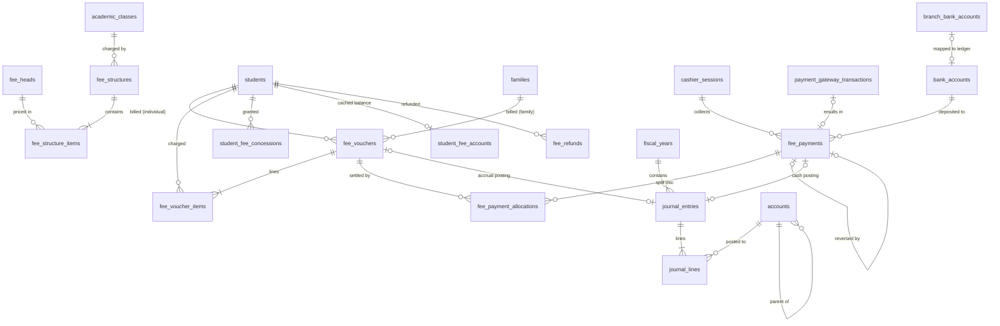
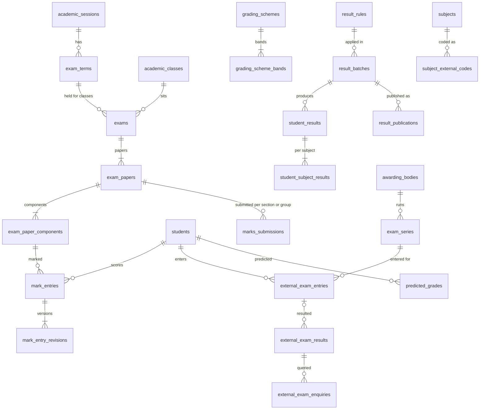
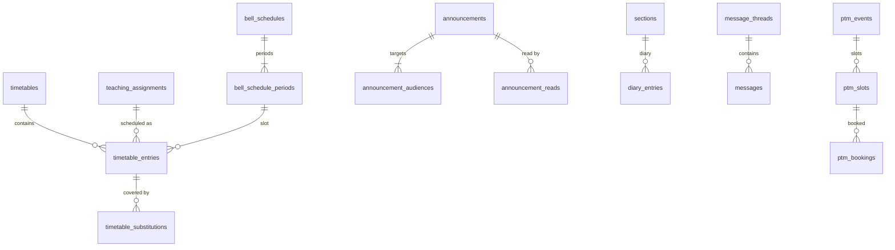

# Deliverable 7: Database Schema and Entity Relationship Diagrams
# Part 3 of 4: Fee, Accounting, Examination, Result, ExternalExam, Timetable, Communication, Administration, Reporting

**Version:** 1.0 (draft for approval) | **Date:** 23 Nov 2026
**Conventions:** as defined in Part 1 ([T], [T-], [B], [B-], [S], [L]; `FK->` composite tenant key; `FK=>` simple key; `?` = NULL allowed)

---

## 7.25 New Decisions in This Part

| ID | Decision |
|---|---|
| DEC-108 | **Upward references are soft.** A column in a lower module that points to a table of a higher module (D3 3.3 dependency order) is stored as an indexed column or a `*_ref_type` / `*_ref_id` pair **without** a database foreign key. Downward and same-module references use composite foreign keys (DEC-43). Soft references are validated in the writing action and covered by tests |
| DEC-109 | A timetable version covers a whole branch, session and shift (not one section), because schools publish and activate the whole schedule at once and clash checks are branch-wide. This refines FR-TTB-002 |
| DEC-110 | Every system-generated journal entry is unique per source event: `uq_jen_source (organization_id, source_type, source_id, entry_type)`. A voucher or payment can never be posted twice |
| DEC-111 | Recurring fee charges are unique per student, fee month and fee head across all live vouchers (individual or family) through `fee_voucher_items.is_live` and a generated `recurring_marker` |
| DEC-112 | `student_fee_accounts` holds cached outstanding and advance balances for fast defaulter lists; vouchers, payments and allocations remain the source of truth, and a nightly job verifies the cache |
| DEC-113 | A payment reversal is a new `fee_payments` row with a negative amount pointing to the original (`reversal_of_payment_id`, unique); the original is marked `reversed`, never edited |
| DEC-114 | Journal lines always carry a `branch_id`. Organization-level entries use the organization's configured head-office branch (setting `accounting.head_office_branch_id`) |

### Corrections to Parts 1 and 2 (from DEC-108)

| Table | Change | Reason |
|---|---|---|
| `branch_bank_accounts` (Part 1) | Remove `account_id`; ledger mapping moves to `bank_accounts.branch_bank_account_id` (Accounting) | Organization must not depend on Accounting |
| `branches.principal_employee_id` (Part 1) | Removed; the principal is the holder of the `principal` role in that branch | Organization must not depend on HR |
| `departments.head_employee_id` (Part 1) | Removed; HR owns `department_heads` (below) | Same |
| `teaching_group_members` (Part 2) | Ownership moves from Academic to Student (it references `student_enrollments`) | Academic is lower than Student |
| `student_withdrawals.deposit_refund_id` (Part 2) | Removed; `fee_refunds.student_withdrawal_id` points the other way | Student is lower than Fee |
| `student_attendances.leave_application_id`, `staff_attendances.leave_application_id` (Part 2) | Replaced by soft `source_ref_type` and `source_ref_id` (no foreign key) | Attendance is lower than Leave |
| `student_period_attendances.timetable_entry_id` (Part 2) | Kept as a soft reference (no foreign key) | Attendance is lower than Timetable |

### `department_heads` [T-] alias `dhd` (HR)
`department_id` FK->departments, `employee_id` FK->employees, `starts_on` DATE, `ends_on` DATE?, `active_marker` GENERATED. Keys: `uq_dhd (organization_id, department_id, active_marker)`.

---

## 7.26 Fee

### `fee_heads` [T][S] alias `fhd`

| Column | Type | Rules |
|---|---|---|
| institution_id | BIGINT UNSIGNED? | FK->institutions |
| code | VARCHAR(30) | |
| name, name_ur | VARCHAR(100) | |
| head_type | VARCHAR(32) | `monthly`, `annual`, `one_time`, `on_demand`, `refundable_deposit`, `fine`, `pass_through` |
| is_recurring | TINYINT(1) | True for `monthly` and `annual` |
| ledger_account_id | BIGINT UNSIGNED | FK->accounts (income; liability for `refundable_deposit` and `pass_through`) |
| is_taxable | TINYINT(1) | |
| allocation_priority | SMALLINT UNSIGNED | Lower is paid first (FR-FEE-018) |
| is_active | TINYINT(1) | |

Keys: `uq_fhd_code (organization_id, code)`.

### `fee_tax_rules` [T] alias `ftx`
`name` VARCHAR(100), `rate_percent` DECIMAL(5,2), `applies_to_head_ids` JSON, `annual_threshold_amount` DECIMAL(15,2)?, `liability_account_id` FK->accounts, `effective_from` DATE, `effective_to` DATE?, `is_active`. Keys: `ix_ftx (organization_id, effective_from)`. Rates are data, never code (GAP-10).

### `fee_structures` [B][S] alias `fst`
`academic_session_id` FK->academic_sessions, `academic_class_id` FK->academic_classes, `section_id`? FK->sections, `section_key` GENERATED, `student_category_id`? FK->student_categories, `category_key` GENERATED, `name`, `effective_from` DATE, `effective_to` DATE?, `status` (`draft`, `active`, `archived`), `version` SMALLINT UNSIGNED. Keys: `uq_fst (organization_id, branch_id, academic_class_id, section_key, category_key, effective_from)`, `ix_fst_session (organization_id, branch_id, academic_session_id, status)`.

### `fee_structure_items` [B-] alias `fsi`
`fee_structure_id` FK->fee_structures, `fee_head_id` FK->fee_heads, `amount` DECIMAL(15,2), `applicable_months` JSON (`[4,5,6,...]`), `collect_with_month` JSON? (vacation advance, e.g. `{"6":5,"7":5}`), `due_month` TINYINT UNSIGNED? (annual heads). Keys: `uq_fsi (organization_id, fee_structure_id, fee_head_id)`; CHECK `amount >= 0`.

### `fee_discount_rules` [T] alias `fdr`
`rule_type` VARCHAR(20) (`sibling`, `early_payment`, `category`), `name`, `config` JSON (e.g. `{"position":2,"percent":20,"head_ids":[...]}`), `sibling_scope` VARCHAR(20)? (`organization`, `institution`, `branch`), `institution_id`?, `effective_from`, `effective_to`?, `is_active`. Keys: `ix_fdr (organization_id, rule_type, is_active)`.

### `student_fee_concessions` [B] alias `sfc`
`student_id` FK->students, `fee_head_id`? FK->fee_heads (NULL = all eligible heads), `concession_type` (`percentage`, `fixed`), `value` DECIMAL(15,2), `starts_on`, `ends_on`?, `reason` VARCHAR(500), `approval_request_id`? FK->approval_requests, `status` (`pending`, `active`, `expired`, `revoked`). Keys: `ix_sfc (organization_id, student_id, status)`; CHECK `value >= 0`.

### `scholarships` [B] alias `sch`
`student_id`, `sponsor_id`? FK->sponsors, `name`, `scholarship_type` VARCHAR(30), `concession_type`, `value`, `fee_head_ids` JSON, `starts_on`, `ends_on`, `approval_request_id`, `status`. Keys: `ix_sch (organization_id, student_id, status)`.

### `installment_plans` [B] alias `ipl` and `installment_plan_lines` [B-] alias `ipn`
Plan: `student_id`, `source_voucher_id`? FK->fee_vouchers, `total_amount`, `approval_request_id`?, `status` (`pending`, `active`, `completed`, `cancelled`). Lines: `installment_plan_id`, `line_no`, `due_on` DATE, `amount`, `fee_voucher_id`? FK->fee_vouchers (voucher generated for the line). Keys: `uq_ipn (organization_id, installment_plan_id, line_no)`.

### `fee_vouchers` [B] alias `fvc`

| Column | Type | Rules |
|---|---|---|
| voucher_no | VARCHAR(30) | Numbering service |
| voucher_type | VARCHAR(20) | `monthly`, `admission`, `ad_hoc`, `installment`, `exam_entry`, `readmission`, `fine` |
| student_id | BIGINT UNSIGNED? | FK->students (individual voucher) |
| family_id | BIGINT UNSIGNED? | FK->families (family voucher, FR-FEE-010) |
| academic_session_id | BIGINT UNSIGNED | FK->academic_sessions |
| fee_month | DATE? | First day of the fee month; NULL for ad-hoc |
| issue_date, due_date, valid_until | DATE | |
| gross_amount, discount_amount, tax_amount, late_fee_amount, arrears_amount, advance_applied_amount | DECIMAL(15,2) | Frozen at generation (BR-FEE-02) except `late_fee_amount` set by the late-fee job before payment |
| net_amount | DECIMAL(15,2) | CHECK net_amount >= 0 |
| paid_amount | DECIMAL(15,2) | CHECK paid_amount <= net_amount |
| outstanding_amount | DECIMAL(15,2) | GENERATED (net_amount - paid_amount) STORED |
| status | VARCHAR(32) | `issued`, `partially_paid`, `paid`, `overdue`, `cancelled`, `superseded` |
| consumer_number | VARCHAR(30)? | 1Bill (R2) |
| cancelled_at, cancelled_by, cancel_reason | | |
| superseded_by_id | BIGINT UNSIGNED? | FK->fee_vouchers |
| bulk_operation_id | BIGINT UNSIGNED? | FK->bulk_operations |
| accrual_journal_entry_id | BIGINT UNSIGNED? | FK->journal_entries (Fee depends on Accounting, so a real foreign key is allowed) |

Keys: `ck_fvc_payer CHECK ((student_id IS NULL) <> (family_id IS NULL))`, `uq_fvc_no (organization_id, voucher_no)`, `uq_fvc_consumer (organization_id, consumer_number)`, `ix_fvc_month (organization_id, branch_id, fee_month, status)`, `ix_fvc_student (organization_id, student_id, fee_month)`, `ix_fvc_family (organization_id, family_id, fee_month)`, `ix_fvc_due (organization_id, status, due_date)`.

### `fee_voucher_items` [B-] alias `fvi`

| Column | Type | Rules |
|---|---|---|
| fee_voucher_id | BIGINT UNSIGNED | FK->fee_vouchers |
| student_id | BIGINT UNSIGNED | FK->students (each line names its student, also on family vouchers) |
| fee_head_id | BIGINT UNSIGNED? | FK->fee_heads (NULL for tax or arrears lines without head) |
| fee_month | DATE? | Copied from voucher |
| line_type | VARCHAR(20) | `charge`, `discount`, `concession`, `scholarship`, `tax`, `late_fee`, `arrears`, `advance_adjustment` |
| description | VARCHAR(255) | |
| amount | DECIMAL(15,2) | Positive for charges, tax, late fee, arrears; negative for reductions |
| is_recurring | TINYINT(1) | Copied from head |
| is_live | TINYINT(1) | Set to 0 when the voucher is cancelled or superseded (same transaction) |
| recurring_marker | TINYINT | GENERATED (IF(is_live = 1 AND line_type = 'charge' AND is_recurring = 1, 1, NULL)) |
| source_ref_type / source_ref_id | VARCHAR(40)? / BIGINT UNSIGNED? | Concession, scholarship, transport allocation, exam entry (soft, DEC-108) |
| sort_order | SMALLINT UNSIGNED | |

Keys: `uq_fvi_recurring (organization_id, student_id, fee_month, fee_head_id, recurring_marker)` (DEC-111), `ix_fvi_voucher (organization_id, fee_voucher_id)`, `ix_fvi_head_month (organization_id, fee_head_id, fee_month)`.

### `fee_payments` [B] alias `fpy`

| Column | Type | Rules |
|---|---|---|
| receipt_no | VARCHAR(30) | Gapless numbering per branch and fiscal year |
| payment_method | VARCHAR(20) | `cash`, `bank_deposit`, `cheque`, `online`, `onebill`, `adjustment` |
| amount | DECIMAL(15,2) | Positive for payments, negative for reversals (DEC-113) |
| received_on | DATE | Bank stamp date for deposits (A-26) |
| received_at | DATETIME | |
| student_id | BIGINT UNSIGNED? | FK->students |
| family_id | BIGINT UNSIGNED? | FK->families |
| payer_name | VARCHAR(150)? | |
| cashier_session_id | BIGINT UNSIGNED? | FK->cashier_sessions (required for cash, BR-FEE-06) |
| cheque_no, cheque_bank, cheque_date | VARCHAR?, VARCHAR?, DATE? | |
| cheque_status | VARCHAR(20)? | `pending`, `deposited`, `cleared`, `bounced` |
| bank_account_id | BIGINT UNSIGNED? | FK->bank_accounts |
| bank_reference | VARCHAR(60)? | Challan stamp or transfer reference |
| payment_gateway_transaction_id | BIGINT UNSIGNED? | FK->payment_gateway_transactions |
| status | VARCHAR(20) | `posted`, `reversed` |
| reversal_of_payment_id | BIGINT UNSIGNED? | FK->fee_payments |
| reversal_reason | VARCHAR(500)? | |
| idempotency_key | VARCHAR(100)? | FR-GEN-013 |
| recorded_by | BIGINT UNSIGNED | FK->users |
| journal_entry_id | BIGINT UNSIGNED? | FK->journal_entries |
| notes | VARCHAR(500)? | |

Keys: `ck_fpy_sign CHECK ((amount > 0 AND reversal_of_payment_id IS NULL) OR (amount < 0 AND reversal_of_payment_id IS NOT NULL))`, `uq_fpy_receipt (organization_id, branch_id, receipt_no)`, `uq_fpy_idem (organization_id, idempotency_key)`, `uq_fpy_reversal (organization_id, reversal_of_payment_id)`, `uq_fpy_gateway (organization_id, payment_gateway_transaction_id)`, `ix_fpy_date (organization_id, branch_id, received_on)`, `ix_fpy_session (organization_id, cashier_session_id)`, `ix_fpy_student (organization_id, student_id, received_on)`, `ix_fpy_bankref (organization_id, bank_account_id, bank_reference)`.

### `fee_payment_allocations` [B-] alias `fpa`
`fee_payment_id` FK->fee_payments, `fee_voucher_id` FK->fee_vouchers, `fee_voucher_item_id`? FK->fee_voucher_items, `amount` DECIMAL(15,2) (negative for reversal allocations), `allocated_at` DATETIME. Keys: `ix_fpa_voucher (organization_id, fee_voucher_id)`, `ix_fpa_payment (organization_id, fee_payment_id)`. The allocation service locks the voucher row (`FOR UPDATE`) and refuses to exceed `outstanding_amount` (BR-FEE-04).

### `fee_advance_movements` [B-] alias `fav`
`student_id` FK->students, `amount` DECIMAL(15,2) (positive = credit added, negative = credit used), `fee_payment_id`? FK->fee_payments, `fee_voucher_id`? FK->fee_vouchers, `fee_refund_id`? FK->fee_refunds, `created_at`. Keys: `ix_fav (organization_id, student_id, created_at)`.

### `student_fee_accounts` [T-] alias `sfa` (DEC-112)
`student_id` FK->students, `outstanding_balance` DECIMAL(15,2), `advance_balance` DECIMAL(15,2), `oldest_unpaid_month` DATE?, `unpaid_months_count` SMALLINT UNSIGNED, `last_payment_on` DATE?, `recalculated_at` DATETIME. Keys: `uq_sfa (organization_id, student_id)`, `ix_sfa_defaulters (organization_id, unpaid_months_count, outstanding_balance)`.

### `fee_refunds` [B] alias `frf`
`refund_no` VARCHAR(30), `student_id`, `student_withdrawal_id`? FK->student_withdrawals, `refund_type` (`security_deposit`, `excess_payment`, `other`), `amount` DECIMAL(15,2) CHECK > 0, `method` VARCHAR(20), `approval_request_id`, `status` (`pending`, `approved`, `paid`, `rejected`), `paid_on` DATE?, `journal_entry_id`? FK->journal_entries, `reason` VARCHAR(500). Keys: `uq_frf_no (organization_id, refund_no)`, `ix_frf_student (organization_id, student_id)`.

### `cashier_sessions` [B] alias `csn`
`user_id` FK->users, `opened_at` DATETIME, `opening_float` DECIMAL(15,2), `closed_at` DATETIME?, `expected_cash` DECIMAL(15,2)?, `counted_cash` DECIMAL(15,2)?, `variance` DECIMAL(15,2)?, `variance_approval_request_id`?, `status` (`open`, `closed`, `variance_pending`, `reconciled`), `open_marker` GENERATED (IF(status = 'open', 1, NULL)). Keys: `uq_csn_open (organization_id, branch_id, user_id, open_marker)` (one open session per cashier per branch).

### `payment_gateway_accounts` [T] alias `pga` (R2)
`provider` VARCHAR(20) (`jazzcash`, `easypaisa`, `onebill`, `bank`), `branch_id`? FK->branches, `merchant_id` VARCHAR(60), `credentials` TEXT (encrypted), `mode` (`sandbox`, `live`), `settlement_bank_account_id`? FK->bank_accounts, `is_active`. Keys: `uq_pga (organization_id, provider, merchant_id)`.

### `payment_gateway_transactions` [B] alias `pgt` (R2)
`payment_gateway_account_id`, `fee_voucher_id` FK->fee_vouchers, `payer_user_id`? FK->users, `amount`, `merchant_txn_ref` VARCHAR(60), `provider_txn_id` VARCHAR(100)?, `status` (`initiated`, `pending`, `succeeded`, `failed`, `expired`, `reconciled`), `initiated_at`, `verified_at`?, `verification_method` (`callback`, `inquiry`, `reconciliation`)?, `last_response` JSON?. Keys: `uq_pgt_ref (organization_id, payment_gateway_account_id, merchant_txn_ref)`, `uq_pgt_provider (organization_id, payment_gateway_account_id, provider_txn_id)`, `ix_pgt_voucher (organization_id, fee_voucher_id)`.

---

## 7.27 Accounting

### `fiscal_years` [T] alias `fyr`
`name` VARCHAR(20) (`FY2026-27`), `starts_on`, `ends_on` DATE, `status` (`open`, `closing`, `closed`), `closed_at`?, `closed_by`?. Keys: `uq_fyr_name (organization_id, name)`, `ix_fyr_dates (organization_id, starts_on, ends_on)`.

### `accounts` [T][S] alias `acc`
`parent_id`? FK->accounts, `code` VARCHAR(20), `name`, `name_ur`?, `account_type` (`asset`, `liability`, `equity`, `income`, `expense`), `is_group` TINYINT(1), `is_system` TINYINT(1), `system_role` VARCHAR(40)? (`cash_in_hand`, `fee_receivable`, `advance_fees_liability`, `security_deposit_liability`, `exam_fees_payable`, `fee_income_default`, `discount_allowed`, `late_fee_income`, `salaries_payable`, `salary_expense`), `normal_balance` (`debit`, `credit`), `path` VARCHAR(255) (materialized path), `depth` TINYINT UNSIGNED, `is_active`. Keys: `uq_acc_code (organization_id, code)`, `uq_acc_role (organization_id, system_role)` (DEC-99), `ix_acc_path (organization_id, path)`.

### `bank_accounts` [T][S] alias `bnk`
`branch_bank_account_id`? FK->branch_bank_accounts, `ledger_account_id` FK->accounts, `bank_name`, `account_title`, `account_number`, `iban`?, `is_active`. Keys: `uq_bnk (organization_id, account_number)`.

### `journal_entries` [T] alias `jen`

| Column | Type | Rules |
|---|---|---|
| fiscal_year_id | BIGINT UNSIGNED | FK->fiscal_years |
| entry_no | VARCHAR(30) | Numbering per fiscal year |
| entry_date | DATE | Must fall in an open fiscal year and unlocked month (BR-ACC-03) |
| entry_type | VARCHAR(30) | `manual`, `fee_voucher`, `fee_payment`, `fee_payment_reversal`, `fee_refund`, `exam_fee_remittance`, `payroll`, `expense`, `purchase`, `vendor_payment`, `opening`, `reversal` |
| source_type / source_id | VARCHAR(40)? / BIGINT UNSIGNED? | Soft reference to the originating record |
| narration | VARCHAR(500) | |
| total_debit, total_credit | DECIMAL(15,2) | CHECK total_debit = total_credit AND total_debit > 0 |
| status | VARCHAR(20) | `draft`, `posted`, `reversed` |
| posted_at, posted_by | | |
| reversal_of_entry_id | BIGINT UNSIGNED? | FK->journal_entries |
| approval_request_id | BIGINT UNSIGNED? | FK->approval_requests |

Keys: `uq_jen_no (organization_id, fiscal_year_id, entry_no)`, `uq_jen_source (organization_id, source_type, source_id, entry_type)` (DEC-110), `uq_jen_reversal (organization_id, reversal_of_entry_id)`, `ix_jen_date (organization_id, entry_date)`.

### `journal_lines` [B-] alias `jln`

| Column | Type | Rules |
|---|---|---|
| journal_entry_id | BIGINT UNSIGNED | FK->journal_entries |
| line_no | SMALLINT UNSIGNED | |
| account_id | BIGINT UNSIGNED | FK->accounts (posting accounts only) |
| debit, credit | DECIMAL(15,2) | DEFAULT 0 |
| branch_id | BIGINT UNSIGNED | Dimension (DEC-114) |
| department_id | BIGINT UNSIGNED? | FK->departments |
| party_type / party_id | VARCHAR(20)? / BIGINT UNSIGNED? | `student`, `employee`, `vendor` sub-ledger (soft, DEC-108) |
| description | VARCHAR(255)? | |
| entry_date | DATE | Copied from entry for range queries |

Keys: `ck_jln_side CHECK (debit >= 0 AND credit >= 0 AND (debit = 0) <> (credit = 0))`, `uq_jln (organization_id, journal_entry_id, line_no)`, `ix_jln_ledger (organization_id, account_id, branch_id, entry_date)`, `ix_jln_party (organization_id, party_type, party_id, account_id)`. The posting service sums lines and compares to the header totals inside the transaction (BR-ACC-01).

### R2 accounting tables

| Table | Alias | Columns | Keys |
|---|---|---|---|
| `bank_statement_lines` [T-] | `bsl` | `bank_account_id`, `statement_date`, `value_date`?, `description`, `reference`?, `debit`, `credit`, `balance`?, `import_batch_ref`?, `match_status` (`unmatched`, `matched`, `ignored`), `matched_journal_line_id`? | `ix_bsl (organization_id, bank_account_id, statement_date)` |
| `bank_reconciliations` [T] | `brc` | `bank_account_id`, `period_start`, `period_end`, `statement_balance`, `book_balance`, `difference`, `status`, `reconciled_by`?, `reconciled_at`? | `uq_brc (organization_id, bank_account_id, period_end)` |
| `vendors` [T][S] | `vnd` | `name`, `ntn`?, `contact_person`?, `mobile_e164`?, `email`?, `address`?, `payable_account_id`? | `ix_vnd (organization_id, name)` |
| `expense_vouchers` [B] | `exv` | `voucher_no`, `expense_date`, `expense_account_id`, `amount`, `payment_method`, `paid_from_account_id`, `vendor_id`?, `description`, `approval_request_id`, `status`, `journal_entry_id`? | `uq_exv (organization_id, voucher_no)` |
| `purchase_bills` [B] | `pbl` | `bill_no`, `vendor_id`, `bill_date`, `due_date`?, `total_amount`, `status` (`draft`, `approved`, `partially_paid`, `paid`, `cancelled`), `approval_request_id`?, `journal_entry_id`? | `uq_pbl (organization_id, vendor_id, bill_no)` |
| `purchase_bill_lines` [B-] | `pbn` | `purchase_bill_id`, `line_no`, `description`, `account_id`, `quantity`, `unit_price`, `amount` | `uq_pbn` |
| `vendor_payments` [B] | `vpy` | `payment_no`, `vendor_id`, `purchase_bill_id`?, `amount`, `paid_on`, `paid_from_account_id`, `journal_entry_id`? | `uq_vpy (organization_id, payment_no)` |

---

## 7.28 Examination

### `exam_terms` [T] alias `etm`
`academic_session_id` FK->academic_sessions, `code` VARCHAR(20), `name`, `name_ur`, `term_type` VARCHAR(20) (`weekly_test`, `monthly_test`, `class_test`, `unit_test`, `midterm`, `final`, `send_up`, `mock`, `practical`, `oral`), `weightage_percent` DECIMAL(5,2)?, `grading_scheme_id`? FK->grading_schemes, `starts_on`?, `ends_on`?, `display_order`. Keys: `uq_etm (organization_id, academic_session_id, code)`.

### `exams` [B] alias `exm`
`exam_term_id` FK->exam_terms, `academic_class_id` FK->academic_classes, `name`, `status` (`draft`, `scheduled`, `in_progress`, `marks_entry`, `completed`, `cancelled`), `fee_clearance_required` TINYINT(1), `date_sheet_published_at`?, `admit_cards_issued_at`?. Keys: `uq_exm (organization_id, exam_term_id, academic_class_id)`.

### `exam_papers` [B-] alias `epp`
`exam_id` FK->exams, `subject_id` FK->subjects, `class_subject_id` FK->class_subjects, `paper_date` DATE?, `starts_at` TIME?, `duration_minutes` SMALLINT UNSIGNED?, `room_id`? FK->rooms, `total_marks` DECIMAL(6,2)?, `pass_marks` DECIMAL(6,2)?, `is_grade_only` TINYINT(1) (FR-RES-016), `status`. Keys: `uq_epp (organization_id, exam_id, subject_id)`, `ix_epp_date (organization_id, branch_id, paper_date)`; CHECK `is_grade_only = 1 OR total_marks > 0`.

### `exam_paper_components` [B-] alias `epc`
`exam_paper_id` FK->exam_papers, `code` VARCHAR(10) (`TH`, `PR`, `OR`, `P1`, `P2`), `name`, `max_marks` DECIMAL(6,2)?, `pass_marks` DECIMAL(6,2)?, `sort_order`. Keys: `uq_epc (organization_id, exam_paper_id, code)`.

### `exam_admit_cards` [B-] alias `eac`
`exam_id` FK->exams, `student_id` FK->students, `roll_no` VARCHAR(20)?, `issued_at` DATETIME?, `blocked_reason` VARCHAR(100)? (fee clearance). Keys: `uq_eac (organization_id, exam_id, student_id)`.

### `mark_entries` [B] alias `mke`

| Column | Type | Rules |
|---|---|---|
| exam_paper_id | BIGINT UNSIGNED | FK->exam_papers |
| exam_paper_component_id | BIGINT UNSIGNED | FK->exam_paper_components |
| student_id | BIGINT UNSIGNED | FK->students |
| student_enrollment_id | BIGINT UNSIGNED | FK->student_enrollments |
| section_id | BIGINT UNSIGNED | FK->sections |
| teaching_group_id | BIGINT UNSIGNED? | FK->teaching_groups |
| mark_code | VARCHAR(8) | `numeric`, `grade`, `ABS`, `MED`, `EXM` (DEC-28) |
| marks_obtained | DECIMAL(6,2)? | |
| grade | VARCHAR(4)? | Grade-only papers |
| remarks | VARCHAR(255)? | |
| entered_by, entered_at | | |
| status | VARCHAR(20) | `draft`, `submitted`, `approved`, `returned` |
| current_revision_no | SMALLINT UNSIGNED | |

Keys: `ck_mke_code CHECK ((mark_code = 'numeric' AND marks_obtained IS NOT NULL AND grade IS NULL) OR (mark_code = 'grade' AND grade IS NOT NULL AND marks_obtained IS NULL) OR (mark_code IN ('ABS','MED','EXM') AND marks_obtained IS NULL))`, `ck_mke_nonneg CHECK (marks_obtained IS NULL OR marks_obtained >= 0)`, `uq_mke (organization_id, exam_paper_id, exam_paper_component_id, student_id)`, `ix_mke_section (organization_id, section_id, exam_paper_id)`. Upper bound (≤ component max) is validated in `MarksValidator`.

### `mark_entry_revisions` [B-] alias `mkr`
`mark_entry_id` FK->mark_entries, `revision_no`, `mark_code`, `marks_obtained`?, `grade`?, `changed_by`, `reason` VARCHAR(500)?, `approval_request_id`?, `created_at`. Keys: `uq_mkr (mark_entry_id, revision_no)`.

### `marks_submissions` [B] alias `mks`
`exam_paper_id`, `section_id`?, `teaching_group_id`?, `section_key`, `group_key` GENERATED, `teaching_assignment_id` FK->teaching_assignments, `status` (`open`, `submitted`, `approved`, `returned`), `submitted_by`?, `submitted_at`?, `reviewed_by`?, `reviewed_at`?, `return_comment`?. Keys: `ck_mks_target CHECK ((section_id IS NULL) <> (teaching_group_id IS NULL))`, `uq_mks (organization_id, exam_paper_id, section_key, group_key)`.

### `invigilation_duties` [B-] alias `ivd` (R2)
`exam_paper_id`, `room_id`?, `employee_id`, `duty_date`, `starts_at`, `ends_at` TIME. Keys: `uq_ivd (organization_id, employee_id, duty_date, starts_at)`.

---

## 7.29 Result

### `grading_schemes` [T][S] alias `grs`
`institution_id` FK->institutions, `code` VARCHAR(30) (`internal_default`, `punjab_legacy`, `ibcc_revised_2026`, `cambridge_o_level`, `cambridge_as`, `cambridge_a_level`, `igcse_numeric`), `name`, `scheme_type` (`percentage_bands`, `grade_only`, `numeric`), `pass_percentage` DECIMAL(5,2)?, `uses_gpa` TINYINT(1), `is_active`. Keys: `uq_grs (organization_id, institution_id, code)`.

### `grading_scheme_bands` [T-] alias `grb`
`grading_scheme_id`, `grade` VARCHAR(4), `min_percentage`, `max_percentage` DECIMAL(5,2)?, `gpa_point` DECIMAL(3,2)?, `is_pass` TINYINT(1), `remark_en` VARCHAR(100)?, `remark_ur` VARCHAR(100)?, `sort_order`. Keys: `uq_grb (organization_id, grading_scheme_id, grade)`. Non-overlap of bands is validated on save.

### `result_rules` [T] alias `rrl`
`institution_id`, `education_level_id`? FK->education_levels, `name`, `subject_pass_percentage`, `overall_pass_percentage` DECIMAL(5,2), `max_failed_subjects_for_compartment` TINYINT UNSIGNED, `grace_marks_per_subject`, `grace_marks_total` DECIMAL(5,2), `rounding_mode` VARCHAR(20), `term_weightages` JSON?, `min_attendance_percentage` DECIMAL(5,2)?, `absent_policy` (`exclude`, `zero`), `ranking_enabled` TINYINT(1), `ranking_method` (`standard`, `dense`), `ranking_scope` (`section`, `class`, `branch`), `ranking_visible_to_portal` TINYINT(1), `tie_breakers` JSON?, `is_active`. Keys: `ix_rrl (organization_id, institution_id, education_level_id, is_active)`.

### `result_batches` [B] alias `rbt`
`academic_class_id` FK->academic_classes, `batch_type` (`exam`, `term`, `cumulative_annual`), `exam_id`? FK->exams, `exam_term_id`? FK->exam_terms, `scope_key` VARCHAR(40) GENERATED (CONCAT(batch_type, ':', IFNULL(exam_id, 0), ':', IFNULL(exam_term_id, 0))), `result_rule_id`, `grading_scheme_id`, `version` SMALLINT UNSIGNED, `status` (`pending`, `processing`, `processed`, `stale`, `approved`, `published`, `unpublished`, `superseded`), `current_marker` GENERATED (IF(status <> 'superseded', 1, NULL)), `processed_at`?, `processed_by`?, `approval_request_id`?, `publish_scheduled_at`?, `published_at`?, `superseded_by_id`? FK->result_batches, `bulk_operation_id`?. Keys: `uq_rbt_current (organization_id, academic_class_id, scope_key, current_marker)`, `uq_rbt_version (organization_id, academic_class_id, scope_key, version)`.

### `student_results` [B-] alias `srs`
`result_batch_id` FK->result_batches, `student_id`, `student_enrollment_id`, `section_id`, `total_max` DECIMAL(8,2)?, `total_obtained` DECIMAL(8,2)?, `percentage` DECIMAL(5,2)?, `grade` VARCHAR(4)?, `gpa` DECIMAL(3,2)?, `result_status` (`pass`, `fail`, `compartment`, `absent`, `withheld`, `incomplete`), `failed_subjects_count` TINYINT UNSIGNED, `grace_applied` DECIMAL(6,2), `position_section`, `position_class`, `position_branch` SMALLINT UNSIGNED?, `attendance_percentage` DECIMAL(5,2)?, `teacher_remarks` TEXT?, `principal_remarks` TEXT?, `is_withheld` TINYINT(1), `withheld_reason` VARCHAR(255)?. Keys: `uq_srs (organization_id, result_batch_id, student_id)`, `ix_srs_student (organization_id, student_id)`.

### `student_subject_results` [B-] alias `ssr`
`student_result_id` FK->student_results, `subject_id`, `exam_paper_id`? FK->exam_papers, `max_marks`?, `obtained_marks`?, `grade`?, `is_pass` TINYINT(1)?, `grace_marks` DECIMAL(5,2), `mark_code` VARCHAR(8), `component_breakdown` JSON?, `teacher_comment` VARCHAR(500)?, `predicted_grade` VARCHAR(5)?. Keys: `uq_ssr (organization_id, student_result_id, subject_id)`.

### `result_publications` [B] alias `rpb`
`result_batch_id`, `audience` (`students`, `guardians`, `both`), `published_at`, `published_by`, `notifications_sent_at`?, `unpublished_at`?, `unpublish_reason`?. Keys: `ix_rpb (organization_id, result_batch_id)`.

---

## 7.30 ExternalExam (D6A)

| Table | Alias | Columns | Keys |
|---|---|---|---|
| `awarding_bodies` | `awb` | `id`, `organization_id`? (NULL = platform catalog), `organization_key` GENERATED, `code` (`CAIE`, `PEARSON`, `OXFORDAQA`, `BISE_LHR`, ..., `FBISE`), `name`, `body_type` (`international`, `national_board`), `country` CHAR(2), `website`?, `is_active`, timestamps | `uq_awb (organization_key, code)` |
| `branch_centre_numbers` [B] | `bcn` | `awarding_body_id` FK=>awarding_bodies, `centre_number` VARCHAR(20), `valid_from`?, `valid_to`? | `uq_bcn (organization_id, branch_id, awarding_body_id, centre_number)` |
| `subject_external_codes` [T-] | `sxc` | `subject_id` FK->subjects, `awarding_body_id`, `qualification` (`o_level`, `igcse`, `as_level`, `a_level`, `as_a_level`, `ial`, `ssc`, `hssc`, `checkpoint`), `syllabus_code` VARCHAR(20), `syllabus_title`, `components` JSON, `valid_from_series` VARCHAR(20)?, `valid_to_series` VARCHAR(20)? | `uq_sxc (organization_id, subject_id, awarding_body_id, qualification, syllabus_code)` |
| `external_candidate_ids` [T-] | `xci` | `student_id`, `awarding_body_id`, `candidate_number`?, `uci`?, `board_registration_no`?, `centre_number`? | `uq_xci_uci (organization_id, awarding_body_id, uci)`, `uq_xci_reg (organization_id, awarding_body_id, board_registration_no)`, `ix_xci_student` |
| `exam_series` [T] | `exs` | `awarding_body_id`, `code` (`2027-06`), `name` (`June 2027`), `series_month` DATE, `entry_deadline_normal`, `entry_deadline_late1`?, `entry_deadline_late2`?, `retake_deadline`?, `results_on`?, `status` (`planning`, `open`, `closed`, `resulted`) | `uq_exs (organization_id, awarding_body_id, code)` |
| `external_exam_fee_schedules` [T-] | `xfs` | `exam_series_id`, `subject_external_code_id`, `component_option` VARCHAR(20)?, `component_key` GENERATED (IFNULL(component_option, '')), `entry_stage` (`normal`, `late1`, `late2`, `retake`), `fee_amount`, `reference_currency` CHAR(3)?, `reference_amount`?, `exchange_rate` DECIMAL(12,6)? | `uq_xfs (organization_id, exam_series_id, subject_external_code_id, component_key, entry_stage)` |
| `external_exam_entries` [B] | `xen` | `exam_series_id`, `student_id`, `student_enrollment_id`, `subject_external_code_id`, `component_option`?, `entry_stage`, `entry_type` (`first`, `retake`, `resit`), `status` (`draft`, `confirmed`, `paid`, `submitted`, `withdrawn`, `absent`, `resulted`), `fee_amount`, `fee_voucher_item_id`? FK->fee_voucher_items, `guardian_confirmed_at`?, `confirmed_by`?, `submitted_at`?, `withdrawn_at`?, `withdrawal_request_id`?, `live_marker` GENERATED (IF(status <> 'withdrawn', 1, NULL)) | `uq_xen (organization_id, exam_series_id, student_id, subject_external_code_id, live_marker)`, `ix_xen_status (organization_id, branch_id, exam_series_id, status)` |
| `external_exam_result_imports` [T] | `xri` | `exam_series_id`, `stored_file_id`, `mapping` JSON, `status`, `rows_total`, `rows_matched`, `rows_unmatched`, `imported_by`, `imported_at` | `ix_xri` |
| `external_exam_results` [B-] | `xrs` | `exam_series_id`, `student_id`, `subject_external_code_id`, `external_exam_entry_id`?, `qualification`, `syllabus_grade` VARCHAR(5)?, `obtained_marks`?, `max_marks`? (national boards), `component_grades` JSON?, `external_exam_result_import_id`?, `is_published`, `published_at`?, `superseded_by_id`?, `current_marker` GENERATED (IF(superseded_by_id IS NULL, 1, NULL)) | `uq_xrs (organization_id, exam_series_id, student_id, subject_external_code_id, current_marker)` |
| `external_exam_enquiries` [B] | `xeq` | `external_exam_result_id`, `requested_by_user_id`, `service_type` VARCHAR(20), `status` (`requested`, `approved_by_school`, `submitted`, `completed`, `rejected`, `cancelled`), `fee_voucher_item_id`?, `original_grade`, `final_grade`?, `outcome` (`no_change`, `grade_changed`)?, `decided_by`?, `completed_at`? | `ix_xeq (organization_id, external_exam_result_id)` |
| `external_certificates` [B] | `xct` | `student_id`, `awarding_body_id`, `exam_series_id`?, `certificate_type` (`statement_of_results`, `certificate`), `received_on`, `handed_over_on`?, `handed_over_to_name`?, `signature_file_id`?, `remarks`? | `ix_xct (organization_id, student_id)` |
| `predicted_grades` [B] | `prg` | `student_id`, `subject_id`, `exam_series_id`?, `series_key` GENERATED (IFNULL(exam_series_id, 0)), `qualification`, `predicted_grade` VARCHAR(5), `entered_by`, `entered_at`, `reviewed_by`?, `reviewed_at`?, `status` (`draft`, `submitted`, `approved`), `superseded_at`?, `current_marker` GENERATED (IF(superseded_at IS NULL, 1, NULL)) | `uq_prg (organization_id, student_id, subject_id, series_key, current_marker)` |
| `ibcc_conversion_rules` | `icr` | `id`, `organization_id`? (NULL = platform default), `organization_key` GENERATED, `session_year` SMALLINT, `qualification` (`o_level`, `a_level`), `grade` VARCHAR(5), `subject_key` VARCHAR(30) DEFAULT '' (subject-specific A*), `marks` DECIMAL(5,2), timestamps | `uq_icr (organization_key, session_year, qualification, grade, subject_key)` |
| `equivalence_calculations` [T] | `eqc` | `student_id`, `calculation_type` (`ssc`, `hssc`), `rule_session_year`, `inputs` JSON, `total_marks` DECIMAL(7,2), `max_marks` DECIMAL(7,2), `percentage` DECIMAL(5,2), `calculated_by`, `calculated_at`, `notes`? | `ix_eqc (organization_id, student_id)` |

---

## 7.31 Timetable (DEC-109)

| Table | Alias | Columns | Keys |
|---|---|---|---|
| `bell_schedules` [B][S] | `bsc` | `shift_id`?, `name`, `day_pattern` JSON (`["mon","tue","wed","thu"]` vs `["fri"]`), `effective_from`, `effective_to`?, `is_active` | `ix_bsc (organization_id, branch_id, shift_id, is_active)` |
| `bell_schedule_periods` [B-] | `bsp` | `bell_schedule_id`, `period_no`, `label`, `starts_at` TIME, `ends_at` TIME, `is_break` | `uq_bsp (organization_id, bell_schedule_id, period_no)`; CHECK ends_at > starts_at |
| `timetables` [B] | `ttb` | `academic_session_id`, `shift_id`?, `shift_key` GENERATED, `name`, `version` SMALLINT, `status` (`draft`, `active`, `archived`), `effective_from` DATE, `activated_at`?, `activated_by`?, `active_marker` GENERATED | `uq_ttb_active (organization_id, branch_id, academic_session_id, shift_key, active_marker)` |
| `timetable_entries` [B-] | `tte` | `timetable_id`, `day_of_week` TINYINT (1 = Monday), `bell_schedule_period_id`, `period_no`, `teaching_assignment_id` FK->teaching_assignments, `section_id`? (copied), `teaching_group_id`? (copied), `subject_id`, `employee_id`, `room_id`?, `notes`? | `uq_tte_teacher (organization_id, timetable_id, day_of_week, period_no, employee_id)`, `uq_tte_room (organization_id, timetable_id, day_of_week, period_no, room_id)`, `uq_tte_section (organization_id, timetable_id, day_of_week, period_no, section_id)`, `uq_tte_group (organization_id, timetable_id, day_of_week, period_no, teaching_group_id)` (nullable columns allowed per DEC-99). Cross-branch teacher clashes and student clashes inside teaching groups are checked by `TimetableConflictDetector` |
| `timetable_substitutions` [B] (R2) | `tsb` | `timetable_entry_id`, `substitution_date`, `absent_employee_id`, `substitute_employee_id`, `reason`?, `assigned_by`, `status` | `uq_tsb (organization_id, timetable_entry_id, substitution_date)` |

---

## 7.32 Communication

| Table | Alias | Columns | Keys |
|---|---|---|---|
| `announcements` [T] | `ann` | `branch_id`?, `announcement_type` (`announcement`, `notice`, `circular`), `title`, `title_ur`?, `body` TEXT (sanitized), `requires_acknowledgment`, `is_pinned`, `publish_at`, `expires_at`?, `status` (`draft`, `scheduled`, `published`, `expired`, `withdrawn`), `published_by`?, `send_sms`, `send_whatsapp` | `ix_ann (organization_id, status, publish_at)` |
| `announcement_audiences` [T-] | `aau` | `announcement_id`, `audience_type` (`organization`, `institution`, `branch`, `academic_class`, `section`, `role`, `user`), `audience_id`?, `portal` (`app`, `guardian`, `student`) | `ix_aau (organization_id, audience_type, audience_id, portal)` |
| `announcement_reads` [T-] | `ard` | `announcement_id`, `user_id`, `read_at`, `acknowledged_at`? | `uq_ard (organization_id, announcement_id, user_id)` |
| `diary_entries` [B] | `dry` | `section_id`?, `teaching_group_id`?, `diary_date` DATE, `subject_id`?, `teaching_assignment_id`?, `entry_type` (`homework`, `reminder`, `note`), `content` TEXT, `status` (`draft`, `pending_review`, `published`), `published_at`?, `edited_after_publish_at`?, `created_by` | `ck_dry_target CHECK (section_id IS NOT NULL OR teaching_group_id IS NOT NULL)`, `ix_dry (organization_id, section_id, diary_date)` |
| `message_threads` [B] (R2) | `mth` | `student_id`, `guardian_id`, `employee_id`, `subject` VARCHAR(150), `status` (`open`, `closed`, `locked`), `last_message_at` | `uq_mth (organization_id, student_id, guardian_id, employee_id)` |
| `messages` [B-] (R2) | `msg` | `message_thread_id`, `sender_type` (`guardian`, `employee`, `admin`), `sender_user_id`, `body` TEXT, `sent_at`, `read_at`?, `hidden_by_moderator_at`? | `ix_msg (organization_id, message_thread_id, sent_at)` |
| `ptm_events` [B] (R2) | `pte` | `name`, `event_date`, `starts_at`, `ends_at`, `academic_class_ids` JSON?, `status` | `ix_pte` |
| `ptm_slots` [B-] (R2) | `pts` | `ptm_event_id`, `employee_id`, `starts_at`, `ends_at` DATETIME, `capacity` TINYINT | `uq_pts (organization_id, ptm_event_id, employee_id, starts_at)` |
| `ptm_bookings` [B-] (R2) | `ptb` | `ptm_slot_id`, `guardian_id`, `student_id`, `status` (`booked`, `cancelled`, `attended`, `no_show`), `attended_at`?, `notes`? | `uq_ptb (organization_id, ptm_slot_id, student_id)` |

---

## 7.33 Administration

| Table | Alias | Columns | Keys |
|---|---|---|---|
| `calendar_events` [T] | `cal` | `institution_id`?, `branch_id`?, `branch_key` GENERATED, `event_type` (`public_holiday`, `institution_holiday`, `closure`, `vacation`, `event`, `exam_period`, `ptm`, `working_day_override`), `title`, `title_ur`?, `starts_on`, `ends_on`, `affects_attendance` TINYINT(1), `closure_reason`?, `audience` JSON?, `created_by` | `ix_cal (organization_id, branch_key, starts_on, ends_on)`; CHECK ends_on >= starts_on |
| `gate_passes` [B] (R2) | `gtp` | `student_id`, `pickup_authorization_id`?, `picked_by_name`, `picked_by_cnic_last4`?, `reason`, `out_at`, `issued_by`, `guardian_notified_at`? | `ix_gtp (organization_id, student_id, out_at)` |
| `visitor_logs` [B] (R3) | `vst` | `visitor_name`, `mobile_e164`?, `cnic_last4`?, `purpose`, `host_employee_id`?, `badge_no`?, `checked_in_at`, `checked_out_at`?, `photo_file_id`? | `ix_vst (organization_id, branch_id, checked_in_at)` |
| `complaints` [B] (R3) | `cmp` | `complaint_no`, `complainant_type` (`guardian`, `staff`, `other`), `complainant_user_id`?, `student_id`?, `category`, `description`, `priority`, `assigned_to_user_id`?, `status`, `sla_due_at`?, `resolved_at`?, `resolution`?, `satisfaction_rating`? | `uq_cmp (organization_id, complaint_no)`, `ix_cmp (organization_id, branch_id, status)` |

---

## 7.34 Reporting

| Table | Alias | Columns | Keys |
|---|---|---|---|
| `daily_metric_snapshots` [T-] | `dms` | `branch_id`?, `branch_key` GENERATED, `metric_key` VARCHAR(60), `snapshot_date` DATE, `dimension_key` VARCHAR(60) DEFAULT '', `value` DECIMAL(18,4), `computed_at` DATETIME | `uq_dms (organization_id, branch_key, metric_key, snapshot_date, dimension_key)` |
| `saved_report_filters` [T-] | `srf` | `user_id`, `report_key`, `name`, `filters` JSON | `uq_srf (organization_id, user_id, report_key, name)` |
| `scheduled_reports` [T] (R2) | `scr` | `report_key`, `filters` JSON, `format`, `frequency` (`daily`, `weekly`, `monthly`), `send_time` TIME, `recipients` JSON, `last_sent_at`?, `is_active`, `created_by` | `ix_scr (organization_id, is_active)` |

---

## 7.35 ER Diagrams

### Fee and Accounting

### Examination, Result, ExternalExam

### Timetable and Communication

**Cardinality notes:** a voucher has 1..n items and 0..n allocations; a payment has 0..n allocations (none when fully held as advance) and at most one reversal; a journal entry has 2..n lines; an exam paper has 1..n components and each component at most one mark entry per student; a result batch has 0..n student results and at most one non-superseded batch per class and scope; a timetable has 0..n entries with at most one entry per teacher, room, section and teaching group in any slot.

---

## Assumptions (Part 3)

| ID | Assumption |
|---|---|
| A-58 | Fee months are calendar months; a voucher covers one fee month (vacation advance months appear as extra charge lines with their own `fee_month`). |
| A-59 | Each organization configures a head-office branch for organization-level journal lines (DEC-114). |
| A-60 | Gapless receipt numbers are per branch and fiscal year; voucher numbers need not be gapless. |

## Gaps Found and Added (Part 3)

| ID | Gap | Decision |
|---|---|---|
| GAP-145 | Several Part 1 and Part 2 foreign keys pointed upward in the dependency order | Soft references and ownership corrections (DEC-108) |
| GAP-146 | A voucher or payment could be posted to the books twice | `uq_jen_source` (DEC-110) |
| GAP-147 | Family and individual vouchers could charge the same head twice for a month | `recurring_marker` on items (DEC-111) |
| GAP-148 | Defaulter lists would scan all vouchers | `student_fee_accounts` cache (DEC-112) |
| GAP-149 | Advance credit had no history | `fee_advance_movements` |
| GAP-150 | Tax rates on vouchers had no table | `fee_tax_rules` |
| GAP-151 | Two open cashier sessions per cashier were possible | `uq_csn_open` |
| GAP-152 | Organization-level journal lines had no branch | Head-office branch (DEC-114) |
| GAP-153 | Per-section timetable versions made whole-school activation and clash checks awkward | Branch-level versions (DEC-109) |
| GAP-154 | Admit card blocks had no record | `exam_admit_cards` |
| GAP-155 | Department heads stored in Organization created an upward dependency | `department_heads` in HR |
