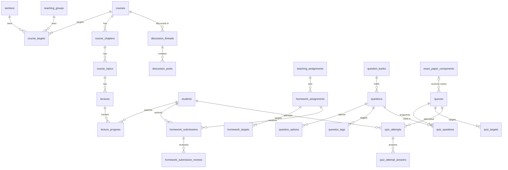
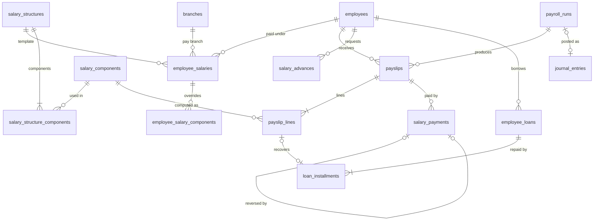
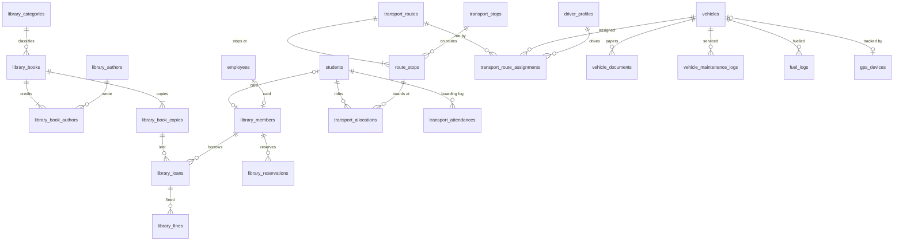
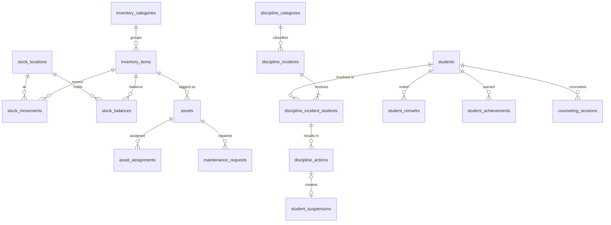

# Deliverable 7: Database Schema and Entity Relationship Diagrams
# Part 4 of 4: Learning, Homework, Assessment, Payroll, Library, Transport, Inventory, Discipline, Integrity, History, Partitioning, Migration Order, Seed Data

**Version:** 1.0 (draft for approval) | **Date:** 23 Nov 2026
**Conventions:** these follow Part 1 ([T], [T-], [B], [B-], [S], [L]). `FK->` is a composite tenant key, `FK=>` is a simple key, and `?` means NULL is allowed. Every table in this part except [L] tables also carries `uq_{alias}_org_id (organization_id, id)` from the Blueprint macro, so other tables can point at it with a composite key.

---

## 7.36 New Decisions

| ID | Decision |
|---|---|
| DEC-115 | **Payroll runs per pay branch.** Each employee has exactly one pay branch at a time (`employee_salaries.pay_branch_id`), even when they work in several branches (D4 shared employees). A regular payslip is unique per employee per month across the whole organization, so a shared teacher can never be paid twice. |
| DEC-116 | **Approved payslips never change.** Corrections go through a `supplementary` payroll run for the same month, or an `arrears` or `recovery` line in the next regular run. |
| DEC-117 | Employee bank account numbers and IBANs are encrypted, with a `*_last4` column for display, using the DEC-95 pattern. |
| DEC-118 | **Quiz questions are snapshotted at publish time.** `quiz_questions.question_snapshot` stores the stem, options and correct answers as they were when the quiz opened. Editing the question bank later never changes past attempts or scores. |
| DEC-119 | Homework submissions keep one row per attempt. The latest attempt carries a generated `current_marker`, so resubmissions keep the full history. |
| DEC-120 | **Stock is a ledger.** `stock_movements` is append-only and signed. `stock_balances` caches quantity per item and location, is updated in the same transaction under a row lock, and has a CHECK that blocks negative stock. The nightly integrity job compares it with the ledger. |
| DEC-121 | "One active at a time" rules use the generated `active_marker` / `open_marker` / `live_marker` pattern from DEC-92: one open loan per book copy, one active transport allocation per student, one active assignment per asset, one active vehicle per route, one in-progress quiz attempt per student per quiz. |
| DEC-122 | **Counseling notes are restricted.** They are encrypted at rest, excluded from global search, bulk exports and imports, and the audit log records only which fields changed, never the values. Only the counselor who wrote them and holders of the counseling notes permission from D5 can read them. |
| DEC-123 | **Partitioned tables have no foreign keys.** MySQL does not allow foreign keys on partitioned InnoDB tables or pointing at them. All [L] tables therefore use soft references, include the partition column in the primary key and in every unique key, and are checked by the nightly integrity job. |
| DEC-124 | **Fines reach people through their owning module.** Library fines for students become fee voucher lines through the `VoucherLineContributor` registry (D3). Fines and recoveries for employees become payslip deduction lines. Library and Transport never insert rows into fee or payroll tables themselves. |
| DEC-125 | `journal_entries.entry_type` gains `salary_payment`, `salary_advance` and `loan_disbursement`. `uq_jen_source` (DEC-110) covers them, so a payroll run, salary payment, advance or loan can be posted only once. |
| DEC-126 | A nightly `core:integrity:check` command fans out one job per organization. It recomputes every cache (`student_fee_accounts`, `stock_balances`, `leave_balances`, `employee_loans.outstanding_amount`), checks every soft reference resolves, and checks journal entries balance. Any mismatch raises a platform alert and an organization IT admin notification. It never auto-fixes money. |

---

## 7.37 Learning (LMS)

| Table | Columns | Keys |
|---|---|---|
| `courses` [B][S] alias `crs` | `academic_session_id`, `academic_class_id`, `subject_id`, `owner_employee_id`, `title`, `title_ur`?, `description`? (sanitized HTML), `cover_file_id`? FK->stored_files, `status` (`draft`, `published`, `archived`), `published_at`?, `copied_from_course_id`? (soft, may come from an earlier session) | `ix_crs_class (organization_id, branch_id, academic_session_id, academic_class_id, subject_id)` |
| `course_targets` [B-] alias `crt` (new) | `course_id`, `section_id`?, `teaching_group_id`?, `target_key` GENERATED | `ck_crt_target` (exactly one of section or teaching group), `uq_crt (organization_id, course_id, target_key)` |
| `course_chapters` [B-] alias `cch` | `course_id`, `title`, `title_ur`?, `sort_order`, `is_published` | `ix_cch (organization_id, course_id, sort_order)` |
| `course_topics` [B-] alias `ctp` | `course_chapter_id`, `title`, `sort_order`, `is_published` | `ix_ctp (organization_id, course_chapter_id, sort_order)` |
| `lectures` [B-] alias `lec` | `course_id` (copied for fast queries), `course_topic_id`, `title`, `lecture_type` (`video_url`, `video_file`, `document`, `rich_text`, `link`), `body`? (sanitized), `video_provider`? (`youtube`, `vimeo`), `video_url`?, `stored_file_id`?, `duration_seconds`?, `available_from`?, `allow_download`, `status` (`draft`, `published`, `hidden`), `sort_order` | `ix_lec_topic (organization_id, course_topic_id, sort_order)`, `ix_lec_course (organization_id, course_id, status)` |
| `lecture_progress` [B-] alias `lpr` | `lecture_id`, `student_id`, `first_viewed_at`, `last_viewed_at`, `watched_seconds`, `progress_percent` (0 to 100), `completed_at`? | `uq_lpr (organization_id, lecture_id, student_id)`, `ix_lpr_student (organization_id, student_id, last_viewed_at)`; CHECK progress_percent BETWEEN 0 AND 100 |
| `discussion_threads` [B] alias `dth` | `course_id`, `lecture_id`?, `title`, `created_by_user_id`, `is_pinned`, `is_locked`, `status` (`open`, `hidden`, `closed`), `last_post_at` | `ix_dth (organization_id, course_id, last_post_at)` |
| `discussion_posts` [B-] alias `dps` | `discussion_thread_id`, `parent_post_id`? (one level of replies), `author_user_id`, `body` (sanitized, max 5,000 characters), `edited_at`?, `hidden_at`?, `hidden_by`?, `hidden_reason`? | `ix_dps (organization_id, discussion_thread_id, created_at)` |
| `content_reports` [B] alias `crp` | `reportable_type` (morph alias: `discussion_post`, `lecture`, `message`), `reportable_id`, `reported_by_user_id`, `reason` (`abuse`, `spam`, `inappropriate`, `copyright`, `other`), `details`?, `status` (`open`, `actioned`, `dismissed`), `reviewed_by`?, `reviewed_at`?, `action_taken`? | `uq_crp (organization_id, reportable_type, reportable_id, reported_by_user_id)`, `ix_crp_status (organization_id, branch_id, status)` |

Rules carried from D2: a student sees a course only when one of its targets matches their current placement (section or teaching group). Progress rows are written by a throttled endpoint (at most once every 30 seconds per lecture per student).

---

## 7.38 Homework

| Table | Columns | Keys |
|---|---|---|
| `homework_assignments` [B] alias `hwa` | `academic_session_id`, `teaching_assignment_id`, `subject_id`, `title`, `instructions` (sanitized), `assigned_on`, `due_at`, `submission_mode` (`online`, `offline`, `none`), `max_marks`?, `allow_late`, `late_until`?, `status` (`draft`, `published`, `closed`), `published_at`?, `diary_entry_id`? FK->diary_entries (auto-created diary line) | `ix_hwa_due (organization_id, branch_id, due_at)`, `ix_hwa_ta (organization_id, teaching_assignment_id, assigned_on)`; CHECK late_until is NULL or later than due_at |
| `homework_targets` [B-] alias `hwt` | `homework_assignment_id`, `section_id`?, `teaching_group_id`?, `student_id`? (individual work), `target_key` GENERATED | `ck_hwt_target` (exactly one), `uq_hwt (organization_id, homework_assignment_id, target_key)` |
| `homework_submissions` [B-] alias `hws` | `homework_assignment_id`, `student_id`, `attempt_no`, `content`? (text answer), `submitted_at`?, `is_late`, `status` (`submitted`, `resubmit_requested`, `reviewed`, `excused`), `superseded_at`?, `current_marker` GENERATED (1 while `superseded_at` is NULL). Files go in `file_attachments` (collection `attachments`). | `uq_hws_attempt (organization_id, homework_assignment_id, student_id, attempt_no)`, `uq_hws_current (organization_id, homework_assignment_id, student_id, current_marker)` |
| `homework_submission_reviews` [B-] alias `hwr` | `homework_submission_id`, `reviewed_by_employee_id`, `marks`?, `grade`?, `feedback`?, `outcome` (`accepted`, `resubmit`), `reviewed_at` | `ix_hwr (organization_id, homework_submission_id)`; CHECK marks >= 0 |

A student who has not submitted has no row; the "not submitted" list is the target roster minus current submissions. Marks never exceed `max_marks` (checked in the review action).

---

## 7.39 Assessment

| Table | Columns | Keys |
|---|---|---|
| `question_banks` [T][S] alias `qbk` | `branch_id`? with `branch_key`, `subject_id`, `education_level_id`?, `name`, `owner_employee_id`, `sharing` (`private`, `department`, `branch`, `organization`), `is_active` | `ix_qbk (organization_id, branch_key, subject_id)` |
| `questions` [T][S] alias `qst` | `question_bank_id`, `question_type` (`mcq_single`, `mcq_multi`, `true_false`, `short_answer`, `fill_blank`, `numeric`, `long_answer`), `stem` (sanitized; supports Urdu and math markup), `stem_file_id`?, `language` (`en`, `ur`), `difficulty` (`easy`, `medium`, `hard`), `default_marks`, `accepted_answers` JSON? (short answer and fill in the blank), `numeric_answer` DECIMAL(18,6)?, `numeric_tolerance`?, `explanation`?, `chapter_ref`?, `version`, `status` (`draft`, `approved`, `retired`), `created_by`, `approved_by`? | `ix_qst_bank (organization_id, question_bank_id, status)`, `ix_qst_type (organization_id, question_bank_id, question_type, difficulty)` |
| `question_options` [T-] alias `qop` | `question_id`, `label` (A, B, C, D), `body`, `is_correct`, `sort_order` | `uq_qop (organization_id, question_id, sort_order)` |
| `question_tags` [T-] alias `qtg` | `question_id`, `tag` VARCHAR(50) | `uq_qtg (organization_id, question_id, tag)`, `ix_qtg_tag (organization_id, tag)` |
| `quizzes` [B] alias `quz` | `academic_session_id`, `teaching_assignment_id`?, `subject_id`, `title`, `instructions`?, `quiz_type` (`practice`, `graded`, `exam_linked`), `exam_paper_component_id`? FK->exam_paper_components (pushes marks into Examination), `opens_at`, `closes_at`, `time_limit_minutes`?, `max_attempts`, `scoring_policy` (`highest`, `latest`, `first`), `shuffle_questions`, `shuffle_options`, `show_results` (`immediately`, `after_close`, `manual`), `total_marks`, `pass_marks`?, `status` (`draft`, `scheduled`, `open`, `closed`, `results_released`, `archived`), `published_at`?, `published_by`? | `ix_quz (organization_id, branch_id, opens_at)`; CHECK closes_at > opens_at, max_attempts >= 1 |
| `quiz_questions` [B-] alias `qqn` | `quiz_id`, `question_id`, `question_version`, `question_snapshot` JSON (DEC-118), `marks`, `negative_marks`, `sort_order` | `uq_qqn (organization_id, quiz_id, question_id)` |
| `quiz_targets` [B-] alias `qtt` | `quiz_id`, `section_id`?, `teaching_group_id`?, `student_id`?, `target_key` GENERATED | `ck_qtt_target` (exactly one), `uq_qtt (organization_id, quiz_id, target_key)` |
| `quiz_attempts` [B-] alias `qat` | `quiz_id`, `student_id`, `attempt_no`, `started_at`, `deadline_at` (server-set), `submitted_at`?, `submit_type`? (`manual`, `auto_timeout`, `force_closed`), `status` (`in_progress`, `submitted`, `graded`, `voided`), `score`?, `needs_manual_grading`, `question_order` JSON, `ip_address`?, `graded_by`?, `graded_at`?, `void_reason`?, `open_marker` GENERATED (1 while `in_progress`) | `uq_qat (organization_id, quiz_id, student_id, attempt_no)`, `uq_qat_open (organization_id, quiz_id, student_id, open_marker)` |
| `quiz_attempt_answers` [B-] alias `qaa` | `quiz_attempt_id`, `quiz_question_id`, `selected_option_labels` JSON?, `answer_text`?, `answer_numeric`?, `is_correct`?, `marks_awarded`?, `auto_graded`, `graded_by`?, `feedback`?, `answered_at` | `uq_qaa (organization_id, quiz_attempt_id, quiz_question_id)` |

Answers saved after `deadline_at` plus a 30-second network grace are rejected by the server. When an `exam_linked` quiz releases results, the chosen score per student is written to `mark_entries` through Examination's public action, never directly.

---

## 7.40 Payroll

### Setup

| Table | Columns | Keys |
|---|---|---|
| `salary_components` [T][S] alias `slc` | `code`, `name`, `name_ur`?, `component_type` (`earning`, `deduction`, `employer_contribution`), `calculation` (`fixed`, `percent_of_basic`, `percent_of_gross`, `attendance_based`, `slab`, `formula_key`), `default_value`?, `formula_key`? (a registered calculator, not free text), `is_taxable`, `is_system`, `system_role`? (`income_tax`, `eobi_employee`, `eobi_employer`, `social_security`, `absence_deduction`, `late_deduction`, `loan_recovery`, `advance_recovery`, `arrears`, `library_fine`), `ledger_account_id` FK->accounts, `sort_order`, `is_active` | `uq_slc_code (organization_id, code)`, `uq_slc_role (organization_id, system_role)` |
| `payroll_tax_slabs` alias `ptx` (new) | `organization_id`? (NULL for the platform default), `organization_key` GENERATED, `tax_year` (e.g. `2026-27`), `min_income`, `max_income`?, `fixed_tax`, `rate_percent`, `excess_over`, `effective_from` | `uq_ptx (organization_key, tax_year, min_income)` |
| `salary_structures` [T][S] alias `sst` | `institution_id`?, `designation_id`?, `name`, `effective_from`, `is_active` | `ix_sst (organization_id, institution_id)` |
| `salary_structure_components` [T-] alias `ssc` | `salary_structure_id`, `salary_component_id`, `amount_type` (`fixed`, `percent_of_basic`, `percent_of_gross`), `value`, `sort_order` | `uq_ssc (organization_id, salary_structure_id, salary_component_id)` |
| `employee_salaries` [T] alias `esl` | `employee_id`, `salary_structure_id`, `pay_branch_id` FK->branches (DEC-115), `employee_salary_history_id`? FK->employee_salary_histories (HR, DEC-103), `basic_amount`, `effective_from`, `effective_to`?, `payment_method` (`bank_transfer`, `cash`, `cheque`), `bank_name`?, `bank_account_no_encrypted`?, `bank_account_last4`?, `iban_encrypted`?, `eobi_number`?, `social_security_number`?, `ntn`?, `is_tax_exempt`, `status`, `active_marker` GENERATED (1 while `effective_to` is NULL) | `uq_esl_active (organization_id, employee_id, active_marker)`, `ix_esl_branch (organization_id, pay_branch_id)` |
| `employee_salary_components` [T-] alias `esc` (new) | `employee_salary_id`, `salary_component_id`, `amount_type`, `value`, `starts_month`?, `ends_month`? | `uq_esc (organization_id, employee_salary_id, salary_component_id)` |

### Runs and payslips

| Table | Columns | Keys |
|---|---|---|
| `payroll_runs` [B] alias `prr` | `run_no`, `pay_month` (first day of month), `run_type` (`regular`, `supplementary`, `final_settlement`), `attendance_from`, `attendance_to`, `status` (`draft`, `calculating`, `calculated`, `under_review`, `approved`, `posted`, `paid`, `cancelled`), `employee_count`, `gross_total`, `deduction_total`, `net_total`, `employer_contribution_total`, `calculated_at`?, `approval_request_id`?, `approved_at`?, `journal_entry_id`? FK->journal_entries, `bulk_operation_id`?, `regular_marker` GENERATED (1 when `run_type = 'regular'` and not cancelled) | `uq_prr_no (organization_id, run_no)`, `uq_prr_regular (organization_id, branch_id, pay_month, regular_marker)` |
| `payslips` [B-] alias `psl` | `payroll_run_id`, `employee_id`, `employee_salary_id`, `payslip_no`, `pay_month`, `run_type` (copied), snapshot columns `employee_name`, `designation_name`, `department_name`, `working_days`, `present_days`, `paid_leave_days`, `unpaid_leave_days`, `absent_days`, `late_count`, `gross_earnings`, `total_deductions`, `net_pay`, `employer_contributions`, `payment_method`, `bank_account_last4`?, `status` (`draft`, `final`, `held`, `paid`), `held_reason`?, `regular_marker` GENERATED (1 when regular and the run is not cancelled; cleared in the cancel action) | `uq_psl_no (organization_id, payslip_no)`, `uq_psl_regular (organization_id, employee_id, pay_month, regular_marker)` (DEC-115), `uq_psl_run (organization_id, payroll_run_id, employee_id)`; CHECK net_pay = gross_earnings - total_deductions, net_pay >= 0 |
| `payslip_lines` [B-] alias `pll` | `payslip_id`, `salary_component_id`, `line_type` (`earning`, `deduction`, `employer_contribution`), `description`, `amount` (>= 0), `calculation_basis` JSON?, `source_ref_type` / `source_ref_id`? (soft: `loan_installment`, `salary_advance`, `library_fine`), `sort_order` | `ix_pll (organization_id, payslip_id)`, `ix_pll_source (organization_id, source_ref_type, source_ref_id)` |

### Advances, loans and payments

| Table | Columns | Keys |
|---|---|---|
| `salary_advances` [B] alias `sad` | `advance_no`, `employee_id`, `amount`, `requested_on`, `reason`, `recovery_months`, `recovery_start_month`, `monthly_recovery_amount`, `approval_request_id`, `status` (`requested`, `approved`, `rejected`, `disbursed`, `recovering`, `recovered`, `cancelled`), `disbursed_on`?, `journal_entry_id`?, `recovered_amount` | `uq_sad_no (organization_id, advance_no)`, `ix_sad_emp (organization_id, employee_id, status)`; CHECK recovered_amount <= amount |
| `employee_loans` [B] alias `eln` | `loan_no`, `employee_id`, `principal_amount`, `installment_amount`, `installment_count`, `start_month`, `purpose`, `approval_request_id`, `status` (`requested`, `approved`, `rejected`, `disbursed`, `recovering`, `closed`, `written_off`), `disbursed_on`?, `journal_entry_id`?, `outstanding_amount` (cache, DEC-126) | `uq_eln_no (organization_id, loan_no)`, `ix_eln_emp (organization_id, employee_id, status)` |
| `loan_installments` [B-] alias `lin` | `employee_loan_id`, `installment_no`, `due_month`, `amount`, `status` (`due`, `recovered`, `deferred`, `waived`), `payslip_line_id`? FK->payslip_lines, `recovered_on`? | `uq_lin_no (organization_id, employee_loan_id, installment_no)`, `uq_lin_month (organization_id, employee_loan_id, due_month)` |
| `salary_payments` [B] alias `spy` | `payment_no`, `payroll_run_id`, `payslip_id`, `payment_method`, `amount` (negative only for reversals), `paid_on`, `bank_account_id` FK->bank_accounts, `bank_reference`?, `export_job_id`? FK->export_jobs (bank upload file), `status` (`posted`, `reversed`), `reversal_of_payment_id`?, `journal_entry_id`?, `live_marker` GENERATED (1 when `posted` and positive) | `ck_spy_sign` (same rule as `ck_fpy_sign`), `uq_spy_no (organization_id, payment_no)`, `uq_spy_payslip (organization_id, payslip_id, live_marker)`, `uq_spy_reversal (organization_id, reversal_of_payment_id)` |

Attendance figures on a payslip are read from `staff_attendances` for the run's attendance window after the staff attendance period lock for that month. A run cannot be calculated while that period is unlocked.

---

## 7.41 Library

| Table | Columns | Keys |
|---|---|---|
| `library_categories` [T][S] alias `lct` | `parent_id`?, `code` (e.g. Dewey `500`), `name`, `name_ur`?, `path`, `depth` | `uq_lct_code (organization_id, code)` |
| `library_authors` [T] alias `lau` | `name`, `name_ur`? | `ix_lau_name (organization_id, name)` |
| `library_publishers` [T] alias `lpb` | `name`, `city`? | `ix_lpb_name (organization_id, name)` |
| `library_books` [B][S] alias `lbk` | `title`, `title_ur`?, `subtitle`?, `isbn`? VARCHAR(17), `edition`?, `publication_year`?, `language`, `library_category_id`?, `library_publisher_id`?, `call_number`?, `pages`?, `subject_id`?, `cover_file_id`?, `is_reference_only`, `is_active` | `uq_lbk_isbn (organization_id, branch_id, isbn)` (NULL means no ISBN, DEC-99), `ix_lbk_title (organization_id, branch_id, title)`, FULLTEXT `ft_lbk (title, subtitle)` |
| `library_book_authors` [T-] alias `lba` (new) | `library_book_id`, `library_author_id`, `role` (`author`, `editor`, `translator`), `sort_order` | `uq_lba (organization_id, library_book_id, library_author_id, role)` |
| `library_book_copies` [B-] alias `lbc` | `library_book_id`, `accession_no`, `barcode`, `rack_location`?, `acquired_on`?, `acquisition_source` (`purchase`, `donation`, `grant`), `price`?, `purchase_bill_line_id`? FK->purchase_bill_lines, `condition` (`new`, `good`, `worn`, `damaged`), `status` (`available`, `on_loan`, `reserved`, `repair`, `lost`, `withdrawn`), `withdrawn_on`?, `withdrawn_reason`? | `uq_lbc_accession (organization_id, branch_id, accession_no)`, `uq_lbc_barcode (organization_id, branch_id, barcode)` |
| `library_members` [B] alias `lmb` | `member_type` (`student`, `employee`), `student_id`?, `employee_id`?, `card_no`, `max_loans`, `loan_days`, `valid_from`, `valid_to`?, `status` (`active`, `suspended`, `expired`) | `ck_lmb_person` (exactly one, matching `member_type`), `uq_lmb_card (organization_id, branch_id, card_no)`, `uq_lmb_student (organization_id, branch_id, student_id)`, `uq_lmb_employee (organization_id, branch_id, employee_id)` |
| `library_loans` [B] alias `lln` | `library_book_copy_id`, `library_member_id`, `issued_at`, `due_on`, `returned_at`?, `renew_count`, `issued_by`, `returned_to`?, `return_condition`?, `status` (`on_loan`, `returned`, `lost`), `open_marker` GENERATED (1 while `on_loan`) | `uq_lln_open (organization_id, library_book_copy_id, open_marker)`, `ix_lln_member (organization_id, library_member_id, status)`, `ix_lln_due (organization_id, branch_id, due_on, status)` |
| `library_reservations` [B] alias `lrs` (new) | `library_book_id`, `library_member_id`, `reserved_at`, `ready_at`?, `expires_at`?, `status` (`waiting`, `ready`, `fulfilled`, `cancelled`, `expired`), `live_marker` GENERATED (1 while `waiting` or `ready`) | `uq_lrs_live (organization_id, library_book_id, library_member_id, live_marker)`, `ix_lrs_queue (organization_id, library_book_id, status, reserved_at)` |
| `library_fines` [B] alias `lfn` | `library_loan_id`, `library_member_id`, `fine_type` (`overdue`, `lost`, `damage`), `days_overdue`?, `amount`, `waived_amount`, `status` (`pending`, `billed`, `paid`, `waived`), `fee_voucher_item_id`? FK->fee_voucher_items (students), `payslip_line_id`? FK->payslip_lines (employees), `waiver_approval_request_id`? | `uq_lfn (organization_id, library_loan_id, fine_type)`, `ix_lfn_status (organization_id, branch_id, status)`; CHECK waived_amount <= amount |

Overdue fine rates live in settings (`library.fine_per_day`, `library.max_fine_per_loan`), never in code. A student whose loans are open cannot get a clearance certificate (ClearanceCheck registry, D3).

---

## 7.42 Transport

| Table | Columns | Keys |
|---|---|---|
| `vehicles` [B][S] alias `veh` | `registration_no`, `vehicle_type` (`bus`, `coaster`, `van`, `car`), `make`?, `model`?, `model_year`?, `seating_capacity`, `ownership` (`owned`, `leased`, `contracted`), `vendor_id`? FK->vendors (contractor), `status` (`active`, `workshop`, `retired`) | `uq_veh_reg (organization_id, registration_no)` |
| `vehicle_documents` [B-] alias `vdc` | `vehicle_id`, `document_type` (`registration`, `fitness`, `insurance`, `route_permit`, `token_tax`), `document_no`?, `issued_on`?, `expires_on`?, `stored_file_id`?, `reminder_sent_at`? | `ix_vdc_expiry (organization_id, expires_on)` |
| `driver_profiles` [B] alias `drv` | `employee_id`, `license_no`, `license_category`, `license_expires_on`, `medical_fit_until`?, `police_verified_on`?, `status` | `uq_drv_emp (organization_id, employee_id)`, `ix_drv_expiry (organization_id, license_expires_on)` |
| `transport_routes` [B][S] alias `trt` | `code`, `name`, `shift_id`?, `status` (`active`, `inactive`) | `uq_trt_code (organization_id, branch_id, code)` |
| `transport_stops` [B][S] alias `tsp` | `name`, `name_ur`?, `area`?, `landmark`?, `latitude` DECIMAL(10,7)?, `longitude` DECIMAL(10,7)? | `ix_tsp (organization_id, branch_id, name)` |
| `route_stops` [B-] alias `rst` | `transport_route_id`, `transport_stop_id`, `sequence_no`, `pickup_time`?, `drop_time`?, `monthly_fee`, `is_active` | `uq_rst (organization_id, transport_route_id, transport_stop_id)`, `uq_rst_seq (organization_id, transport_route_id, sequence_no)`; CHECK monthly_fee >= 0 |
| `transport_route_assignments` [B] alias `tra` (new) | `transport_route_id`, `vehicle_id`, `driver_profile_id`, `attendant_employee_id`?, `starts_on`, `ends_on`?, `active_marker` GENERATED | `uq_tra_route (organization_id, transport_route_id, active_marker)`, `uq_tra_vehicle (organization_id, vehicle_id, active_marker)`, `uq_tra_driver (organization_id, driver_profile_id, active_marker)` |
| `transport_allocations` [B] alias `tal` | `student_id`, `academic_session_id`, `transport_route_id`, `route_stop_id`, `direction` (`both`, `pickup_only`, `drop_only`), `starts_on`, `ends_on`?, `monthly_fee` (snapshot), `fee_head_id` FK->fee_heads, `status` (`active`, `suspended`, `ended`), `ended_reason`?, `active_marker` GENERATED (1 while `active` or `suspended`) | `uq_tal_active (organization_id, student_id, active_marker)`, `ix_tal_route (organization_id, transport_route_id, status)` |
| `transport_attendances` [B] alias `ttd` | `transport_route_id`, `student_id`, `trip_date`, `trip_type` (`pickup`, `drop`), `status` (`boarded`, `not_boarded`, `dropped`), `recorded_at`, `recorded_by_user_id`, `source` (`app`, `manual`) | `uq_ttd (organization_id, student_id, trip_date, trip_type)`, `ix_ttd_route (organization_id, transport_route_id, trip_date)` |
| `vehicle_maintenance_logs` [B-] alias `vml` | `vehicle_id`, `maintenance_type` (`service`, `repair`, `tyre`, `inspection`), `description`, `service_date`, `odometer_km`?, `cost`, `vendor_id`?, `expense_voucher_id`? FK->expense_vouchers, `next_due_on`?, `next_due_km`? | `ix_vml (organization_id, vehicle_id, service_date)` |
| `fuel_logs` [B-] alias `fue` | `vehicle_id`, `filled_on`, `fuel_type`, `litres` DECIMAL(8,2), `amount`, `odometer_km`, `receipt_file_id`?, `filled_by`?, `expense_voucher_id`? | `ix_fue (organization_id, vehicle_id, filled_on)`; CHECK litres > 0 |
| `gps_devices` [B] alias `gps` | `vehicle_id`?, `provider`, `device_identifier`, `sim_number`?, `credentials_encrypted`?, `last_seen_at`?, `last_latitude`?, `last_longitude`?, `is_active` | `uq_gps_device (provider, device_identifier)` globally, like attendance device serials |
| `gps_positions` [L] alias `gpp` (new) | `organization_id`, `gps_device_id`, `vehicle_id`?, `recorded_at` (partition column), `latitude`, `longitude`, `speed_kmh`?, `heading`?, `created_at` | PK `(id, recorded_at)`, `ix_gpp (organization_id, vehicle_id, recorded_at)` |

Seat capacity is enforced in the allocation action: it locks the active `transport_route_assignments` row and counts active allocations before inserting. The monthly transport charge reaches the fee voucher through `VoucherLineContributor`, with `fee_voucher_items.source_ref_type = 'transport_allocation'`.

---

## 7.43 Inventory

| Table | Columns | Keys |
|---|---|---|
| `inventory_categories` [T][S] alias `ict` | `parent_id`?, `name`, `category_kind` (`consumable`, `asset`), `useful_life_months`?, `path` | `uq_ict (organization_id, parent_key, name)` with `parent_key` GENERATED |
| `inventory_items` [T][S] alias `iit` | `code`, `name`, `name_ur`?, `inventory_category_id`, `unit` (`pcs`, `box`, `ream`, `litre`, `kg`, `set`), `item_kind` (`consumable`, `asset`), `reorder_level`?, `expense_account_id`?, `asset_account_id`?, `is_active` | `uq_iit_code (organization_id, code)` |
| `stock_locations` [B][S] alias `stl` | `name`, `location_type` (`store`, `lab`, `office`, `classroom`, `library`), `room_id`?, `custodian_employee_id`?, `is_active` | `uq_stl (organization_id, branch_id, name)` |
| `stock_movements` [B] alias `smv` (append-only) | `movement_no`, `inventory_item_id`, `stock_location_id`, `movement_type` (`opening`, `purchase_receipt`, `issue`, `return`, `transfer_out`, `transfer_in`, `adjustment`, `write_off`), `quantity` DECIMAL(12,3) signed, `unit_cost`?, `total_cost`?, `transfer_group_ulid`? (pairs a transfer out with its transfer in), `purchase_bill_line_id`?, `issued_to_employee_id`?, `issued_to_section_id`?, `reason`?, `approval_request_id`? (required for `adjustment` and `write_off`), `moved_at`, `recorded_by` | `uq_smv_no (organization_id, movement_no)`, `ix_smv_item (organization_id, inventory_item_id, stock_location_id, moved_at)`; CHECK quantity <> 0 |
| `stock_balances` [B] alias `sbl` (new, DEC-120) | `inventory_item_id`, `stock_location_id`, `quantity`, `average_unit_cost`?, `last_movement_at`, `recalculated_at` | `uq_sbl (organization_id, inventory_item_id, stock_location_id)`; CHECK quantity >= 0 |
| `assets` [B][S] alias `ast` | `asset_tag`, `inventory_item_id`, `name`, `serial_no`?, `purchase_date`?, `purchase_cost`?, `purchase_bill_line_id`?, `vendor_id`?, `warranty_until`?, `stock_location_id`?, `useful_life_months`?, `salvage_value`?, `condition`, `status` (`in_store`, `assigned`, `under_repair`, `disposed`, `lost`), `disposed_on`?, `disposal_method`?, `disposal_value`?, `disposal_approval_request_id`? | `uq_ast_tag (organization_id, asset_tag)`, `ix_ast_status (organization_id, branch_id, status)` |
| `asset_assignments` [B-] alias `asa` | `asset_id`, `employee_id`?, `room_id`?, `assigned_on`, `expected_return_on`?, `returned_on`?, `condition_out`, `condition_in`?, `assigned_by`, `active_marker` GENERATED | `ck_asa_target` (exactly one of employee or room), `uq_asa_active (organization_id, asset_id, active_marker)` |
| `maintenance_requests` [B] alias `mrq` | `request_no`, `asset_id`?, `room_id`?, `category` (`electrical`, `plumbing`, `it`, `furniture`, `civil`, `other`), `description`, `priority` (`low`, `normal`, `high`, `urgent`), `requested_by_user_id`, `assigned_to_user_id`?, `status` (`open`, `assigned`, `in_progress`, `resolved`, `closed`, `rejected`), `resolved_at`?, `resolution`?, `cost`?, `expense_voucher_id`? | `uq_mrq_no (organization_id, request_no)`, `ix_mrq_status (organization_id, branch_id, status)` |

A transfer writes two movements in one transaction: `transfer_out` at the source (negative) and `transfer_in` at the target (positive), sharing a `transfer_group_ulid`. Stock items are expensed when purchased through `purchase_bills`; stock issues do not post to the ledger (A-65).

---

## 7.44 Discipline

| Table | Columns | Keys |
|---|---|---|
| `discipline_categories` [T][S] alias `dct` (new) | `code`, `name`, `name_ur`?, `severity` (`minor`, `moderate`, `major`, `critical`), `default_points`?, `requires_guardian_notice`, `is_active` | `uq_dct_code (organization_id, code)` |
| `discipline_incidents` [B] alias `din` | `incident_no`, `occurred_at`, `location`?, `discipline_category_id`, `description`, `reported_by_user_id`, `status` (`reported`, `under_review`, `action_decided`, `closed`, `dismissed`), `reviewed_by`?, `closed_at`? | `uq_din_no (organization_id, incident_no)`, `ix_din (organization_id, branch_id, occurred_at)` |
| `discipline_incident_students` [B-] alias `dis` | `discipline_incident_id`, `student_id`, `student_enrollment_id`, `involvement` (`offender`, `victim`, `witness`), `statement`?, `guardian_notified_at`? | `uq_dis (organization_id, discipline_incident_id, student_id)`, `ix_dis_student (organization_id, student_id)` |
| `discipline_actions` [B] alias `dac` | `discipline_incident_student_id`, `action_type` (`verbal_warning`, `written_warning`, `detention`, `guardian_meeting`, `community_service`, `suspension`, `expulsion_recommendation`), `description`?, `starts_on`?, `ends_on`?, `student_suspension_id`? FK->student_suspensions, `approval_request_id`?, `decided_by`, `decided_at`, `status` (`decided`, `served`, `revoked`), `revoked_reason`? | `ix_dac (organization_id, discipline_incident_student_id)` |
| `student_remarks` [B] alias `srm` | `student_id`, `student_enrollment_id`, `remark_type` (`positive`, `concern`, `general`), `subject_id`?, `body`, `visibility` (`internal`, `guardian`), `created_by_user_id` | `ix_srm (organization_id, student_id, created_at)` |
| `student_achievements` [B] alias `sac` | `student_id`, `achievement_type` (`academic`, `sports`, `arts`, `debate`, `community`, `other`), `title`, `level` (`school`, `inter_school`, `district`, `provincial`, `national`, `international`), `position`?, `awarded_on`, `description`?, `certificate_file_id`?, `show_on_portal`, `recorded_by` | `ix_sac (organization_id, student_id, awarded_on)` |
| `counseling_sessions` [B] alias `cns` | `student_id`, `counselor_employee_id`, `session_date`, `session_type` (`individual`, `group`, `guardian`), `referral_source` (`self`, `teacher`, `guardian`, `discipline`), `discipline_incident_id`?, `notes_encrypted` TEXT, `follow_up_on`?, `confidentiality` (`standard`, `restricted`), `status` (`scheduled`, `held`, `cancelled`) | `ix_cns (organization_id, student_id, session_date)`, `ix_cns_counselor (organization_id, counselor_employee_id, session_date)` |

A suspension decided here creates the `student_suspensions` row through Student's public action, which also writes the timeline event and blocks attendance marking for those days with code `SU`. Every action and achievement writes a `student_timeline_events` row; counseling sessions write a timeline row with no content ("Counseling session held").

---

## 7.45 ER Diagrams

### Learning, Homework, Assessment

### Payroll

### Library and Transport

### Inventory and Discipline

---

## 7.46 How the Schema Prevents Duplicates

Every rule below is enforced by the database. Application checks give friendly messages first, but the unique key is the final guard, so two requests racing each other cannot both succeed.

### Duplicate students, guardians and enrollments

| Risk | Guard |
|---|---|
| Same child admitted twice | Unique B-Form lookup hash per organization on `students` (DEC-95, DEC-99). Admission shows a "possible match" panel on name, father name and date of birth before the key is ever hit. |
| Same guardian created twice | `uq_gdn_cnic (organization_id, cnic_lookup_hash)` |
| Student enrolled in two sections or two branches at once | `uq_sen_active` on `student_enrollments` allows one active enrollment per student across the organization (DEC-100) |
| Two registration or GR numbers handed out | Numbers come from `numbering_sequences` under a row lock, and their separate tables (DEC-102) have unique keys per scope |
| Same subject chosen twice | Unique student, enrollment and subject key on `student_subjects` |
| Two primary guardians | `uq_gst_primary (organization_id, student_id, primary_marker)` |
| A child in two families | `uq_fms_student (organization_id, student_id)` |

### Duplicate attendance

| Risk | Guard |
|---|---|
| Two daily records for one student | `uq_sat (organization_id, student_id, attendance_date)` |
| Two daily records for one employee | Unique employee and date key on `staff_attendances` |
| Two period records | `uq_spa (organization_id, student_id, attendance_date, period_no)` |
| Device resends the same punch | `uq_apn (organization_id, device_key, identity_key, punched_at)` plus `webhook_receipts` dedupe on `ix_whr_dedupe` |
| Two sources mark the same day | One row per day; precedence (DEC-25) decides which source wins, and every change becomes a revision row (DEC-105) |
| Two boarding records per trip | `uq_ttd (organization_id, student_id, trip_date, trip_type)` |

### Duplicate money

| Risk | Guard |
|---|---|
| Cashier double-clicks Save | Idempotency token on the form, `uq_idk_key` on `idempotency_keys` and `uq_fpy_idem` on `fee_payments` |
| Gateway callback arrives twice, or callback and status poll race | `uq_pgt_ref`, `uq_pgt_provider` and `uq_fpy_gateway`. The webhook is stored first in `webhook_receipts`, and the processing job confirms the payment with the provider's verify API before posting (D3, DEC-42). |
| Two payments settle one voucher beyond its total | The allocation action locks the voucher row (`SELECT ... FOR UPDATE`), and the CHECK `paid_amount <= net_amount` rejects overpayment. Any excess goes to `fee_advance_movements`. |
| Same month charged twice, for example on an individual and a family voucher | `uq_fvi_recurring (organization_id, student_id, fee_month, fee_head_id, recurring_marker)` (DEC-111) |
| A payment reversed twice | `uq_fpy_reversal` and `uq_spy_reversal` |
| A voucher, payment, payroll run or refund posted to the books twice | `uq_jen_source (organization_id, source_type, source_id, entry_type)` (DEC-110, DEC-125) |
| Two open cashier sessions | `uq_csn_open` |
| An employee paid twice in a month | `uq_psl_regular` (DEC-115), `uq_prr_regular` and `uq_spy_payslip` |
| A loan installment recovered twice | `uq_lin_month` and `loan_installments.payslip_line_id` |
| Exam entry fee billed twice | `uq_xen` with `live_marker`, plus `external_exam_entries.fee_voucher_item_id` |
| Receipt number reused | `uq_fpy_receipt (organization_id, branch_id, receipt_no)` |

### Duplicate academic and operational records

| Risk | Guard |
|---|---|
| Two marks for one student, paper and component | `uq_mke` |
| Two live result versions for one class and scope | `uq_rbt_current` |
| Two active timetables | `uq_ttb_active` |
| Teacher or room booked twice in a slot | `uq_tte_teacher`, `uq_tte_room` |
| Same copy lent twice | `uq_lln_open` |
| Student on two routes | `uq_tal_active` |
| Asset with two holders | `uq_asa_active` |
| Two quiz attempts open at once | `uq_qat_open` |
| Two current homework submissions | `uq_hws_current` |

---

## 7.47 How the Schema Prevents Cross-Tenant Access

Isolation works in layers. D4 4.15 lists all 22; these are the ones the schema itself carries.

| Layer | How it works |
|---|---|
| Tenant column everywhere | Every tenant table has `organization_id NOT NULL` (except a handful of catalog tables where NULL means platform default, each with a generated `organization_key`). An arch test fails the build if a tenant model's table lacks it. |
| Composite foreign keys | A child row points at `(organization_id, parent_id)`, not just `parent_id` (DEC-43). The database refuses a row in organization A that references a parent in organization B, even if application code has a bug. |
| Every parent exposes `(organization_id, id)` | The Blueprint macro adds `uq_{alias}_org_id` to every tenant table so composite keys can point at it. |
| Unique keys start with `organization_id` | Two schools can both have receipt `R-0001` or GR `1024`. A lookup by number can never return another tenant's row because the number is only unique inside one organization. |
| Global scopes, fail closed | `OrganizationScope` and `AllowedBranchesScope` (DEC-46) apply to every tenant model. Without a resolved tenant, queries throw `MissingTenantContext` (DEC-45) instead of returning everything. |
| Public identifiers | URLs use ULIDs. Route model binding resolves through the scopes, so another tenant's ULID returns 404, not 403 (DEC-27). |
| Soft references validated | Every soft reference (DEC-108, DEC-123) is written by an action that loads the target through scoped models first. The nightly integrity job (DEC-126) checks that every soft reference points at a row in the same organization. |
| Jobs and commands | Jobs carry the organization id and run through `TenantAware` middleware. Scheduled commands fan out one job per organization. |
| Files | Storage paths start with the organization ULID, and every download goes through a signed, permission-checked route that loads `stored_files` through the scope. |
| Global unique exceptions | Only hostnames (`organization_domains.domain`), attendance device serials and GPS device identifiers are globally unique. Each resolves to exactly one organization before any tenant data is touched. |
| Tests | Every feature test file includes the two-tenant fixture: it creates organization B data and asserts organization A's user cannot list, view, update, export or guess it (D4 4.24). |

---

## 7.48 Historical Data Handling

Rule from the brief: historical records are never destroyed. The schema uses eight patterns.

| Pattern | Used by | What it means |
|---|---|---|
| Append-only logs [L] | `audit_logs`, `login_events`, `attendance_punches`, `webhook_receipts`, `student_timeline_events`, `device_sync_logs`, `gps_positions` | Insert only. No updates, no deletes except partition archiving (7.50). |
| Revision tables | `student_attendance_revisions`, `staff_attendance_revisions`, `mark_entry_revisions` | The live row holds the current value; every change adds a numbered revision with who, when and why. |
| Effective dating with markers | `section_class_teacher_histories`, `guardian_students`, `department_heads`, `employee_branch_assignments`, `employee_salary_histories`, `employee_salaries`, `transport_route_assignments`, `transport_allocations`, `asset_assignments`, `device_enrollments` | A new period closes the old row (`ends_on` / `unlinked_on`) instead of editing it. The generated marker keeps only one row active. |
| Supersession | `result_batches`, `fee_vouchers` (`superseded`), `external_exam_results`, `predicted_grades`, `homework_submissions`, `timetables` (`archived`) | A new version replaces the old as current. The old one stays readable and linked through `superseded_by_id` or a cleared marker. |
| Reversal rows | `fee_payments`, `salary_payments`, `journal_entries` | Money is never edited. A negative or reversing row points at the original (DEC-113). |
| Snapshots | `fee_vouchers` amounts, `fee_structures.version`, `payslips` names and attendance counts, `quiz_questions.question_snapshot`, `transport_allocations.monthly_fee`, `student_results` with the rule and scheme used | The document shows what was true when it was issued, even if master data changes later. |
| Status instead of delete | All transactional tables | Transactions are cancelled, voided, withdrawn or revoked, never deleted. A draft that was never submitted and has no children may be hard deleted by its creator. |
| Soft delete [S] | Master data only (classes, subjects, fee heads, routes, books, items) | Deactivated records stay referenced by history. A master record with transactions can be deactivated but never hard deleted. |

**Freezing the past:** `period_locks` stop changes to closed months for attendance, fees, accounting, examination and payroll. `fiscal_years.status = closed` stops postings. A closed academic session (D6) makes its enrollments, attendance, marks and results read-only. Unlocking needs an approval and relocks automatically (`relock_due_at`).

**Personal data:** applicants who never enrolled are anonymized after a configurable period (default 2 years) by replacing names, contacts and CNIC data with placeholders while keeping counts for reports. Enrolled students' records are kept permanently because certificates and verification depend on them.

---

## 7.49 Cardinality Summary

| Relationship | Cardinality |
|---|---|
| organization to institutions to branches | 1 to many to many |
| branch to academic sessions | per institution and track: many, one active (DEC-79) |
| academic class to sections | 1 to many |
| student to enrollments | 1 to many over time, one active (DEC-100) |
| enrollment to section placement | 1 to 1 (DEC-68) |
| student to guardians | many to many through `guardian_students`, exactly one primary |
| student to family | many to 0 or 1 |
| student to daily attendance | 1 to at most one per date |
| section to class teacher | 1 to at most one active (DEC-75) |
| teaching assignment to target | exactly one section or one teaching group |
| employee to branches | many to many, one primary and one pay branch |
| voucher to items | 1 to 1 or more |
| payment to allocations | 1 to 0 or more; voucher to allocations 1 to 0 or more |
| payment to reversal | 1 to 0 or 1 |
| journal entry to lines | 1 to 2 or more, balanced |
| exam to papers to components | 1 to 1 or more to 1 or more |
| component to mark entry per student | at most 1 |
| class and scope to current result batch | at most 1 |
| quiz to attempts per student | 1 to at most `max_attempts`, one open |
| homework to current submission per student | at most 1 |
| employee to payslip per month (regular) | at most 1 |
| loan to installments | 1 to 1 or more, one per month |
| book to copies | 1 to 1 or more; copy to open loan at most 1 |
| route to active vehicle | at most 1; vehicle to active route at most 1 |
| student to active transport allocation | at most 1 |
| asset to active holder | at most 1 |
| item and location to balance row | exactly 1 once stock exists |
| incident to students | 1 to 1 or more |

---

## 7.50 Partitioning Plan

All [L] tables are partitioned from the first migration. They are empty at launch, so there is no later conversion. Every one follows DEC-123: no foreign keys, partition column in the primary key and every unique key.

| Table | Partition column | Scheme | Hot retention (default) | After retention |
|---|---|---|---|---|
| `audit_logs` | `created_at` | RANGE COLUMNS, monthly | 24 months | Archived, kept 10 years |
| `login_events` | `created_at` | monthly | 12 months | Archived, kept 3 years |
| `webhook_receipts` | `created_at` | monthly | 12 months | Archived, kept 6 years (payment evidence) |
| `attendance_punches` | `punched_at` | monthly | 13 months | Archived, kept 5 years. Daily attendance rows stay forever. |
| `device_sync_logs` | `created_at` | monthly | 3 months | Dropped |
| `notification_delivery_attempts` | `created_at` | monthly | 6 months | Dropped. The dispatch row keeps the final status. |
| `gps_positions` | `recorded_at` | daily | 30 days | Dropped |
| `student_timeline_events` | `occurred_at` | yearly | Forever | Never dropped |

Retention values are platform settings, not code. Two platform-level commands (not per tenant) maintain them:

1. `core:partitions:maintain` runs on the 1st of each month. It splits the catch-all `p_future` partition so the next 3 periods always exist.
2. `core:partitions:archive` runs after it. For each partition past retention it writes one compressed NDJSON file per organization to object storage (so tenant export and extraction still work, D4 4.20), verifies row counts and checksums, records the archive in `platform_settings`-owned archive metadata, and only then drops the partition.

---

## 7.51 Migration Order

Migrations live in `modules/{Name}/database/migrations`. Timestamps are assigned by batch so that a table is always created after every table it references. A Pest arch test parses each migration and fails if it references a table created later. The corrections in Part 3 (DEC-108) are written into the create migrations directly, because nothing is in production yet; there are no alter migrations for them.

| Batch | Release | Modules | Tables |
|---|---|---|---|
| M00 | R1 | Framework, Platform catalog | Laravel framework tables, `plans`, `plan_modules`, `platform_settings`, `platform_announcements`, `awarding_bodies` (platform rows), `ibcc_conversion_rules`, `payroll_tax_slabs` (platform rows only, table used in R2) |
| M01 | R1 | Organization, Platform tenancy | `organizations`, `organization_domains`, `organization_subscriptions`, `organization_modules`, `usage_counters`, `institutions`, `branches`, `branch_bank_accounts`, `departments`, `shifts`, `rooms` |
| M02 | R1 | Core, Identity, Settings, Audit | `numbering_sequences`, `stored_files`, `file_attachments`, `period_locks`, `idempotency_keys`, `webhook_receipts`, `bulk_operations`, `users`, `roles`, `permissions`, `role_permissions`, `user_role_assignments`, `user_permission_overrides`, `password_reset_tokens`, `one_time_passwords`, `trusted_devices`, `support_access_grants`, `settings`, `translation_overrides`, `audit_logs`, `login_events` |
| M03 | R1 | Approval, Notification, ImportExport, Document | All Part 1 tables of these modules |
| M04 | R1 | Academic (with Cambridge tracks) | Sessions, levels, progressions, groups, buckets, subjects, classes, class subjects, sections, class teacher histories, teaching groups, teaching assignments |
| M05 | R1 | Admission, Student, Guardian | All Part 2 tables of these modules, including `teaching_group_members` |
| M06 | R1 | HR, Attendance, Leave | Designations, employees and R1 HR tables, `department_heads`, attendance tables, leave tables |
| M07 | R1 | Fee, Accounting core | `fiscal_years`, `accounts`, `bank_accounts`, `journal_entries`, `journal_lines`, then all Fee tables except gateway tables |
| M08 | R1 | Examination, Result, ExternalExam | All Part 3 tables of these modules except `invigilation_duties` |
| M09 | R1 | Timetable, Communication, Administration, Reporting | `bell_schedules`, `bell_schedule_periods`, `timetables`, `timetable_entries`, `announcements`, `announcement_audiences`, `announcement_reads`, `diary_entries`, `calendar_events`, `daily_metric_snapshots`, `saved_report_filters` |
| M10 | R2 | Learning, Homework, Assessment | All 7.37 to 7.39 tables |
| M11 | R2 | Payroll, HR R2, Accounting R2 | Vendors, expense vouchers, purchase bills, vendor payments, bank reconciliation tables, HR R2 tables, then all 7.40 tables |
| M12 | R2 | Online payments, Communication R2, Timetable R2, Administration R2, Examination R2 | `payment_gateway_accounts`, `payment_gateway_transactions`, `message_threads`, `messages`, `ptm_*`, `timetable_substitutions`, `gate_passes`, `invigilation_duties`, `scheduled_reports` |
| M13 | R3 | Library, Transport | All 7.41 and 7.42 tables |
| M14 | R3 | Inventory, Discipline, Administration R3 | All 7.43 and 7.44 tables, `visitor_logs`, `complaints` |

Each batch runs in CI against an empty MySQL 8.4 database and against a copy of the previous batch's seeded database, so migrations are tested both fresh and as upgrades. D13 maps these batches to delivery phases.

---

## 7.52 Seed Data

Seeders are idempotent: they upsert by `code`, so running them again never creates duplicates. There are three kinds.

### Platform catalog (runs on every deploy)

| Seeder | Contents |
|---|---|
| `PlanSeeder` | Starter plans and their module lists (prices are display only) |
| `PermissionCatalogSync` (command `iam:permissions:sync`, D5) | Every permission from module registries, plus the 22 tenant role templates and 3 platform roles |
| `NotificationEventSeeder` | Event catalog and default English and Urdu templates for SMS, WhatsApp, email and in-app |
| `DocumentTemplateSeeder` | Default voucher, receipt, admit card, result card, leaving certificate, character certificate, payslip and ID card templates |
| `AwardingBodySeeder` | CAIE, Pearson Edexcel, OxfordAQA, FBISE and the Punjab boards |
| `IbccConversionSeeder` | IBCC grade-to-marks tables by session year (D6A) |
| `PayrollTaxSlabSeeder` | Empty by default. A platform admin enters each Finance Act's slabs; nothing is hardcoded (A-62). |
| `PlatformSettingsSeeder` | Retention periods, partition settings, default locale `en`, default timezone `Asia/Karachi` |

### Organization onboarding (runs once per new organization through the OnboardingStep registry)

| Step | Contents |
|---|---|
| Institution and head-office branch | From the signup form |
| Education levels and progressions | PG to I2 (national) and O1 to A2 (Cambridge), with Urdu names (D6, D6A) |
| Study groups and subjects | National groups and Cambridge groups with subject codes and external syllabus codes |
| Grading schemes | `internal_default`, `punjab_legacy`, `ibcc_revised_2026`, `cambridge_o_level`, `cambridge_as`, `cambridge_a_level`, `igcse_numeric` |
| Result rules | One default per level |
| Attendance policies | Organization defaults for students and staff (DEC-74 calendar) |
| Leave types and policies | Casual, sick, earned, maternity, unpaid, short leave |
| Designations | Principal, vice principal, teacher, accountant, clerk, librarian, driver, guard and others with suggested roles |
| Chart of accounts | Standard school chart with all `system_role` accounts (Part 3) |
| Fee heads | Admission, tuition, exam, annual, transport, security deposit, late fee, exam entry (pass-through) |
| Salary components (R2) | Basic, house rent, medical, conveyance, income tax, EOBI, social security, absence, late, loan and advance recovery, arrears |
| Discipline categories (R3) | Common categories with severities |
| Library categories (R3) | Dewey top-level classes |
| Inventory categories (R3) | Furniture, IT equipment, lab equipment, sports, stationery, cleaning |
| Numbering sequences | Default formats for every numbered document |
| Calendar | The current year's federal public holidays from the platform holiday list, with Islamic holidays marked tentative until announced |
| Notification rules and role assignments | Default rules on, owner gets `org_owner` |

### Demo data (local and staging only)

`DemoSeeder` builds one organization with two branches, both tracks, 600 students, 50 employees, three months of attendance, vouchers and payments, one exam with results, and R2 and R3 sample data when those modules are enabled. It refuses to run when `APP_ENV=production`.

---

## Assumptions (Part 4)

| ID | Assumption |
|---|---|
| A-61 | Payroll is monthly. Daily-wage staff are paid in the monthly run through an attendance-based component. |
| A-62 | Income tax slabs change with each Finance Act and are entered as data by a platform admin, with an organization override if needed. |
| A-63 | Each branch runs its own library. Inter-branch loans are not supported in R3. |
| A-64 | Transport fee is a flat monthly amount per stop. Distance-based fares are not modeled. |
| A-65 | Inventory is valued at weighted average cost for reports. Stock is expensed at purchase, so issues do not post to the ledger. |
| A-66 | LMS videos use YouTube or Vimeo links or uploaded files within the plan's storage limit. There is no video transcoding in R2. |
| A-67 | Quiz integrity relies on a server timer, shuffling, one open attempt and IP logging. There is no webcam proctoring. |
| A-68 | GPS positions are kept for 30 days by default. |

## Gaps Found and Added (Part 4)

| ID | Gap | Decision |
|---|---|---|
| GAP-156 | Courses had no way to say which sections or teaching groups see them | `course_targets` |
| GAP-157 | Homework resubmissions overwrote the first attempt | One row per attempt with `current_marker` (DEC-119) |
| GAP-158 | Editing a bank question would silently change past quiz scores | Question snapshots (DEC-118) |
| GAP-159 | Employee-specific allowances had nowhere to live | `employee_salary_components` |
| GAP-160 | Income tax slabs had no table | `payroll_tax_slabs` |
| GAP-161 | A teacher shared by two branches could be paid by both | Pay branch and `uq_psl_regular` (DEC-115) |
| GAP-162 | Books with several authors could not be recorded | `library_book_authors` |
| GAP-163 | Book reservations had no table | `library_reservations` |
| GAP-164 | Route vehicle and driver changes lost history | `transport_route_assignments` |
| GAP-165 | Live GPS positions had no storage plan | `gps_positions`, partitioned daily |
| GAP-166 | Stock levels required summing every movement and allowed negative stock | `stock_balances` with a CHECK (DEC-120) |
| GAP-167 | Discipline incidents had no category list or severity | `discipline_categories` |
| GAP-168 | MySQL partitioned tables cannot carry foreign keys | Soft references and the integrity job (DEC-123, DEC-126) |
| GAP-169 | Salary payments, advances and loans had no journal entry types | DEC-125 |
| GAP-170 | Caches could drift from their source tables unnoticed | Nightly `core:integrity:check` (DEC-126) |
| GAP-171 | Applicants who never enrolled kept personal data forever | Anonymization after a configurable period (7.48) |
| GAP-172 | No rule for how partitions are created and archived | `core:partitions:maintain` and `core:partitions:archive` (7.50) |

---

Reply CONTINUE for Deliverable 8
